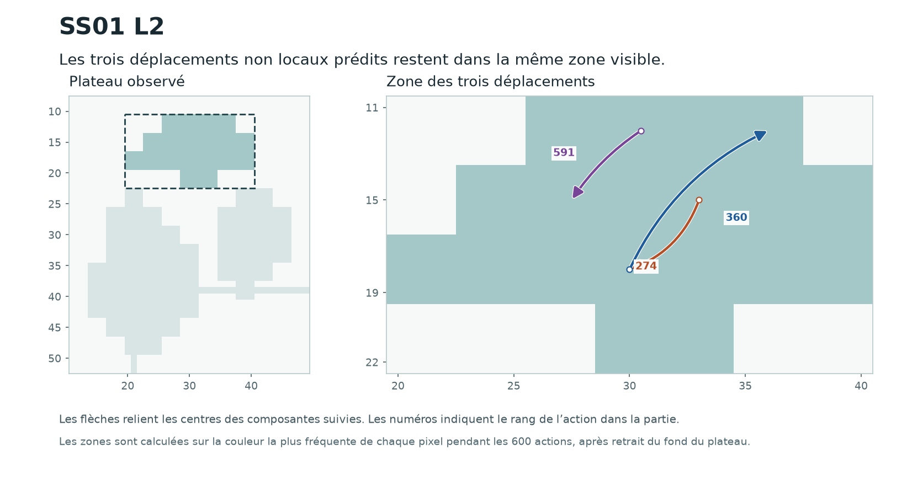

# Résultats des expériences de préparation et de dérivation

Le témoin est `bacd5c7f`, le candidat `2c823c51` et les moteurs communs `f4d28aee`. Les deux tags ont été vérifiés sur GitHub avant le premier essai Custom 4 de ce chantier. Les quatre cibles avaient déjà été évaluées lors de l’étude précédente. SS09 L2 est toujours réservé.

## Victoires officielles

| Jeu | Témoin depuis L1 | Candidat depuis L1 | Témoin sur le L2 isolé | Candidat sur le L2 isolé |
|---|---|---|---|---|
| SS01 | L1 arrêté en 531 actions | L1 arrêté en 600 actions | L2 arrêté en 600 actions | L2 arrêté en 600 actions |
| SS06 | L1 arrêté en 600 actions | L1 arrêté en 600 actions | L2 arrêté en 104 actions | L2 arrêté en 600 actions |
| SS07 | L1 arrêté en 600 actions | L1 arrêté en 600 actions | L2 arrêté en 5 actions | L2 arrêté en 5 actions |
| SS08 | L1 arrêté en 70 actions | L1 arrêté en 600 actions | L2 arrêté en 600 actions | L2 arrêté en 600 actions |

Les images initiales concordent pour les huit comparaisons et pour le témoin répété sur SS01 L2. Ce témoin frais effectue 600 actions et son résultat est « L2 arrêté en 600 actions ». Sa trajectoire est identique de celle du témoin archivé. Les plafonds sont les mêmes. Les actions effectivement exécutées et les arrêts au temps actif sont indiqués dans les données.

Les quatre parcours du candidat partant du L1 ont été reprogrammés pour limiter la mémoire utilisée simultanément. Leurs premières exécutions ont été interrompues avant tout résultat enregistré. Les quatre mesures publiées proviennent chacune d’une partie complète, repartie de zéro avec les réglages gelés.

## Dérivations dans les parties directes au L2

Une confirmation au même endroit exige une nouvelle mesure de B seul, puis de B après A. Une nouvelle utilisation peut porter sur la même relation déjà confirmée. Une dérivation réussie exige une prédiction à un emplacement distinct de celui de l’apprentissage, un témoin local et un effet conforme. Le transport vérifié exige aussi la conservation du changement pendant le déplacement et l’égalité des pixels extérieurs au lieu du contrôle.

| Jeu | Relations confirmées¹ | Réutilisations réussies | Prédictions ailleurs vérifiées / testées² | Transports vérifiés | Nouveaux mouvements vérifiés | Passages à distance anticipés puis réutilisés |
|---|---:|---:|---:|---:|---:|---:|
| SS01 | 47 | 43 | 3 / 3 | 0 | 2 | 3 |
| SS06 | 7 | 8 | 0 / 0 | 0 | 0 | 0 |
| SS07 | 0 | 0 | 0 / 0 | 0 | 0 | 0 |
| SS08 | 34 | 28 | 9 / 10 | 0 | 6 | 2 |

¹ Nombre d’essais de confirmation réussis. Une hypothèse est identifiée dans ses reçus par la scène et les commandes apprises.

² Le dénominateur compte les mises à l’épreuve finales de B après une préparation reproduite au nouvel endroit. Les préparations réfutées et les témoins incompatibles sont comptés séparément dans les données.

## SS01 L2, de la prédiction au déplacement

Le candidat termine ses 600 actions avec 127 images distinctes et 420 retours à une image déjà visitée. Il reproduit A dans trois des quinze tentatives de préparation à un nouveau lieu. Les trois prédictions finales de B réussissent. Un second passage du solveur gelé restitue exactement les 600 actions et la même empreinte de trajectoire. Trois vérifications supplémentaires rejouent le préfixe de chaque essai depuis le début, puis comparent B seul à A suivi de B. Les trois effets prédits sont confirmés depuis un état moteur apparié.

À l’action 591, le contrôle ACTION5 seul laisse immobile la composante désignée dans la prédiction. Après ACTION3, ACTION5 la déplace de (30, 11) à (27, 14), selon le vecteur prédit (−3, +3). La relation avait été apprise avec un objet de référence à (29, 17) et testée avec cet objet à (26, 17). Sur les trois dérivations, deux font apparaître un mouvement supplémentaire dans l’ensemble des composantes. Dans cet essai, l’apparition du mouvement de cette composante précise faisait partie de la prédiction.

Les actions 274, 360 et 591 satisfont le critère préenregistré d’un passage anticipé en dehors du graphe des petits déplacements connus. Dans le rejeu complet, aucune chaîne de déplacements observée sans ACTION5 ne relie les deux positions de la même composante. Les trois trajets restent pourtant dans une seule zone visible de 171 pixels après retrait du fond. Cette zone occupe les coordonnées x = 20 à 40 et y = 11 à 22. Les mesures établissent une capacité de déplacement conditionnelle à l’intérieur de cette zone. Elles laissent le franchissement d’un autre îlot à démontrer.



## Les sources

Sur les 100 traces du candidat, SIC vérifie aussi deux dérivations à un autre emplacement dans TEQU L1. Le témoin et le candidat échouent tous deux sur ce niveau au plafond de 60 actions.

| Partie sur 240 actions au maximum | Témoin | Candidat | Confirmations | Réutilisations | Dérivations vérifiées / testées |
|---|---|---|---:|---:|---:|
| KEYD L1 | Arrêt à 240 | Arrêt à 240 | 3 | 6 | 0 / 2 |
| SWCH L1 | Arrêt à 240 | Arrêt à 240 | 5 | 4 | 0 / 4 |

Sur les 100 L1 à 60 actions, le témoin obtient 66 victoires et le candidat 66. Gains du candidat sur les sources — aucun. Pertes — aucune.

## Contrôle indépendant des prédictions sur les sources

Le banc reprend uniquement les hypothèses et les lieux proposés par l’agent sur KEYD et SWCH. Il rejoue deux fois le même préfixe jusque dans le même état initial, puis exécute B seul ou A suivi de B. Il vérifie la préparation et la capacité précise annoncée avant le retour. Ces mesures hors ligne renseignent la validité des prédictions. Les gains de niveau et les succès autonomes restent ceux des parties ci-dessus.

- KEYD donne 0 prédictions vérifiées sur 10 comparaisons distinctes.
- SWCH donne 0 prédictions vérifiées sur 31 comparaisons distinctes.

Les jeux peuvent conserver un état caché. La découverte d’un passage entre régions demande une prédiction vérifiée et sa réutilisation. Une translation longue ou la comparaison de deux images seules ne suffisent pas à identifier le mécanisme du jeu.

[Protocole figé](sic-preparation-source100.md) · [Mesures et reçus](sic-preparation-results.json)

Pour reproduire l’audit complémentaire, lancer le banc de la branche de résultats avec la variable `SIC_STUDY_RECORD_COMMANDS=1` et le solveur du tag candidat. Cela conserve les commandes dans le JSONL de rejeu. Les deux vérificateurs ci-dessous lisent ce JSONL et celui de la partie officielle. Ils contrôlent leur empreinte commune avant l’analyse.

```sh
node scripts/audit-preparation-motion.mjs <moteurs> <solveur-figé> <partie.jsonl> <rejeu.jsonl> <géométrie.json>
node scripts/audit-spatial-derivations.mjs <moteurs> <solveur-figé> <partie.jsonl> <rejeu.jsonl> <interventions.json>
```
