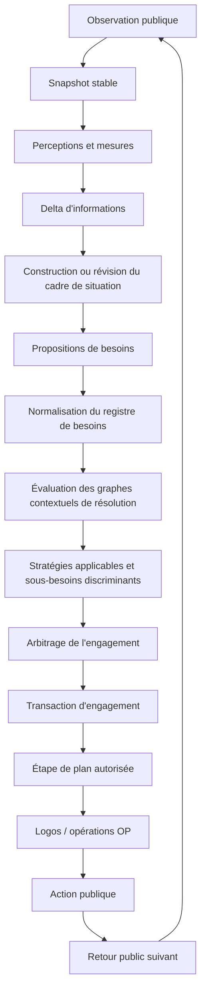

# Symbolic Intelligence Configuration — Architecture V8 de l'intelligence configurable par l'humain

**Statut :** proposition normative, version 0.3  
**Date initiale :** 12 novembre 2026  
**Révision :** 13 novembre 2026  
**Nom officiel :** **Symbolic Intelligence Configuration (SIC)**  
**Projet :** SRA Playground / ARC-3-AGENT  
**Moteur :** Logos Engine  
**Branche de rédaction :** `architecture/v8-human-configurable-intelligence-20261112`  
**Baseline d'intégration :** `recovery/site109-reconstruction-20261112`

---

## 1. Finalité

Cette architecture vise une finalité plus ambitieuse qu'un nouvel agent de jeu :

> permettre à un être humain de concevoir, configurer, observer, tester, corriger et transmettre de l'intelligence sous une forme explicite.

**Symbolic Intelligence Configuration (SIC)** est le nom officiel de cette discipline, de son langage de configuration et de son cadre d'ingénierie. Aucun second nom concurrent n'est introduit dans cette spécification.

L'objectif n'est pas de fournir une interface décorative autour d'un mécanisme opaque. L'objectif est que les éléments déterminants de l'intelligence soient réellement représentés, exécutés et inspectables sous les perspectives suivantes :

1. **Perceptions**
2. **Informations**
3. **Stratégies**
4. **Objectifs**
5. **Plans d'actions**

Ces cinq perspectives ne sont pas cinq moteurs indépendants. Elles sont cinq projections d'un même état cognitif canonique.

Le système introduit aussi un concept transversal, le **besoin**, qui exprime ce qui manque pour progresser. Un besoin n'est pas une sixième perspective principale. Il relie les cinq perspectives et explique pourquoi un raisonnement doit continuer, changer de méthode ou créer un sous-objectif.

Le besoin seul ne détermine toutefois jamais la méthode applicable. Il est interprété dans un **cadre de situation** révisable, puis traité par un **graphe contextuel de résolution** propre à son type. Cette couture empêche une stratégie valable pour une morphologie, une topologie ou un modèle de contrôle d'être appliquée silencieusement à une autre situation qui exprime pourtant le même besoin abstrait.

L'ambition de transformer la manière dont l'intelligence artificielle est construite impose une exigence particulière : cette architecture doit être plus rigoureuse, plus testable et plus compréhensible qu'un prototype de recherche ordinaire. Cette ambition est traitée ici comme une obligation d'ingénierie, pas comme une affirmation marketing.

---

## 2. Thèse architecturale

Le système repose sur sept structures complémentaires :

| Structure | Rôle |
|---|---|
| **Graphe d'informations** | Représenter ce qui est observé, appris, supposé, prédit, contredit ou encore inconnu |
| **Cadre de situation** | Qualifier la morphologie, la topologie, le contrôle, la dynamique, les contraintes et la phase pertinentes pour la décision |
| **Registre de besoins** | Représenter ce qui manque pour progresser, sans transformer automatiquement chaque manque en objectif |
| **Graphes contextuels de résolution** | Ordonner, spécialiser, composer ou exclure les réponses possibles à chaque type de besoin |
| **Agenda de stratégies** | Arbitrer entre les engagements applicables après résolution contextuelle |
| **Arbre d'engagements** | Représenter ce que l'agent a effectivement décidé de poursuivre et où il doit revenir |
| **Journal sémantique** | Conserver ce qui s'est réellement produit, dans quel ordre, avec quelles preuves |

À ces structures s'ajoutent :

- des **machines à états** pour les cycles de vie ;
- un **token de concentration** pour l'engagement actif ;
- une **transaction cognitive** pour appliquer les décisions sans état intermédiaire incohérent ;
- un **bac à sable de simulation** séparé du monde observé ;
- le langage **Symbolic Intelligence Configuration** destiné aux auteurs humains ;
- des **primitives TypeScript pures et typées** pour les calculs qui ne peuvent pas être exprimés déclarativement.

La formule centrale est :

> Le graphe d'informations représente ce qui peut être vrai.  
> Le cadre de situation représente dans quel régime cognitif local le besoin doit être interprété.  
> Le registre de besoins représente ce qui manque.  
> Le graphe contextuel de résolution représente comment ce manque peut être traité dans cette situation.  
> L'agenda représente ce qui peut recevoir l'engagement actif.  
> L'arbre d'engagements représente ce que l'agent a décidé de poursuivre.  
> Le journal représente ce qui s'est réellement passé.

---

## 3. Principes normatifs

Les mots **DOIT**, **NE DOIT PAS**, **DEVRAIT** et **PEUT** sont utilisés au sens normatif.

### 3.1 Principes fondamentaux

1. **Tout objectif actif DOIT être émis par une stratégie identifiable.**
2. **Toute stratégie sélectionnée DOIT être justifiée par des informations et un besoin.**
3. **Tout plan actif DOIT être rattaché à un objectif.**
4. **Toute action physique DOIT provenir d'une étape de plan autorisée et revalidée.**
5. **Tout résultat observé DOIT être acquis avant la décision suivante qui prétend l'utiliser.**
6. **Une simulation NE DOIT PAS être présentée comme une observation.**
7. **Une hypothèse NE DOIT PAS être présentée comme une connaissance confirmée.**
8. **Un besoin proposé NE DOIT PAS devenir automatiquement un objectif.**
9. **Un nœud NE DOIT PAS modifier directement un autre nœud en dehors d'une transaction cognitive.**
10. **Une règle lit un snapshot stable et produit une proposition ou un delta.**
11. **Chaque état métier DOIT avoir un propriétaire unique.**
12. **Chaque élément persistant DOIT déclarer sa portée, son origine, ses preuves et ses règles d'invalidation.**
13. **Une recherche interrompue NE DOIT PAS être présentée comme une impossibilité démontrée.**
14. **Une absence de changement visible NE DOIT PAS être généralisée en absence d'effet sans contrat suffisant.**
15. **Le système DOIT pouvoir expliquer pourquoi un élément est apparu, pourquoi il est actif, ce qui le satisferait et ce qui le rendrait périmé.**
16. **Le système DOIT posséder exactement un token de concentration ; il peut être libre ou détenu par un seul engagement, jamais dupliqué.**
17. **La configuration SIC déclarative DOIT être bornée et conçue pour terminer par défaut ; les extensions procédurales peuvent être Turing-complètes seulement sous contrats, budgets et permissions explicites.**
18. **Un besoin abstrait NE DOIT PAS suffire à sélectionner une stratégie ; la sélection DOIT aussi dépendre d'un cadre de situation révisé et prouvé.**
19. **Toute stratégie DOIT déclarer un domaine d'applicabilité, des contre-indications et sa relation de spécialisation, composition ou fallback avec les autres réponses au même besoin.**
20. **L'applicabilité DOIT être ternaire : `applicable`, `not_applicable` ou `unknown` ; une dimension inconnue NE DOIT PAS être traitée comme fausse.**
21. **Chaque type de besoin destiné à plusieurs méthodes DOIT posséder un graphe contextuel de résolution qui ordonne ou compose explicitement ces méthodes.**
22. **Deux stratégies dont les domaines se chevauchent sans spécialisation, ordre, composition ou discriminant déclaré constituent une erreur de configuration.**
23. **Une stratégie générale DOIT être définie par des invariants morphologiques, topologiques, causaux et opérationnels, non par le seul nom d'un jeu ou une ressemblance superficielle.**
24. **Une révision pertinente du cadre de situation DOIT invalider la résolution et réexaminer l'engagement sans dupliquer automatiquement le besoin.**

### 3.2 Principe de parallélisme contrôlé

Le système autorise le parallélisme pour :

- percevoir ;
- mesurer ;
- produire des hypothèses ;
- produire des propositions de besoins ;
- produire des stratégies candidates ;
- simuler des scénarios indépendants ;
- préparer des propositions.

Le système sérialise :

- l'admission des besoins ;
- la sélection d'une stratégie ;
- la création ou la modification d'un engagement ;
- la libération d'une action ;
- l'acquisition du retour qui clôt cette action.

> Parallélisme pour comprendre et proposer. Sérialisation pour choisir et agir.

### 3.3 Principe de compatibilité humaine

Un auteur humain DEVRAIT pouvoir configurer une nouvelle capacité sans écrire de code lorsque cette capacité peut être décrite avec :

- des types existants ;
- des conditions déclaratives ;
- des opérations existantes ;
- des objectifs et plans paramétrés ;
- des règles de portée, d'invalidation et de priorité.

Du code TypeScript supplémentaire est requis seulement pour une nouvelle primitive de calcul, un nouveau détecteur perceptif ou un nouvel effet non exprimable avec les primitives existantes.

La configuration SIC ordinaire reste bornée, inspectable et garantie terminante lorsque ses contrats le permettent. Le système complet demeure expressif et Turing-complet grâce aux primitives TypeScript et extensions procédurales explicitement enregistrées.

---

## 4. Périmètre et non-objectifs

### 4.1 Dans le périmètre

Cette spécification couvre :

- la représentation des cinq perspectives ;
- les besoins typés ;
- les cadres de situation révisables ;
- les graphes contextuels de résolution par type de besoin ;
- les domaines d'applicabilité, contre-indications et relations de spécialisation ;
- la sélection des stratégies ;
- la production des objectifs ;
- la construction et l'exécution des plans ;
- la concentration et la reprise des objectifs parents ;
- les hypothèses et simulations ;
- les opérations OP01 à OP31 comme services de raisonnement ;
- la persistance et la restauration ;
- l'explication humaine ;
- la configuration déclarative ;
- la validation statique et dynamique ;
- la migration progressive depuis le TypeScript courant ;
- les performances et la stabilité.

### 4.2 Hors périmètre initial

La première mise en œuvre ne vise pas :

- plusieurs agents autonomes négociant entre eux ;
- l'apprentissage automatique de nouvelles primitives exécutables sans validation humaine ;
- la génération libre de code de production par un LLM ;
- la migration immédiate de toutes les familles V5/V6 ;
- le remplacement simultané de tout le runtime courant ;
- une ontologie universelle figée à l'avance.

Ces sujets restent compatibles avec l'architecture, mais ne doivent pas élargir le premier incrément au point de le rendre impossible à vérifier.

---

## 5. Vocabulaire

### 5.1 Nœud

Un **nœud** est une entité canonique possédant :

- une identité stable ;
- un type ;
- une révision ;
- un statut ;
- une portée ;
- une origine ;
- des preuves ;
- des dépendances ;
- des règles d'invalidation.

Une vue de l'interface peut afficher un nœud dans plusieurs perspectives sans le dupliquer.

### 5.2 Signal

Un **signal** est une sortie éphémère produite pendant un cycle. Il ne modifie pas l'état canonique.

Exemples :

- changement perceptif ;
- contradiction détectée ;
- précondition manquante ;
- objectif satisfait ;
- étape devenue inexécutable.

### 5.3 Proposition de besoin

Une **proposition de besoin** est un signal typé indiquant qu'un résultat serait utile ou nécessaire.

Elle peut être :

- fusionnée avec un besoin existant ;
- satisfaite immédiatement ;
- conservée comme latente ;
- admise ;
- rejetée ;
- expirée.

### 5.4 Besoin

Un **besoin** est une insuffisance canonique admise par le gestionnaire des besoins.

Exemples :

- connaître l'effet d'une commande ;
- obtenir une preuve d'identité ;
- satisfaire une précondition ;
- rendre un espace accessible ;
- départager plusieurs hypothèses ;
- restaurer le point de reprise d'un plan parent.

Un besoin demande un **résultat sémantique**, pas une perspective particulière.

### 5.5 Stratégie

Une **stratégie** est une méthode réutilisable capable de répondre à certains types de besoins sous certaines conditions.

Elle ne commande pas directement une action. Elle propose :

- un objectif ;
- un plan ou un constructeur de plan ;
- des demandes perceptives ;
- des simulations ;
- des besoins dérivés bornés.

### 5.6 Objectif

Un **objectif** est un engagement à obtenir un résultat vérifiable.

Un objectif actif possède obligatoirement :

- une stratégie émettrice ;
- un besoin servi ;
- un objectif parent ou une stratégie racine ;
- une condition de réussite ;
- une condition d'échec ou de réfutation ;
- une condition de suspension ;
- un point de reprise ;
- une portée ;
- un budget.

### 5.7 Plan d'actions

Un **plan d'actions** est l'application concrète d'une stratégie à un objectif et un contexte.

Un plan peut être :

- partiel ;
- conditionnel ;
- révisable ;
- hiérarchique ;
- interrompu ;
- repris.

### 5.8 Engagement

Un **engagement** est l'ensemble cohérent :

`stratégie sélectionnée + objectif + plan + point de reprise + token de concentration`

### 5.9 Contribution

Une **contribution** est un résultat qui satisfait, réduit, réfute ou transforme un besoin.

Une contribution peut venir :

- d'une perception ;
- d'une information déjà acquise ;
- d'une inférence ;
- d'une simulation ;
- d'un objectif atteint ;
- d'un retour d'action.

---

## 6. Les cinq perspectives

## 6.1 Perceptions

La perspective **Perceptions** répond à :

> Qu'est-ce que l'agent extrait de ce qui est actuellement observable ?

Elle contient notamment :

- objets détectés ;
- positions ;
- formes ;
- couleurs ;
- relations spatiales ;
- relations temporelles ;
- changements ;
- apparitions et disparitions ;
- frontières ;
- ambiguïtés perceptives ;
- résultats de comparaisons ciblées.

Une perception est liée à :

- une observation publique ;
- un détecteur ;
- une révision ;
- une région ou un objet ;
- une qualité de complétude ;
- une preuve brute consultable.

Une perception peut proposer un besoin seulement à travers un **contrat de détection enregistré**. Elle ne crée jamais directement un objectif.

Exemple :

```text
Perception :
  La pièce P a changé de position de (+0, +1).

Peut contribuer à :
  Need<KnowEffect(command=C, subject=P)>
```

## 6.2 Informations

La perspective **Informations** répond à :

> De quels éléments l'agent dispose-t-il pour raisonner ?

Elle contient :

- faits observés ;
- informations acquises par expérience ;
- relations ;
- méthodes ;
- contraintes ;
- hypothèses ;
- inconnues ;
- contradictions ;
- résultats de simulation ;
- souvenirs ;
- informations périmées mais conservées ;
- réfutations.

Statuts recommandés :

```text
observed
acquired
inferred
hypothesized
simulated
remembered
unknown
contradicted
stale
revalidated
refuted
```

Une information peut :

- satisfaire directement un besoin ;
- réduire l'espace des réponses ;
- proposer un besoin lorsqu'une contradiction ou une inconnue bloque un engagement ;
- être utilisée par une stratégie ;
- être invalidée par un changement de portée.

## 6.3 Stratégies

La perspective **Stratégies** répond à :

> Quelles méthodes peuvent répondre aux besoins actuels et pourquoi ?

Une stratégie déclare :

- les types de besoins auxquels elle répond ;
- son domaine d'applicabilité dans le cadre de situation ;
- ses préconditions positives ;
- ses contre-indications et dimensions inconnues tolérées ;
- ses relations de spécialisation, composition ou fallback ;
- ses inhibitions ;
- les informations consommées ;
- les opérations Logos utilisées ;
- les objectifs qu'elle peut émettre ;
- les plans qu'elle peut construire ;
- ses budgets ;
- ses règles d'expiration ;
- son explication humaine.

Une stratégie candidate ne devient pas automatiquement active.

Son cycle de vie est :

```text
inactive
candidate
selected
suspended
completed
rejected
expired
```

### 6.3.1 Mission et stratégies racines

La **mission** est un contrat externe persistant qui définit la finalité générale, les contraintes et les critères de responsabilité du système. Elle n'est pas elle-même un objectif actif. Une stratégie racine transforme la mission, les observations et les informations courantes en besoins, objectifs et engagements explicites.

V8 conserve et formalise les trois racines fondamentales de la V5 :

| Stratégie racine | Question directrice | Responsabilités principales |
|---|---|---|
| **Assimilation** | Qu'est-ce qui vient d'être observé et comment l'intégrer correctement ? | acquisition du retour, identité, révision des informations, contradictions, revalidation, frontières |
| **Exploration** | Que faut-il découvrir pour pouvoir progresser ? | inconnues, hypothèses, expériences discriminantes, effets de commandes, limites, acquisition d'information |
| **Solving** | Comment obtenir effectivement le résultat demandé ? | choix de cible, satisfaction de préconditions, composition, planification, exécution, ressources, reprise du parent |

Structure normative :

```text
Mission
├── Assimilation
├── Exploration
└── Solving
    ↓
Besoins et stratégies spécialisées
    ↓
Objectifs
    ↓
Plans
    ↓
Actions et retours
```

Ces trois racines ne sont pas trois missions indépendantes. Elles organisent les méthodes fondamentales par lesquelles une mission produit du raisonnement. Assimilation peut continuer en arrière-plan pour des acquisitions passives ; toute réorientation active qui commande la prochaine action reste soumise au token unique.

Les cinq perspectives peuvent également posséder des racines de navigation dans l'interface, mais ces racines sont des vues de lecture :

- Perceptions : observation ou cycle courant ;
- Informations : modèle du monde et mémoire ;
- Stratégies : Assimilation, Exploration et Solving, puis leurs stratégies spécialisées ;
- Objectifs : arbre des engagements reliés à la mission ;
- Plans d'actions : plans actifs, suspendus et futurs.

Elles ne créent pas cinq autorités concurrentes.

## 6.4 Objectifs

La perspective **Objectifs** répond à :

> Quels résultats l'agent a-t-il décidé de poursuivre ?

Les objectifs peuvent être :

```text
proposed
active
waiting
suspended
achieved
refuted
abandoned
expired
```

Le mot **principal** est relatif. Un objectif principal dans une vue locale peut être une étape d'un engagement supérieur.

Tous les objectifs, y compris l'objectif racine, sont émis par une stratégie :

- une stratégie racine transforme une mission et une observation initiale en objectif global ;
- une stratégie de décomposition produit des objectifs intermédiaires ;
- une stratégie d'information produit un objectif destiné à lever une inconnue ;
- une stratégie de réparation produit un objectif de restauration ou de reconfiguration.

## 6.5 Plans d'actions

La perspective **Plans d'actions** répond à :

> Quelles étapes concrètes sont prévues dans cette situation ?

Cycle de vie d'un plan ou d'une étape :

```text
draft
ready
running
waiting_for_need
verified
failed
replaced
cancelled
```

Chaque étape déclare :

- intention ;
- action ou sous-plan attendu ;
- gardes avant action ;
- effet attendu ;
- observation requise après action ;
- besoin à proposer si une condition manque ;
- stratégie de compensation ou d'abandon ;
- preuve de réussite ;
- point de reprise.

Une étape inexécutable produit au plus une **proposition de besoin**. Elle ne crée pas directement un sous-objectif.

---

## 7. Les besoins comme couture transversale

### 7.1 Pourquoi les besoins sont nécessaires

Sans besoin explicite, les conditions du système tendent à appeler directement des stratégies ou à créer directement des sous-objectifs.

Cela produit :

- dépendances cachées ;
- ordre implicite ;
- oscillations ;
- doublons ;
- effets de bord ;
- difficulté à expliquer pourquoi une stratégie s'est activée.

Le besoin introduit une couture stable :

```text
information ou plan
        ↓
proposition de besoin
        ↓
registre de besoins
        ↓
cadre de situation
        ↓
graphe contextuel de résolution
        ↓
stratégies applicables ou besoins discriminants
        ↓
arbitrage de l'engagement
        ↓
objectif et plan
```

### 7.2 Ce que tout nœud peut faire

Tout nœud PEUT :

- référencer un besoin ;
- contribuer à un besoin ;
- signaler qu'un besoin est satisfait ou réfuté ;
- produire une proposition de besoin si son type de nœud et son contrat l'autorisent.

Aucun nœud NE PEUT :

- admettre lui-même son besoin ;
- s'attribuer le token de concentration ;
- créer directement un objectif actif ;
- muter directement un plan ou une information appartenant à un autre propriétaire ;
- déclencher récursivement une cascade dans le même cycle.

### 7.3 Matrice des rôles

| Perspective | Proposition de besoin autorisée | Contribution possible |
|---|---|---|
| Perceptions | ambiguïté, événement attendu absent, frontière, changement à expliquer | preuve observée |
| Informations | inconnue, contradiction, péremption, dépendance non établie | fait, hypothèse, méthode, réfutation |
| Stratégies | prérequis méthodologique ou besoin dérivé borné | méthode et construction d'engagement |
| Objectifs | condition de réussite non satisfaite ou dépendance de résultat | résultat atteint pour un besoin parent |
| Plans | précondition manquante, accès requis, ressource absente, étape inexécutable | changement concret produit par une étape |

---

## 8. Cadre de situation et graphes contextuels de résolution

### 8.1 Pourquoi le besoin abstrait ne suffit pas

Un même besoin peut apparaître dans des situations qui exigent des méthodes incompatibles.

`Need<ReachTarget>` peut signifier :

- déplacer directement un acteur dans une grille ;
- sélectionner puis translater un polyomino ;
- pousser un objet intermédiaire ;
- emprunter un portail ;
- attendre une entité autonome ;
- transformer d'abord la morphologie du sujet ;
- découvrir encore le modèle de contrôle.

Raccorder directement toutes ces méthodes au même type de besoin recréerait les effets de bord que SIC cherche à supprimer. La véritable clé de résolution est :

```text
Besoin
+ cadre de situation
+ portée
+ preuves disponibles
+ phase courante
+ engagements en cours
→ graphe contextuel de résolution
→ stratégies applicables
```

Le besoin reste abstrait et transférable. Le cadre de situation et le graphe de résolution déterminent comment il peut être traité ici et maintenant.

### 8.2 Cadre de situation

Un **cadre de situation** (*Situation Frame*) est une synthèse typée, partielle et révisable des dimensions qui discriminent les méthodes applicables.

Il ne copie pas tout le graphe d'informations. Il référence uniquement les propriétés utiles à la résolution actuelle.

Dimensions initiales recommandées :

| Dimension | Exemples |
|---|---|
| **Morphologie** | point, acteur mobile, bloc rigide, polyomino, objet composite, objet déformable |
| **Topologie** | grille, graphe, régions, couloirs, portails, espace de placement |
| **Modèle de contrôle** | directionnel, clic direct, sélection puis commande, contrôle indirect, inconnu |
| **Affordances** | pousser, tirer, tourner, colorer, transporter, activer, attendre |
| **Dynamique** | statique, autonome, périodique, réactive, temporisée |
| **Observabilité** | complète, partielle, brouillard, état masqué, effet différé |
| **Réversibilité** | réversible, coûteuse, destructive, irréversible, inconnue |
| **Contraintes** | pas, temps, oxygène, inventaire, ordre, collisions, conservation |
| **Phase** | assimilation, classification, exploration, préparation, exécution, validation, reprise |
| **Historique pertinent** | essais, transformations, frontières, méthodes acquises, réfutations |

Chaque trait du cadre possède :

- une valeur ou `unknown` ;
- un profil épistémique ;
- des preuves ;
- une révision ;
- une portée ;
- des règles d'invalidation.

Le cadre peut rester incomplet. Le système ne calcule que les discriminants demandés par les graphes de résolution actuellement pertinents.

### 8.3 Construction du cadre par les stratégies racines

Les trois racines V5 prennent ici un rôle précis :

- **Assimilation** construit et révise le cadre depuis les observations, retours, identités, frontières et contradictions ;
- **Exploration** acquiert les discriminants encore inconnus lorsqu'ils empêchent une résolution sûre ;
- **Solving** applique une stratégie compatible lorsque le cadre est suffisamment qualifié.

```text
Assimilation
→ cadre de situation partiel
→ besoin
→ discriminant manquant ?
   ├── oui → Exploration
   └── non → Solving
```

Une révision du cadre peut suspendre un plan de Solving, produire un besoin d'Exploration, puis permettre un retour vers le parent.

### 8.4 Domaine d'applicabilité

Chaque stratégie déclare une **enveloppe d'applicabilité** comprenant :

- conditions positives ;
- contre-indications ;
- preuves minimales ;
- dimensions inconnues tolérées ;
- portée ;
- invariants à préserver ;
- version du schéma de situation ;
- relation avec les stratégies plus générales ou spécialisées.

Exemple :

```yaml
strategy:
  id: direct-grid-navigation
  responds_to:
    - reach_target

  applies_when:
    topology: bounded_grid
    control_model: directional_actions
    subject_traits:
      all: [directly_mobile, localized]
    obstacle_dynamics: static
    observability: complete

  forbids:
    - movement_requires_selection
    - object_mediated_control
    - autonomous_motion_dominant
    - destructive_move_unbounded

  requires_evidence:
    - traversability_model_complete

  specializes:
    - generic-spatial-progress
```

Les contre-indications sont aussi importantes que les préconditions. Une stratégie qui sait quand elle fonctionne mais pas quand elle devient incorrecte reste dangereuse.

### 8.5 Applicabilité ternaire

L'évaluation d'une stratégie retourne :

```text
applicable
not_applicable
unknown
```

- `applicable` : les gardes requises sont prouvées et aucune contre-indication n'est établie ;
- `not_applicable` : une contradiction ou une contre-indication est établie ;
- `unknown` : un discriminant nécessaire manque ou reste ambigu.

`unknown` ne vaut jamais `false`.

Lorsque l'applicabilité est inconnue, le graphe peut :

- réutiliser une information revalidable ;
- demander une perception ciblée ;
- produire un besoin de discrimination ;
- choisir une stratégie sûre sous information partielle ;
- rester explicitement bloqué.

### 8.6 Graphe contextuel de résolution du besoin

Chaque type de besoin pouvant être satisfait par plusieurs méthodes possède un **Need Resolution Graph** configuré par l'humain.

Ce graphe décrit :

- les discriminants à examiner ;
- les gardes ;
- l'ordre de spécialisation ;
- les sous-besoins ;
- les compositions ;
- les fallbacks autorisés ;
- les arrêts de sécurité ;
- les conditions de sortie.

Types de nœuds initiaux :

| Nœud | Sémantique |
|---|---|
| `ALL` | tous les enfants doivent contribuer |
| `ANY` | une contribution suffisante termine la branche |
| `SEQUENCE` | les enfants sont traités dans l'ordre |
| `SELECT` | une branche est choisie par discriminants explicites |
| `FALLBACK` | les branches sont essayées dans l'ordre déclaré |
| `GUARD` | conditionne l'accès à une branche |
| `EXPLORE` | produit un besoin destiné à acquérir un discriminant |
| `STOP` | interdit la poursuite dans cette situation |
| `REUSE` | cherche une information ou méthode revalidable |
| `STRATEGY` | référence une stratégie candidate |

Le stockage canonique est un graphe typé, généralement acyclique. Une projection en arbre est produite pour une instance de résolution donnée.

> Stockage en graphe, évaluation ordonnée, présentation en arbre.

### 8.7 Graphe statique et instance runtime

Deux objets sont distingués :

1. **ResolutionGraphDefinition** : configuration versionnée commune à un type de besoin ;
2. **ResolutionInstance** : évaluation du graphe pour un besoin, un cadre et une révision précis.

L'instance runtime conserve :

- branches examinées ;
- discriminants utilisés ;
- résultats `applicable`, `not_applicable` ou `unknown` ;
- stratégies rejetées et raisons ;
- sous-besoins produits ;
- branche sélectionnée ;
- ambiguïtés restantes ;
- révisions du besoin, du cadre et du graphe.

Exemple de lecture humaine :

```text
Need N-42 : atteindre la sortie

Situation :
  topology = bounded_grid
  control_model = directional_actions
  subject = directly_mobile
  obstacles = static

Branches :
  direct-grid-navigation → applicable
  portal-navigation → not_applicable : aucune preuve de portail
  object-mediated-transport → not_applicable : acteur directement mobile
  establish-control-model → inutile : contrôle déjà acquis

Sélection :
  direct-grid-navigation
```

### 8.8 Ordre déterministe de résolution

L'ordre normatif est :

1. normaliser le besoin et le cadre ;
2. évaluer les gardes du graphe ;
3. éliminer les branches `not_applicable` ;
4. produire les besoins nécessaires aux branches `unknown` ;
5. appliquer la relation de spécialisation ;
6. appliquer l'ordre `SEQUENCE`, `SELECT` ou `FALLBACK` déclaré ;
7. vérifier preuves, risques, coûts et réversibilité ;
8. conserver `ambiguous` si aucune règle autorisée ne départage encore.

Une stratégie spécialisée applicable précède sa stratégie générique. Un fallback n'est utilisé que si les branches antérieures sont explicitement inapplicables, échouées ou épuisées selon leur contrat.

Aucun score global opaque ne remplace cet ordre.

### 8.9 Chevauchements et trous de couverture

Le compilateur SIC doit détecter les chevauchements :

```text
Ambiguous resolver overlap

Need:
  reach_target

Strategies:
  direct-grid-navigation
  cautious-grid-navigation

Overlapping domain:
  topology = grid
  control_model = directional
  obstacle_dynamics = static

No specialization, order, composition or discriminator is declared.
```

Un chevauchement est valide seulement si une relation explicite existe :

- `specializes` ;
- `fallback_for` ;
- composition `ALL` ou `SEQUENCE` ;
- branches `SELECT` mutuellement discriminées ;
- coexistence non conflictuelle démontrée.

Le compilateur et les tests doivent aussi détecter les régions non couvertes.

Une région non couverte produit selon la politique :

- une erreur de compilation pour un domaine déclaré fermé ;
- un avertissement et un besoin `classify_or_extend_resolver` pour un domaine ouvert ;
- jamais un fallback arbitraire.

### 8.10 Généralisation par invariants

Une stratégie générale est configurée avec des traits structurels et causaux :

```text
rigid
selectable
translatable
multi_cell
bounded
observable
selection_then_transform
exact_region_target
```

Elle ne doit pas dépendre directement de :

- nom du jeu ;
- numéro du niveau ;
- couleur arbitraire ;
- coordonnées mémorisées ;
- ressemblance visuelle sans causalité.

Une exception liée à un jeu reste possible uniquement comme diagnostic ou compatibilité temporaire, avec justification, expiration et interdiction de promotion en stratégie générale.

### 8.11 Révision du cadre sans duplication du besoin

Le besoin canonique et sa résolution ont des cycles de vie distincts.

Une modification du cadre ne recrée pas automatiquement le besoin. Elle invalide l'instance de résolution et provoque sa réévaluation.

Clé de cache recommandée :

```text
needId
+ needRevision
+ situationFrameId
+ situationFrameRevision
+ resolutionGraphVersion
```

Un plan ou objectif sélectionné conserve la révision du cadre qui a autorisé son engagement. Si un discriminant pertinent change :

1. l'autorisation d'action est invalidée ;
2. le plan est suspendu ;
3. l'instance de résolution est recalculée ;
4. les informations encore valides sont conservées ;
5. le token est retourné ou réorienté selon le résultat.

### 8.12 Exemple : `ReachTarget`

```text
ReachTarget
│
├── contrôle connu ?
│   ├── non → EXPLORE Need<EstablishControlModel>
│   └── oui
│
├── sujet directement mobile ?
│   ├── oui
│   │   ├── topologie de grille connue ?
│   │   │   ├── oui → STRATEGY DirectGridNavigation
│   │   │   └── non → EXPLORE Need<MapTraversability>
│   │
│   └── non
│
├── mouvement médié par un objet ?
│   ├── oui → STRATEGY ObjectMediatedTransport
│   └── non
│
├── portail établi ?
│   ├── oui → STRATEGY PortalRoutePlanning
│   └── non
│
├── dynamique autonome dominante ?
│   ├── oui → STRATEGY TemporalInterceptPlanning
│   └── non
│
└── aucune branche suffisamment qualifiée
    └── EXPLORE Need<ClassifyMovementMechanism>
```

Le même besoin abstrait peut ainsi conduire à des stratégies différentes sans contaminer les autres morphologies ou dispositions.

---

## 9. Modèle canonique minimal

Les interfaces suivantes sont normatives au niveau sémantique. Leur syntaxe TypeScript exacte peut évoluer.

```ts
type NodeId = string;
type Revision = number;
type EpisodeId = string;
type ObservationId = string;

interface ScopeRef {
  episodeId: EpisodeId;
  levelEpoch?: string | number;
  observationId?: ObservationId;
  observationRevision?: number;
  entityRefs?: NodeId[];
  regionRefs?: NodeId[];
  contextRefs?: NodeId[];
}

interface EvidenceRef {
  id: NodeId;
  kind: 'public_observation' | 'derived_measure' | 'action_return'
    | 'simulation' | 'memory' | 'human_authored_rule';
  sourceRef: string;
  revision: Revision;
}

interface CanonicalNode {
  id: NodeId;
  kind: string;
  revision: Revision;
  status: string;
  scope: ScopeRef;
  originRefs: NodeId[];
  evidenceRefs: EvidenceRef[];
  dependencyRefs: NodeId[];
  invalidatedBy: string[];
  createdAtCycle: number;
  updatedAtCycle: number;
}
```

```ts
interface EpistemicProfile {
  status:
    | 'observed'
    | 'acquired'
    | 'inferred'
    | 'hypothesized'
    | 'simulated'
    | 'remembered'
    | 'unknown'
    | 'contradicted'
    | 'stale'
    | 'revalidated'
    | 'refuted';
  completeness: 'complete' | 'partial' | 'unknown';
  supportRefs: NodeId[];
  contradictionRefs: NodeId[];
  freshnessRevision: Revision;
  transferStatus: 'local' | 'portable' | 'requires_revalidation' | 'not_portable';
  ambiguityRefs: NodeId[];
}
```

### 9.1 Cadre de situation et résolution

```ts
type ApplicabilityStatus = 'applicable' | 'not_applicable' | 'unknown';

interface SituationTrait {
  key: string;
  value: string | number | boolean | 'unknown';
  epistemicProfileRef: NodeId;
  evidenceRefs: EvidenceRef[];
  revision: Revision;
  invalidatedBy: string[];
}

interface SituationFrame extends CanonicalNode {
  kind: 'situation_frame';
  missionRef: NodeId;
  rootMode: 'assimilation' | 'exploration' | 'solving';
  traitRefs: NodeId[];
  phaseRefs: NodeId[];
  relevantHistoryRefs: NodeId[];
}

interface ApplicabilityEnvelope {
  id: string;
  requires: string[];
  forbids: string[];
  acceptsUnknown: string[];
  requiredEvidence: string[];
  invariantRefs: string[];
  scopeContractRef: string;
}

interface ResolutionGraphDefinition {
  id: string;
  version: string;
  needKind: string;
  rootNodeRef: string;
  nodeRefs: string[];
  domainPolicy: 'open' | 'closed';
}

type ResolutionNodeKind =
  | 'ALL'
  | 'ANY'
  | 'SEQUENCE'
  | 'SELECT'
  | 'FALLBACK'
  | 'GUARD'
  | 'EXPLORE'
  | 'STOP'
  | 'REUSE'
  | 'STRATEGY';

interface ResolutionNodeDefinition {
  id: string;
  kind: ResolutionNodeKind;
  childRefs: string[];
  conditionRef?: string;
  strategyRef?: string;
  needTemplateRef?: string;
}

interface ResolutionEvaluation {
  nodeRef: string;
  status: ApplicabilityStatus | 'selected' | 'blocked' | 'ambiguous';
  evidenceRefs: EvidenceRef[];
  missingDiscriminantRefs: string[];
  reason: string;
}

interface ResolutionInstance extends CanonicalNode {
  kind: 'resolution_instance';
  needRef: NodeId;
  situationFrameRef: NodeId;
  situationFrameRevision: Revision;
  resolutionGraphRef: string;
  resolutionGraphVersion: string;
  evaluationRefs: NodeId[];
  selectedStrategyRef?: NodeId;
}
```

### 9.2 Proposition de besoin

```ts
interface NeedProposal {
  idempotencyKey: string;
  kind: string;
  requestedResult: string;
  subjectRefs: NodeId[];
  scope: ScopeRef;
  situationFrameRef: NodeId;
  situationFrameRevision: Revision;
  causedByRef: NodeId;
  blocksRefs: NodeId[];
  evidenceRefs: EvidenceRef[];
  satisfactionContractRef: string;
  urgencyBandHint?: string;
  maxDepth: number;
  budgetRef?: string;
}
```

### 9.3 Besoin admis

```ts
type NeedStatus =
  | 'latent'
  | 'admitted'
  | 'assigned'
  | 'waiting'
  | 'satisfied'
  | 'refuted'
  | 'expired'
  | 'cancelled';

interface NeedRecord extends CanonicalNode {
  kind: 'need';
  needKind: string;
  requestedResult: string;
  status: NeedStatus;
  situationFrameRef: NodeId;
  situationFrameRevision: Revision;
  resolutionGraphRef?: string;
  resolutionInstanceRef?: NodeId;
  subjectRefs: NodeId[];
  blocksRefs: NodeId[];
  satisfactionContractRef: string;
  assignedStrategyRef?: NodeId;
  contributionRefs: NodeId[];
  depth: number;
  budgetRef?: string;
}
```

### 9.4 Contribution

```ts
interface NeedContribution extends CanonicalNode {
  kind: 'need_contribution';
  needRef: NodeId;
  contributionKind:
    | 'evidence'
    | 'method'
    | 'narrowing'
    | 'objective_result'
    | 'plan_result'
    | 'refutation';
  completeness: 'complete' | 'partial' | 'unknown';
  payloadRef: NodeId;
}
```

### 9.5 Stratégie

```ts
interface StrategyDefinition {
  id: string;
  version: string;
  respondsToNeedKinds: string[];
  applicabilityEnvelopeRef: string;
  resolutionGraphRefs: string[];
  specializes: string[];
  fallbackFor: string[];
  composesWith: string[];
  requires: string[];
  inhibits: string[];
  operations: string[];
  objectiveTemplateRef: string;
  planTemplateRef: string;
  priorityBand: string;
  tieBreakers: string[];
  expiresOn: string[];
  maxDerivedNeeds: number;
  maxDerivedDepth: number;
  explanationTemplate: string;
}
```

### 9.6 Objectif et plan

```ts
interface ObjectiveInstance extends CanonicalNode {
  kind: 'objective';
  emitterStrategyRef: NodeId;
  servesNeedRef: NodeId;
  situationFrameRef: NodeId;
  situationFrameRevision: Revision;
  resolutionInstanceRef: NodeId;
  parentObjectiveRef?: NodeId;
  successContractRef: string;
  failureContractRef?: string;
  suspensionContractRef?: string;
  resumeRef?: NodeId;
  planRef?: NodeId;
  focusStatus: 'none' | 'focused' | 'suspended';
}

interface PlanInstance extends CanonicalNode {
  kind: 'plan';
  objectiveRef: NodeId;
  strategyRef: NodeId;
  situationFrameRef: NodeId;
  situationFrameRevision: Revision;
  resolutionInstanceRef: NodeId;
  stepRefs: NodeId[];
  currentStepRef?: NodeId;
}

interface PlanStep extends CanonicalNode {
  kind: 'plan_step';
  planRef: NodeId;
  intention: string;
  actionIntentRef?: NodeId;
  childNeedRefs: NodeId[];
  beforeGuardRef?: string;
  expectedEffectRef?: string;
  afterObservationRef?: string;
  resumeRef?: NodeId;
}
```

---

## 10. Cycle cognitif synchronisé

Le moteur suit un cycle inspiré des automates industriels, des circuits synchrones et des transactions de base de données.



### 10.1 Phases

1. **Capture**
   - valider l'observation publique ;
   - attribuer session, séquence et époque ;
   - figer le snapshot.

2. **Perception**
   - exécuter les détecteurs admissibles ;
   - produire uniquement des résultats et signaux purs.

3. **Révision des informations**
   - normaliser les perceptions ;
   - créer ou réviser les informations ;
   - conserver contradictions et inconnues.

4. **Cadre de situation**
   - construire ou réviser seulement les traits pertinents ;
   - associer valeur, preuve, statut épistémique et révision ;
   - invalider les résolutions dépendantes lorsque le cadre change.

5. **Proposition de besoins**
   - examiner les plans bloqués, objectifs, informations et perceptions ;
   - produire des propositions idempotentes liées au cadre courant.

6. **Normalisation**
   - dédupliquer ;
   - fusionner ;
   - satisfaire immédiatement si possible ;
   - expirer les besoins périmés ;
   - détecter les cycles.

7. **Résolution contextuelle**
   - sélectionner le graphe du type de besoin ;
   - évaluer les branches avec le cadre ;
   - produire `applicable`, `not_applicable` ou `unknown` ;
   - créer les sous-besoins de discrimination nécessaires ;
   - appliquer spécialisation, composition et fallback déclarés.

8. **Candidature des stratégies**
   - ne conserver que les stratégies atteintes par le graphe ;
   - appliquer gardes, contre-indications et preuves minimales ;
   - produire des candidatures sans mutation.

9. **Arbitrage**
   - appliquer les bandes de priorité entre engagements applicables ;
   - départager de façon déterministe ;
   - sélectionner au plus un nouvel engagement focal.

10. **Transaction d'engagement**
    - créer ensemble stratégie sélectionnée, objectif, plan, instance de résolution et point de reprise ;
    - attribuer le token de concentration ;
    - appliquer le delta de manière atomique.

11. **Libération de l'étape**
    - revalider besoin, cadre et résolution ;
    - appeler les OP utiles ;
    - produire une action ou rester explicitement bloqué/ambigu.

12. **Retour**
    - l'action reste en attente jusqu'à l'observation suivante ;
    - le retour est acquis avant toute nouvelle décision ;
    - les informations, le cadre, les objectifs et les plans sont révisés au cycle suivant.

### 10.2 Barrière de cycle

Les nouveaux besoins dérivés pendant le cycle N ne deviennent éligibles à l'arbitrage qu'au cycle N+1.

Exception : une garde critique peut empêcher immédiatement une action devenue invalide, mais elle ne crée pas un nouvel engagement dans le même cycle.

---

## 11. Gestionnaire des besoins

### 11.1 Responsabilités

Le `NeedRegistry` est l'unique propriétaire des besoins canoniques.

Il doit :

- valider les propositions ;
- calculer l'identité idempotente ;
- dédupliquer ;
- fusionner les preuves ;
- déterminer la portée ;
- détecter la satisfaction immédiate ;
- conserver les besoins latents ;
- admettre les besoins pertinents ;
- expirer les besoins ;
- détecter les cycles ;
- borner la profondeur ;
- conserver les contributions ;
- produire une explication.

### 11.2 Échelle de résolution

Avant de créer un objectif, le registre et l'agenda essaient, dans cet ordre :

1. information actuelle déjà suffisante ;
2. connaissance mémorisée revalidable ;
3. inférence locale certaine ;
4. observation passive attendue ;
5. perception ciblée ;
6. simulation bornée ;
7. expérience active ;
8. exploration plus large.

Un objectif est créé seulement lorsqu'une stratégie sélectionnée doit engager des ressources pour obtenir le résultat.

### 11.3 Identité et déduplication

Une identité de besoin doit inclure au minimum :

- type de besoin ;
- sujets ;
- portée ;
- contrat de satisfaction ;
- parent bloqué ;
- révisions pertinentes.

Deux propositions équivalentes dans la même portée fusionnent leurs preuves.

Une proposition identique ne doit pas créer plusieurs objectifs.

### 11.4 Cycles

Le registre doit détecter :

```text
Need A → Strategy X → Need B → Strategy Y → Need A
```

Réponses possibles :

- fusion avec le besoin ancêtre ;
- suspension ;
- changement de stratégie ;
- élévation explicite d'un méta-besoin ;
- abandon avec trace.

Aucune boucle ne doit continuer silencieusement.

### 11.5 Besoin stable, résolution révisable

Le `NeedRegistry` possède le besoin. Le registre des cadres possède le `SituationFrame`. Le registre des résolveurs possède les définitions et instances de résolution.

Une révision de morphologie, topologie, contrôle ou dynamique ne crée pas nécessairement un nouveau besoin. Elle invalide l'instance de résolution et réévalue les méthodes applicables.

Le besoin est recréé uniquement si son identité sémantique change : résultat demandé, sujets, portée, parent bloqué ou contrat de satisfaction.

Cette séparation évite que chaque variation perceptive multiplie artificiellement les besoins tout en empêchant la réutilisation d'une décision devenue incorrecte.

---

## 12. Agenda des stratégies après résolution contextuelle

### 12.1 Bandes de priorité

L'agenda utilise des bandes ordonnées, pas un score pondéré opaque.

Ordre recommandé :

1. **Préserver les invariants et empêcher une action invalide**
2. **Acquérir le retour d'une action déjà engagée**
3. **Continuer un engagement encore valide**
4. **Débloquer l'objectif focal**
5. **Acquérir une information décisive**
6. **Préparer une alternative**
7. **Explorer de façon opportuniste**

### 12.2 Départage déterministe

Le graphe contextuel détermine d'abord quelles stratégies peuvent être comparées et dans quel ordre structurel.

À l'intérieur d'une même bande et d'une même branche encore comparable :

1. lien avec l'objectif focal ;
2. stratégie la plus spécialisée dont le domaine est prouvé ;
3. ordre explicite du graphe (`SELECT`, `SEQUENCE`, `FALLBACK`) ;
4. capacité à satisfaire complètement le besoin ;
5. qualité et fraîcheur des preuves ;
6. risque et réversibilité ;
7. coût estimé ;
8. valeur d'information ;
9. ancienneté ;
10. identifiant stable.

Le départage est lexicographique. Les coefficients numériques globaux sont évités par défaut.

Une stratégie générique ne concurrence pas une stratégie spécialisée applicable comme si elles étaient équivalentes. Une stratégie `unknown` ne peut pas gagner silencieusement sur une stratégie prouvée.

### 12.3 Ambiguïté

Si plusieurs stratégies restent équivalentes après les critères autorisés :

- le résultat reste `ambiguous` ;
- aucune stratégie cachée ne tranche ;
- une stratégie de désambiguïsation peut proposer un besoin d'information ;
- l'interface montre les alternatives.

### 12.4 Famine et équité

Un besoin latent ne doit pas devenir prioritaire uniquement parce qu'il est ancien. L'ancienneté intervient après pertinence, preuve, risque et coût.

Le moteur doit néanmoins détecter :

- besoin admissible jamais servi ;
- stratégie toujours inhibée ;
- objectif suspendu sans reprise possible ;
- priorité inversée.

### 12.5 Couverture, chevauchements et ambiguïté

L'agenda ne scanne pas toutes les stratégies associées au nom du besoin. Il reçoit uniquement les branches atteintes par le graphe de résolution.

Trois cas doivent rester distincts :

- **chevauchement de configuration** : plusieurs stratégies couvrent le même domaine sans relation déclarée ; erreur de compilation ;
- **ambiguïté de situation** : le cadre ne contient pas encore le discriminant nécessaire ; besoin d'Exploration ou attente ;
- **égalité légitime** : plusieurs engagements restent comparables après toutes les règles ; résultat runtime `ambiguous`.

Cette distinction empêche de corriger une ambiguïté perceptive avec une priorité arbitraire et de masquer un défaut de configuration derrière un fallback.

---

## 13. Token de concentration, graphe d'attente et arbre d'engagements

### 13.1 Unicité normative

Le système possède **exactement un token de concentration**.

À tout instant, ce token est :

- libre ; ou
- détenu par un seul engagement actif.

Il n'existe pas d'extension V8 à plusieurs tokens. Le parallélisme reste autorisé pour les perceptions, acquisitions passives, mesures, simulations et candidatures, mais une seule branche peut commander la prochaine action publique.

### 13.2 Graphe canonique et projection humaine en arbre

Les besoins, objectifs, stratégies et plans en attente sont conservés dans un graphe canonique, car un même besoin peut bloquer plusieurs objectifs et une information peut contribuer à plusieurs branches.

L'interface les projette sous forme d'arbre, notamment sous les trois stratégies racines :

```text
Mission
├── Assimilation
│   ├── Intégrer le dernier retour
│   └── Résoudre une contradiction d'identité
├── Exploration
│   ├── Déterminer l'effet du bouton  ← TOKEN
│   └── Vérifier si le passage reste ouvert
└── Solving
    ├── Ouvrir la porte
    │   └── Atteindre le bouton
    └── Rejoindre la cible
```

Règle de représentation :

> stockage canonique en graphe, lecture humaine en arbre, concentration unique.

Les priorités en attente peuvent donc être organisées en arbre pour la compréhension, sans perdre les relations multiples du graphe sous-jacent.

### 13.3 Arbre d'engagements

```text
Stratégie racine
└── Objectif global
    └── Stratégie choisie
        └── Plan
            ├── Étape terminée
            ├── Étape focalisée
            │   └── Besoin bloquant
            │       └── Stratégie locale
            │           └── Sous-objectif
            │               └── Plan local
            └── Étape future
```

Chaque sous-objectif conserve :

- origine du besoin ;
- parent ;
- étape bloquée ;
- condition de retour ;
- état du parent ;
- preuves acquises.

### 13.4 Délégation, retour et réorientation

Le token peut être :

- **délégué** à un sous-objectif ;
- **retourné** au parent lorsque le besoin est satisfait ou réfuté ;
- **réorienté** si la stratégie ou le contexte est invalidé.

Aucun retour ne doit dépendre d'une convention implicite de pile d'appels.

### 13.5 Activités sans token

Les activités suivantes peuvent continuer sans posséder le token :

- perception passive ;
- acquisition du retour d'une action déjà engagée ;
- mise à jour d'informations non conflictuelle ;
- simulation bornée ;
- génération de candidats ;
- calcul de priorités en attente ;
- compactage du journal.

Elles ne peuvent ni créer un engagement actif ni libérer une action.

---

## 14. Hypothèses et simulations

### 14.1 Hypothèses

Une hypothèse est une information provisoire.

Elle reste dans la perspective Informations, avec :

- origine ;
- domaine ;
- observations favorables ;
- contradictions ;
- tests discriminants possibles ;
- objectifs et plans qui en dépendent ;
- statut.

Une stratégie peut décider de produire un objectif pour examiner une hypothèse. L'hypothèse n'est pas dupliquée dans Objectifs : l'objectif la référence.

### 14.2 Simulations

Une simulation est une activité de raisonnement exécutée dans un fork immuable du snapshot.

Elle doit déclarer :

- modèle utilisé ;
- hypothèses d'entrée ;
- état initial ;
- actions simulées ;
- budget ;
- résultat ;
- complétude ;
- divergences possibles ;
- provenance.

Le résultat est enregistré comme information `simulated`.

Une simulation ne satisfait pas un besoin exigeant une preuve observée, sauf si le contrat de satisfaction autorise explicitement une preuve de modèle.

### 14.3 Séparation des mondes

Le système doit distinguer :

- monde observé ;
- mémoire ;
- hypothèses ;
- mondes simulés ;
- plans futurs.

Aucun identifiant d'objet simulé ne peut être confondu avec un objet observé sans relation de correspondance explicite.


### 14.4 Profil épistémique sans score global opaque

Une information ne reçoit pas une confiance globale unique telle que `0.73` lorsque ce nombre fusionnerait des dimensions différentes.

Elle porte un **profil épistémique** composé de :

- statut : observé, acquis, inféré, hypothétique, simulé, contredit, réfuté ;
- preuves favorables ;
- contradictions ;
- complétude ;
- portée ;
- fraîcheur et révision ;
- transférabilité ;
- état de revalidation ;
- ambiguïté restante.

Exemple :

```yaml
epistemic_profile:
  status: hypothesized
  support:
    - observed_translation_after_ACTION2
    - repeated_effect_same_scope
  contradictions: []
  completeness: partial
  scope:
    level: 3
    object: piece-P
    configuration: selected
  freshness:
    observation_revision: 17
  transfer:
    status: not_revalidated
  ambiguity:
    status: one_alternative_remaining
```

Des nombres locaux restent autorisés lorsqu'ils possèdent un sens défini, par exemple une distance, une fréquence, une similarité géométrique ou une probabilité statistique calibrée. Ils ne sont pas agrégés silencieusement en une confiance générale.

---

## 15. Transaction cognitive

Une transaction cognitive est un delta atomique.

Elle peut contenir :

- admissions/expirations de besoins ;
- sélection d'une stratégie ;
- création d'un objectif ;
- création d'un plan ;
- attribution du token ;
- suspension d'un parent ;
- mise à jour d'informations ;
- liens de reprise ;
- événements de journal.

Elle doit vérifier avant commit :

- révisions attendues ;
- propriétaires ;
- portée ;
- absence de conflit ;
- absence de cycle interdit ;
- disponibilité du token ;
- invariants métier.

Si une vérification échoue, aucun changement partiel n'est appliqué.

---

## 16. Journal sémantique

Le journal conserve les événements significatifs :

```text
perception_added
information_revised
hypothesis_proposed
hypothesis_refuted
need_proposed
need_admitted
need_merged
need_satisfied
strategy_candidate
strategy_selected
objective_created
objective_suspended
objective_achieved
plan_created
plan_step_blocked
action_released
action_return_observed
simulation_started
simulation_completed
focus_delegated
focus_returned
focus_reoriented
```

Chaque événement doit permettre de répondre :

- pourquoi maintenant ?
- produit par quoi ?
- à partir de quelles preuves ?
- dans quelle portée ?
- pour quel besoin ?
- quel consommateur ?
- quel effet sur la décision ?

Le journal est borné en mémoire active et peut être compacté en snapshots persistants. Les compteurs ne remplacent pas les événements requis pour l'explication.

---

## 17. Portée, invalidation et révision

Chaque élément doit déclarer ce qui l'invalide.

Exemples :

- changement de session ;
- frontière de niveau ;
- changement d'identité d'objet ;
- changement de palette ou de géométrie ;
- nouvelle révision d'une dépendance ;
- action disponible retirée ;
- hypothèse réfutée ;
- objectif parent abandonné ;
- budget expiré.

La conservation et l'applicabilité sont séparées :

> Une information peut être conservée comme prior sans être applicable au nouveau contexte.

Toute réutilisation inter-niveaux ou inter-objets exige une revalidation explicite.

---

## 18. OP01 à OP31 comme services de besoins

Les OP ne sont pas des étapes obligatoires d'un pipeline fixe. Elles sont des services déclenchés par des besoins et consommés par des décisions.

Exemples prioritaires :

| Besoin | OP candidate | Consommateur attendu |
|---|---|---|
| vérifier les préconditions | OP03 | garde de stratégie ou étape |
| trouver un producteur de condition | OP08 | stratégie de décomposition |
| identifier l'inconnue bloquante | OP12 | agenda / stratégie d'information |
| explorer une question ouverte | OP18 | plan d'expérience |
| sélectionner un objectif intermédiaire | OP15 / OP25 | stratégie |
| trouver un accès admissible | OP26 | planification |
| réaliser un intermédiaire | OP28 | autorité d'action |
| comparer attendu et observé | OP29 | acquisition |
| réviser une composition | OP30 | mémoire/modèle |
| réexaminer l'objectif | OP31 | propriétaire d'objectif |

Le contrat obligatoire est :

```text
besoin
→ producteur de données
→ appel OP
→ résultat
→ consommateur
→ effet sémantique
```

Un appel sans consommateur démontré est un usage incomplet.

Une fonction spécialisée peut répondre au besoin sans OP générique si :

- l'équivalence de contrat est documentée ;
- les preuves et limitations sont conservées ;
- la redondance est évitée.

---

## 19. Configuration humaine

## 19.1 Symbolic Intelligence Configuration

**Symbolic Intelligence Configuration (SIC)** est le nom unique du langage et du cadre de configuration décrit par cette architecture.

SIC permet de définir, versionner, valider et exécuter les contrats qui relient perceptions, informations, besoins, stratégies, objectifs et plans.

L'unité distribuable et versionnée de SIC est un **Intelligence Pack**.


```text
pack/
  manifest.yaml
  terms.yaml
  types.yaml
  perceptions/
  information/
  situations/
  needs/
  resolvers/
  strategies/
  objectives/
  plans/
  operations/
  policies/
  tests/
  explanations/
```

Un pack déclare :

- vocabulaire ;
- types ;
- détecteurs disponibles ;
- types de besoins ;
- traits et schémas de cadres de situation ;
- graphes contextuels de résolution ;
- domaines d'applicabilité et contre-indications ;
- stratégies ;
- objectifs ;
- plans ;
- opérations ;
- politiques d'arbitrage ;
- invariants ;
- tests ;
- textes d'explication ;
- version et dépendances.

### 19.2 Frontières et dépendances entre Intelligence Packs

Un Intelligence Pack est un module de capacités. Sa frontière indique ce qu'il possède, ce qu'il expose, ce qu'il importe et ce qu'il est autorisé à faire.

Chaque pack doit déclarer :

- un namespace et une version ;
- ses imports et plages de versions compatibles ;
- ses exports ;
- les types et contrats qu'il possède ;
- ses permissions de lecture, proposition et contribution ;
- ses éventuelles extensions procédurales ;
- ses règles de surcharge ;
- ses tests et sa provenance.

Exemple :

```yaml
pack:
  id: causal-experimentation
  version: 1.0.0

imports:
  - public-observation: ">=1.0 <2.0"
  - object-identity: ">=1.0 <2.0"

exports:
  needs:
    - know_control_effect
  strategies:
    - controlled_experiment
  plans:
    - before_act_after_compare

permissions:
  read:
    - observed_object
    - action_return
  propose:
    - need
    - strategy
  contribute:
    - information
    - need_evidence
  mutate: []
```

Le compilateur SIC doit traiter explicitement :

- collisions de noms ;
- versions incompatibles ;
- propriétaire ambigu ;
- surcharge d'une stratégie générique par une stratégie spécialisée ;
- dépendances circulaires ;
- permissions excessives ;
- imports non utilisés ;
- exports sans consommateur.

Les packs ne se modifient pas directement entre eux. Ils communiquent par types, besoins, informations, contributions et contrats versionnés.

### 19.3 Exemple de stratégie déclarative

```yaml
strategy:
  id: learn-control-effect
  version: 1.0.0

  responds_to:
    - need: know_control_effect

  applies_when:
    control_model: action_on_identified_control
    subject_observability: before_and_after
    effect_attribution: isolatable

  forbids:
    - subject_identity_ambiguous
    - concurrent_uncontrolled_effects
    - irreversible_risk_unbounded

  specializes:
    - generic-information-acquisition

  requires:
    - information: control_visible
    - information: subject_observable_after_action
    - action: control_action_available

  inhibits:
    - need: same_scope_experiment_pending
    - information: subject_identity_ambiguous
    - policy: risk_unbounded

  uses_operations:
    - OP18
    - OP29
    - OP30
    - OP31

  emits:
    objective: establish-control-effect
    plan: controlled-effect-experiment

  priority:
    band: unblock_focused_objective
    tie_breakers:
      - parent_relevance
      - evidence_quality
      - expected_information_gain
      - risk
      - cost
      - stable_id

  limits:
    max_derived_needs: 2
    max_depth: 2
    max_actions: 3
    max_compute_ms: 25

  expires_on:
    - control_identity_changed
    - subject_identity_changed
    - level_epoch_changed

  explanation:
    fr: >
      L'effet de cette commande doit être établi pour reprendre l'étape
      bloquée du plan parent.
```

### 19.4 Contrat de besoin déclaratif

```yaml
need:
  id: know_control_effect
  result_type: attributed_effect
  resolver: know-control-effect-resolution

  identity:
    - control_ref
    - subject_ref
    - level_epoch
    - satisfaction_contract

  satisfaction:
    any:
      - observed_attributed_effect
      - explicit_contextual_refutation

  does_not_accept:
    - simulation_without_observation
    - visual_similarity_only
    - unrelated_action_return

  expires_on:
    - level_epoch_changed
    - control_ref_invalidated
    - subject_ref_invalidated
```

### 19.5 Graphe de résolution déclaratif

```yaml
resolver:
  id: reach-target-resolution
  version: 1.0.0
  need: reach_target
  domain_policy: open

  root:
    kind: SELECT
    branches:
      - guard: control_model == unknown
        node:
          kind: EXPLORE
          need: establish_control_model

      - guard:
          all:
            - subject.directly_mobile
            - topology == bounded_grid
            - control_model == directional_actions
        node:
          kind: STRATEGY
          strategy: direct-grid-navigation

      - guard: movement.object_mediated
        node:
          kind: STRATEGY
          strategy: object-mediated-transport

      - guard: portal_relation == established
        node:
          kind: STRATEGY
          strategy: portal-route-planning

      - otherwise:
          kind: EXPLORE
          need: classify_movement_mechanism
```

Le compilateur produit pour chaque graphe :

- carte de couverture ;
- chevauchements ;
- régions non couvertes ;
- stratégies inatteignables ;
- discriminants jamais produits ;
- cycles ;
- branches dont le fallback masque toujours les suivantes.

### 19.6 Limite entre configuration et code

La configuration SIC déclarative doit rester :

- déclarative ;
- déterministe ;
- validable statiquement ;
- bornée ;
- garantie terminante par défaut lorsque ses contrats le permettent ;
- versionnée.

Le système complet reste Turing-complet grâce à des extensions procédurales explicites. Toute extension procédurale doit déclarer :

- son propriétaire ;
- ses entrées et sorties typées ;
- ses effets autorisés ;
- ses budgets de temps, mémoire et profondeur ;
- ses règles d'annulation ;
- ses permissions ;
- ses tests et sa provenance.

Le code TypeScript fournit :

- primitives de perception ;
- algorithmes géométriques ;
- recherche ;
- simulation ;
- opérations OP ;
- sérialisation ;
- runtime ;
- validateurs ;
- plugins bornés.

Une primitive TypeScript ne peut pas créer directement un objectif ou libérer une action. Elle retourne un résultat typé au noyau.

---

## 20. Atelier de création d'intelligence

L'interface auteur doit guider un humain dans cet ordre :

1. **Définir le vocabulaire**
   - objets, relations, événements, propriétés et traits.

2. **Définir ce qui est observable**
   - détecteurs, mesures, ambiguïtés et preuves.

3. **Définir les informations**
   - statuts, portée, révision et conservation.

4. **Définir les cadres de situation**
   - dimensions discriminantes, sources, valeurs inconnues et invalidations.

5. **Définir les besoins**
   - résultat demandé, satisfaction, expiration et identité.

6. **Définir les graphes de résolution**
   - gardes, spécialisation, composition, séquence, fallback, exploration et stop.

7. **Définir les stratégies**
   - besoins servis, domaine d'applicabilité, contre-indications, opérations et relations avec les autres stratégies.

8. **Définir les objectifs**
   - réussite, échec, suspension et retour.

9. **Définir les plans**
   - étapes, gardes, effets attendus et besoins dérivés.

10. **Définir les politiques**
    - priorité, budgets, risques et invariants éthiques.

11. **Écrire les tests contextuels**
    - cas positif, cas négatif, frontière d'applicabilité, inconnue, autre morphologie, contradiction, frontière et restauration.

12. **Compiler et lint**
    - références ;
    - cycles ;
    - propriétaires ;
    - bornes ;
    - chevauchements ;
    - trous de couverture ;
    - règles inatteignables.

13. **Exécuter en shadow**
    - aucune autorité réelle ;
    - comparaison avec le runtime courant ;
    - matrice de situations pour un même besoin.

14. **Promouvoir**
    - feature flag ;
    - canary ;
    - preuve ;
    - révision ;
    - rollback.

### 20.1 Vues de l'atelier

L'atelier expose :

- éditeur de contrats ;
- graphe de dépendances ;
- arbre d'engagements ;
- chronologie ;
- simulateur ;
- comparateur de versions ;
- explorateur de preuves ;
- matrice besoins/stratégies ;
- cadre de situation courant ;
- arbre d'une instance de résolution ;
- carte des domaines d'applicabilité ;
- rapport de chevauchements et trous de couverture ;
- matrice de non-régression entre situations ;
- couverture de tests ;
- coût estimé et mesuré ;
- rapport de contradictions.

### 20.2 Questions disponibles partout

Chaque élément doit offrir :

- **Pourquoi existe-t-il ?**
- **Pourquoi maintenant ?**
- **Quelle preuve ?**
- **Que manque-t-il ?**
- **Qu'est-ce qui le rendrait faux ?**
- **Qui le consomme ?**
- **Que se passerait-il s'il était désactivé ?**
- **À quel objectif supérieur contribue-t-il ?**

### 20.3 Rôles humains et promotion

Les rôles décrivent des responsabilités, pas nécessairement des personnes différentes. Une même personne peut cumuler tous les rôles dans un projet individuel.

| Rôle | Responsabilité |
|---|---|
| **Auteur** | crée ou modifie vocabulaire, besoins, stratégies, objectifs, plans et tests |
| **Vérificateur** | examine cohérence, effets de bord, preuves, cas négatifs, sécurité et performance |
| **Promoteur / approbateur** | autorise le passage d'une révision vers un statut exécutable supérieur |
| **Opérateur** | active, surveille, désactive ou restaure une version |
| **Auditeur / observateur** | reconstruit après coup la provenance et la justification d'une décision |

Cycle de promotion recommandé :

```text
draft
→ validated
→ shadow
→ active
→ stable
```

Chaque transition conserve auteur, vérificateur, promoteur, preuve, version et possibilité de rollback.

### 20.4 Création, évolution et promotion des contrats

Il faut distinguer :

1. **apprentissage d'instances pendant l'exécution** : l'agent acquiert des faits ou méthodes sous des contrats existants ;
2. **proposition de contrat candidat** : le runtime ou un humain suggère une généralisation, sans autorité exécutable ;
3. **développement du contrat** : formulation, portée, tests, vérification, exécution shadow, revue et promotion ;
4. **activation** : le contrat versionné devient utilisable sous feature flag ou politique explicite.

La création d'un nouveau contrat exécutable est donc principalement un processus de développement et de gouvernance. Le runtime peut proposer, mais ne promeut pas silencieusement ses propres règles.

---

## 21. Validation statique et vérification formelle

Le compilateur doit refuser ou avertir sur :

- référence inconnue ;
- besoin sans stratégie possible ;
- stratégie sans besoin servi ;
- stratégie associée à un besoin sans domaine d'applicabilité ;
- stratégie sans contre-indication lorsque son domaine n'est pas universel ;
- graphe de résolution absent pour un besoin polymorphe ;
- chevauchement non ordonné entre stratégies ;
- région non couverte dans un domaine déclaré fermé ;
- discriminant exigé mais jamais produit ;
- confusion entre `unknown` et `not_applicable` ;
- spécialisation fondée uniquement sur un nom de jeu sans dérogation explicite ;
- objectif sans stratégie émettrice ;
- plan sans objectif ;
- étape sans réussite observable ;
- propriétaire multiple ;
- mutation croisée directe ;
- portée absente ;
- invalidation absente ;
- récursion non bornée ;
- cycle de besoins non géré ;
- priorité non déterministe ;
- budget absent ;
- opération sans consommateur ;
- résultat de simulation présenté comme observation ;
- configuration inatteignable ;
- contrat de satisfaction contradictoire ;
- dépendance de version incompatible.

### 21.1 Sens de la vérification formelle

La vérification formelle ne prétend pas démontrer que l'agent est intelligent ni qu'il résoudra tous les problèmes. Elle sert à démontrer ou explorer rigoureusement des invariants structurels, par exemple :

- il n'existe jamais deux tokens de concentration ;
- une action ne peut pas être libérée sans plan ;
- un objectif actif possède toujours une stratégie émettrice ;
- une transaction ne peut pas être appliquée partiellement ;
- un besoin ne peut pas être dupliqué dans la même portée.

### 21.2 Niveaux de vérification

| Niveau | Technique | Portée recommandée |
|---:|---|---|
| **0** | validation syntaxique : schémas, types, champs, références | tous les fichiers SIC |
| **1** | validation sémantique statique : propriétaires, budgets, cycles évidents, contradictions | tous les Intelligence Packs |
| **2** | tests de propriétés : idempotence, déduplication, restauration, absence de mutation | runtime, registre et transactions |
| **3** | exploration exhaustive de machines à états bornées / model checking | token, objectifs, plans, promotion |
| **4** | solveurs SAT/SMT pour gardes, conflits, activabilité et exclusivité | politiques et contrats complexes |
| **5** | preuve assistée pour un micro-noyau minimal | plus tard, invariants critiques uniquement |

### 21.3 Stratégie de déploiement

La cible initiale est :

- niveaux 0 et 1 pour tous les packs ;
- niveau 2 pour le runtime commun ;
- niveau 3 pour les machines à états fondamentales ;
- niveau 4 pour les conflits difficiles ;
- niveau 5 seulement si le micro-noyau est suffisamment petit et stable.

> On ne formalise pas toute l'intelligence. On formalise les règles qui empêchent l'intelligence de devenir incohérente.

---

## 22. Tests et preuves

### 22.1 Niveaux de test

1. **Schéma**
   - parsing, types, références.

2. **Contrat**
   - activation, refus, expiration.

3. **Propriété**
   - idempotence, déduplication, absence de mutation.

4. **Machine à états**
   - transitions autorisées et interdites.

5. **Cycle cognitif**
   - snapshot, propositions, arbitrage, transaction.

6. **Shadow parity**
   - décisions actuelles vs propositions V8.

7. **Scénario intégré**
   - perception → besoin → stratégie → objectif → plan → retour.

8. **Restauration**
   - snapshot, reprise, portée.

9. **Régression**
   - jeux et capacités existantes.

10. **Performance**
    - coût désactivé, shadow, autorité active.

### 22.2 Cas obligatoires pour chaque capacité

- besoin présent ;
- besoin absent ;
- information suffisante ;
- information insuffisante ;
- ambiguïté ;
- contradiction ;
- frontière ;
- restauration ;
- expiration ;
- duplication ;
- cycle ;
- budget épuisé ;
- retour inattendu ;
- action devenue indisponible.

### 22.3 Propriétés globales

Le système doit démontrer :

- aucun objectif actif sans stratégie ;
- aucune action sans plan ;
- aucun plan sans objectif ;
- aucune stratégie sélectionnée sans besoin ;
- aucun besoin dupliqué dans une même portée ;
- aucune simulation confondue avec le monde ;
- aucun état partiellement commit ;
- aucune reprise sans point de retour ;
- aucune OP utile sans producteur et consommateur ;
- aucune décision cachée dans un fallback.

### 22.4 Matrice contextuelle de non-régression

Chaque stratégie doit fournir au minimum :

1. **tests positifs** : situations où elle doit être atteinte et applicable ;
2. **tests négatifs** : morphologies, topologies ou contrôles où elle doit être exclue ;
3. **tests de frontière** : situations partiellement connues où le résultat attendu est `unknown` ;
4. **tests de spécialisation** : la stratégie spécialisée domine la générique seulement dans son domaine ;
5. **tests de fallback** : le fallback n'est utilisé qu'après l'échec contractuel des branches antérieures ;
6. **tests inter-situations** : modifier une stratégie pour un jeu ne change pas la résolution d'une autre situation du même besoin sans raison déclarée.

Exemple de matrice :

| Besoin | Cadre de situation | Résolution attendue |
|---|---|
| `reach_target` | grille, acteur directement mobile, contrôle directionnel | `direct-grid-navigation` |
| `reach_target` | objet rigide sélectionné, transformation indirecte | `rigid-object-relocation` |
| `reach_target` | portail établi | `portal-route-planning` |
| `reach_target` | contrôle inconnu | besoin `establish_control_model` |
| `reach_target` | dynamique autonome dominante | `temporal-intercept-planning` |

Tests métamorphiques recommandés :

- changer un trait non pertinent ne doit pas modifier la branche ;
- changer un discriminant pertinent doit invalider la résolution ;
- remplacer une valeur connue par `unknown` ne doit pas produire `not_applicable` ;
- une révision du cadre doit réévaluer le graphe sans dupliquer le besoin ;
- une stratégie liée à un jeu par son nom doit échouer à la promotion générale.

Toute modification d'une stratégie doit exécuter la matrice complète de son type de besoin, pas seulement le scénario qui a motivé la modification.

---

## 23. Performance

### 23.1 Critère historique du projet

Pour les jeux de référence :

- STCK global strictement inférieur à +10 % ;
- SMLP global strictement inférieur à +10 % ;
- jeux séparés ;
- aucune compensation ;
- une phase peut dépasser +10 % si le global du même jeu reste conforme.

### 23.2 Budgets V8

Les seuils suivants sont des cibles d'ingénierie, pas un remplacement du critère historique :

- V8 désactivé : coût nul hors branchement constant ;
- journal en compteurs : cible inférieure à +1 % ;
- mode shadow complet : cible inférieure à +3 % ;
- première boucle active : préserver le seuil global historique ;
- chaque phase doit suivre le coût cumulé depuis la baseline de départ.

### 23.3 Techniques

- snapshots immuables partagés ;
- deltas ;
- calcul à la demande ;
- index par type de besoin ;
- index par traits de situation et discriminants demandés ;
- évaluation uniquement des graphes liés aux besoins actifs ;
- résolution incrémentale sur révision du cadre ;
- index par portée ;
- caches avec révisions exactes ;
- trace bornée ;
- simulation bornée ;
- annulation coopérative ;
- budgets de calcul ;
- aucun scan global à chaque action ;
- aucun rendu de l'inspecteur dans le chemin critique lorsque fermé.

---

## 24. Persistance et restauration

Le snapshot persistant doit contenir :

- informations persistantes ;
- hypothèses et réfutations utiles ;
- besoins persistants admis ;
- cadres de situation et traits persistants utiles ;
- instances de résolution nécessaires à l'explication ou à la reprise ;
- versions des graphes de résolution ;
- arbre d'engagements ;
- objectifs suspendus ;
- plans et points de reprise ;
- stratégie sélectionnée ;
- token de concentration ;
- identités et révisions ;
- journal compacté ;
- versions des packs.

Il ne doit pas contenir comme autorité :

- caches recalculables ;
- objets DOM ;
- fonctions ;
- handles Worker ;
- état caché du jeu ;
- solutions enregistrées ;
- objets simulés non matérialisés.

Après restauration :

1. valider les versions ;
2. restaurer le graphe ;
3. revalider la portée courante ;
4. expirer ce qui est devenu obsolète ;
5. renouveler les autorisations d'action ;
6. reprendre le token seulement si l'engagement reste valide.

---

## 25. Éthique, responsabilité et sécurité

Une intelligence configurable par l'humain doit rendre visible :

- qui a défini une règle ;
- quand elle a été révisée ;
- quelles valeurs ou contraintes elle protège ;
- quelles actions elle interdit ;
- quelles preuves elle exige ;
- quel humain ou processus a approuvé sa promotion.

Le système doit séparer :

- règle de valeur ;
- stratégie ;
- objectif ;
- action ;
- preuve.

Un LLM éventuel peut :

- proposer une formulation ;
- rechercher des contrats pertinents ;
- résumer un journal ;
- suggérer un test ;
- produire une proposition non autoritative.

Un LLM ne doit pas :

- modifier silencieusement les règles ;
- créer un objectif actif ;
- libérer une action physique ;
- transformer une hypothèse en fait ;
- contourner les gardes ;
- masquer l'origine d'une décision.

---

## 26. Intégration avec le TypeScript courant

Les composants actuels offrent déjà des coutures utiles :

- `AgentObservation` fournit une frontière publique typée ;
- `CommonCampaignOwner` conserve `needId`, ambiguïté, attente et acquisition du retour ;
- `OperationTraceSink` distingue besoin, appel OP et consommation ;
- les bundles OP18/OP28 fournissent une autorité d'action ;
- OP29/OP30/OP31 fournissent la boucle de retour ;
- les propriétaires de familles fournissent des candidats spécialisés.

V8 ne doit pas dupliquer ces mécanismes. Il doit :

1. généraliser les besoins ;
2. construire un `SituationFrame` partagé à partir des observations et informations ;
3. introduire un registre de graphes contextuels de résolution ;
4. relier les propriétaires à un registre commun ;
5. ajouter l'agenda après le filtrage contextuel ;
6. formaliser objectifs et plans ;
7. rendre les engagements persistants ;
8. transformer les traces en projections humaines.

### 26.1 Correspondance initiale

| Composant courant | Rôle V8 futur |
|---|---|
| `AgentObservation` | snapshot public |
| futur `SituationFrameBuilder` | synthèse incrémentale des discriminants pertinents |
| futur `ResolutionGraphRegistry` | définitions versionnées par type de besoin |
| futur `ResolutionGraphEvaluator` | instance de résolution liée au besoin et au cadre |
| owner de famille | producteur de perception, information ou stratégie candidate avec domaine déclaré |
| `needId` campagne | identité de besoin ou de contribution |
| `NeutralCommonCaller` | précurseur de collecte sans classement caché |
| `CommonCampaignOwner` | précurseur du gestionnaire d'engagement/action |
| `CompositionBundle` | proposition d'étape autorisable |
| OP18/OP28 | exploration/réalisation |
| OP29/OP30/OP31 | comparaison/révision/réexamen |
| `OperationTraceSink` | précurseur du journal sémantique |
| `FieldStock` | exemple d'information conservée mais revalidée |

---

## 27. Mise en place itérative

## Phase V8-0 : spécification et décisions d'architecture

Un **ADR** (*Architecture Decision Record*, ou registre de décision d'architecture) conserve le contexte, les options, la décision, ses raisons et ses conséquences.

**But :** figer le vocabulaire et les invariants sans changer le runtime.

Livrables :

- ce document ;
- ADR sur Symbolic Intelligence Configuration ;
- ADR sur mission et stratégies racines Assimilation / Exploration / Solving ;
- ADR sur l'unicité du token et le graphe d'attente ;
- ADR sur le profil épistémique ;
- ADR sur les niveaux de vérification formelle ;
- ADR sur les rôles et la promotion ;
- ADR sur le cycle de développement des contrats ;
- ADR sur les frontières entre Intelligence Packs ;
- ADR sur les cadres de situation et leur révision ;
- ADR sur les graphes contextuels de résolution, l'applicabilité ternaire et la spécialisation ;
- schémas JSON/TypeScript préliminaires ;
- matrice familles actuelles → rôles V8.

Critères de fin :

- aucun terme critique ambigu ;
- revue humaine ;
- exemples positifs et négatifs ;
- aucune modification de décision ;
- coût nul.

## Phase V8-1 : journal sémantique et identités

**But :** observer le runtime actuel.

Ajouter :

- identités stables ;
- événements sémantiques ;
- liens preuve/producteur/consommateur ;
- projections des cinq perspectives en lecture seule.

Critères :

- décisions identiques au runtime actuel ;
- journal borné ;
- restauration du journal compacté ;
- coût mesuré ;
- cible compteurs < +1 %.

## Phase V8-2 : propositions de besoins en shadow

**But :** faire produire des `NeedProposal` sans autorité.

Ajouter :

- types de besoins initiaux ;
- références vers le cadre de situation courant ;
- producteurs depuis plans, informations et perceptions ;
- déduplication temporaire ;
- tableau de couverture.

Critères :

- aucune création d'objectif V8 ;
- aucune action influencée ;
- propositions explicables ;
- aucun doublon incontrôlé ;
- tests de portée, cycle et expiration.

## Phase V8-3 : registre de besoins

**But :** créer le graphe canonique des besoins.

Ajouter :

- `NeedRegistry` ;
- identité idempotente ;
- admission/latent/satisfaction ;
- contributions ;
- cycle detection ;
- profondeur et budgets ;
- persistance.

Critères :

- propriété unique ;
- transactions ;
- restauration ;
- aucune influence sur la décision ;
- coût shadow cumulé mesuré.

## Phase V8-4 : cadres de situation et graphes de résolution en shadow

**But :** démontrer que le même besoin peut être routé différemment selon des invariants de situation, sans modifier les actions réelles.

Ajouter :

- `SituationFrameBuilder` incrémental ;
- traits morphologiques, topologiques, de contrôle et de dynamique initiaux ;
- applicabilité ternaire ;
- `ResolutionGraphRegistry` ;
- `ResolutionGraphEvaluator` ;
- relations `specializes`, `fallback_for` et composition ;
- instances runtime projetées sous forme d'arbre ;
- carte de couverture et détection des chevauchements.

Critères :

- au moins un même besoin résolu correctement dans trois cadres différents ;
- une dimension inconnue produit `unknown`, jamais `not_applicable` ;
- une révision du cadre invalide la résolution sans dupliquer le besoin ;
- les chevauchements non ordonnés sont refusés ;
- les trous d'un domaine fermé sont refusés ;
- aucune action réelle n'est modifiée ;
- coût shadow mesuré.

## Phase V8-5 : agenda de stratégies en shadow

**But :** produire et départager les stratégies candidates sans autorité.

Ajouter :

- registre des stratégies ;
- consommation des seules branches atteintes par les graphes de résolution ;
- ordre de spécialisation et fallbacks déclarés ;
- bandes de priorité ;
- départage déterministe ;
- ambiguïté explicite ;
- comparaison avec les choix actuels.

Critères :

- chaque candidat justifié ;
- divergence expliquée ;
- aucune action réelle ;
- aucune formule opaque ;
- starvation détectée.

## Phase V8-6 : objectifs et plans en shadow

**But :** construire l'arbre d'engagements parallèle.

Ajouter :

- objectifs ;
- plans ;
- étapes ;
- points de reprise ;
- token simulé ;
- projection UI.

Critères :

- tout objectif a une stratégie ;
- tout plan a un objectif ;
- chaque interruption a un retour ;
- shadow parity sur des traces réelles.

## Phase V8-7 : première boucle active

**Boucle recommandée :**

```text
effet de commande inconnu
→ besoin
→ stratégie d'expérience contrôlée
→ objectif d'information
→ plan local
→ OP18/OP28
→ action
→ OP29/OP30/OP31
→ information acquise
→ reprise du parent
```

Déploiement :

- feature flag ;
- un seul jeu/capacité ;
- fallback explicite, jamais silencieux ;
- comparaison A/B ;
- rollback.

Critères :

- contribution réelle ;
- aucun objectif magique ;
- retour parent démontré ;
- restauration ;
- performance conforme.

## Phase V8-8 : liaison OP03/OP08/OP12/OP26

**But :** démontrer la composition de besoins.

Scénario cible :

```text
plan bloqué
→ OP03 précondition manquante
→ OP12 inconnue bloquante
→ OP08 composition productrice
→ OP26 accès admissible
→ sous-objectif
→ reprise
```

Critères :

- producteur et consommateur démontrés ;
- aucun appel artificiel ;
- inconnue conservée si données incomplètes ;
- coût borné.

## Phase V8-9 : Intelligence Packs SIC et compilateur

Ajouter :

- manifeste ;
- schémas ;
- compilateur ;
- linter ;
- validation ;
- versioning ;
- signature ;
- tests pack ;
- chargement dynamique contrôlé.

Critères :

- une stratégie simple créée sans code ;
- erreurs compréhensibles ;
- compilation déterministe ;
- pack incompatible refusé ;
- provenance complète.

## Phase V8-10 : atelier humain SIC

Ajouter :

- éditeur visuel ;
- graphe ;
- arbre d'engagements ;
- timeline ;
- simulateur ;
- tests ;
- promotion ;
- rollback ;
- comparaison de révisions.

Critères :

- un humain peut créer une capacité simple ;
- comprendre ses activations ;
- la tester ;
- la désactiver ;
- expliquer une décision ;
- retrouver la preuve.

## Phase V8-11 : migration progressive des familles

Pour chaque famille :

1. classifier ses responsabilités ;
2. produire perceptions/informations/besoins/stratégies ;
3. exécuter en shadow ;
4. comparer ;
5. activer ;
6. retirer seulement les conditions remplacées ;
7. mesurer ;
8. documenter.

La migration n'est pas un big bang.

## Phase V8-12 : déclaration V8

Le runtime est déclaré V8 lorsque :

- l'agenda est l'autorité principale ;
- les objectifs sont toujours émis par des stratégies ;
- les plans portent toutes les actions ;
- les besoins sont canoniques et persistants ;
- les cadres de situation sont révisables et prouvés ;
- chaque besoin polymorphe possède un graphe de résolution qualifié ;
- les chevauchements et trous de couverture sont contrôlés ;
- l'interface expose les cinq perspectives ;
- l'atelier produit au moins une capacité utile sans code spécifique ;
- les principales familles ont migré ;
- les performances restent conformes ;
- les anciennes voies directes restantes sont explicitement inventoriées.

---

## 28. Ordre recommandé des premiers besoins

1. `know_control_effect`
2. `satisfy_precondition`
3. `disambiguate_identity`
4. `reach_location`
5. `restore_parent_commitment`
6. `validate_method_in_scope`
7. `find_admissible_access`
8. `compare_expected_observed`

Ces besoins couvrent un grand nombre de familles existantes sans imposer une ontologie trop large au départ. Chaque besoin introduit doit être accompagné d'un cadre minimal de discriminants et, dès qu'il possède plusieurs méthodes, d'un graphe contextuel de résolution.

---

## 29. Risques et réponses

| Risque | Réponse |
|---|---|
| Explosion du nombre de besoins | déduplication, portée, latence, budgets |
| Oscillation des stratégies | hystérésis, cycle de vie, cooldown, engagements persistants |
| Même besoin, morphologies incompatibles | cadre de situation et graphes de résolution par besoin |
| Stratégie trop générale | enveloppe d'applicabilité, contre-indications et tests négatifs |
| Chevauchement entre stratégies | erreur de compilation sans relation explicite |
| Trou de couverture | politique de domaine ouvert/fermé et besoin de classification |
| Inconnue interprétée comme fausse | applicabilité ternaire |
| Explosion combinatoire des contextes | traits composables, discriminants à la demande, héritage et résolution incrémentale |
| Régression entre jeux | matrice contextuelle complète pour chaque type de besoin |
| Priorité opaque | bandes et départage lexicographique après résolution contextuelle |
| Configuration trop puissante | noyau déclaratif borné et terminant par défaut ; extensions procédurales Turing-complètes sous contrats, budgets et permissions |
| Effets de bord | snapshots, propositions, transactions |
| Besoins récursifs infinis | profondeur, cycle detection, budget |
| Mémoire obsolète | portée et revalidation |
| Simulation prise pour réalité | provenance et types distincts |
| Objectifs orphelins | stratégie émettrice obligatoire |
| Plans sans retour | point de reprise obligatoire |
| Migration instable | shadow, feature flags, comparaison et rollback |
| Interface trop technique | noms humains, résumés, détails à la demande |
| Coût excessif | index, cache, delta, bornes et mesure cumulative |
| LLM opaque | rôle consultatif non autoritatif |

---

## 30. Décisions d'architecture retenues et ADR à rédiger

Les orientations suivantes sont désormais retenues. Les ADR ne servent plus à choisir entre plusieurs directions concurrentes, mais à conserver durablement le contexte, la décision et ses conséquences.

### ADR-1 : Symbolic Intelligence Configuration

Décision : **Symbolic Intelligence Configuration (SIC)** est le nom unique du langage, de la discipline et du cadre de configuration.

### ADR-2 : mission et stratégies racines

Décision :

- la mission est un contrat externe persistant ;
- la mission n'est pas un objectif ;
- **Assimilation**, **Exploration** et **Solving** sont les trois stratégies racines ;
- elles produisent ou délèguent vers les stratégies spécialisées et objectifs appropriés ;
- les racines des cinq perspectives sont des racines de navigation, pas des missions concurrentes.

### ADR-3 : unicité du token et attentes

Décision :

- le token de concentration est unique par définition ;
- les priorités en attente sont conservées dans un graphe canonique ;
- elles sont présentées à l'humain sous forme d'arbre ;
- les activités passives et simulations peuvent continuer sans token ;
- une seule branche commande la prochaine action.

### ADR-4 : profil épistémique

Décision : aucun score global opaque de confiance. Une information expose statut, preuves, contradictions, complétude, portée, fraîcheur, transfert, revalidation et ambiguïté.

### ADR-5 : vérification formelle graduée

Décision : appliquer les niveaux 0 à 5 décrits au §20, avec niveaux 0 et 1 obligatoires pour les packs, niveau 2 pour le runtime, niveau 3 pour les machines fondamentales, et niveaux supérieurs ciblés.

### ADR-6 : rôles humains et promotion

Décision : distinguer auteur, vérificateur, promoteur, opérateur et auditeur. Ces rôles sont cumulables par une même personne. La promotion suit `draft → validated → shadow → active → stable`.

### ADR-7 : création et évolution des contrats

Décision : le runtime apprend des instances sous des contrats existants. Un nouveau contrat exécutable suit un processus de développement, tests, shadow, revue, versioning et promotion. Une proposition automatique reste non autoritative.

### ADR-8 : frontières entre Intelligence Packs

Décision : chaque pack possède namespace, version, imports, exports, permissions, propriétaires, règles de surcharge, tests et provenance. Les packs communiquent par contrats typés et ne se mutent pas directement.

### ADR-9 : cadres de situation et résolution contextuelle

Décision :

- le besoin abstrait n'est jamais une clé suffisante de sélection ;
- Assimilation construit un cadre partiel et révisable ;
- Exploration acquiert les discriminants manquants ;
- Solving applique les stratégies dont l'applicabilité est prouvée ;
- chaque besoin polymorphe possède un graphe contextuel de résolution ;
- une révision du cadre invalide la résolution, pas automatiquement le besoin.

### ADR-10 : applicabilité, spécialisation et non-régression

Décision :

- toute stratégie déclare conditions positives, contre-indications et preuves minimales ;
- l'applicabilité est ternaire ;
- les stratégies d'un même besoin déclarent spécialisation, composition, ordre ou discriminants ;
- les chevauchements non ordonnés sont refusés ;
- les capacités générales sont définies par invariants, non par noms de jeux ;
- toute modification exécute une matrice inter-situations du besoin concerné.

---

## 31. Définition de réussite

La réussite ne se mesure pas uniquement au nombre de jeux résolus.

Le système atteint sa finalité lorsqu'un humain peut :

1. définir un vocabulaire ;
2. déclarer ce qui est perceptible ;
3. représenter des informations et hypothèses ;
4. définir un cadre de situation et ses discriminants ;
5. définir un besoin ;
6. organiser ses réponses dans un graphe contextuel de résolution ;
7. associer plusieurs stratégies avec leurs domaines et contre-indications ;
8. définir les objectifs qu'elles produisent ;
9. définir des plans conditionnels ;
10. tester la même stratégie sur des situations positives, négatives et limites ;
11. voir exactement pourquoi une branche est applicable, rejetée ou inconnue ;
12. suivre l'objectif et le plan ;
13. voir l'action et son retour ;
14. corriger une règle sans effets de bord imprévisibles ;
15. comparer deux révisions et leurs cartes de couverture ;
16. publier une version vérifiable ;
17. assumer la responsabilité de l'intelligence conçue.

La promesse centrale est alors concrète :

> l'intelligence n'est plus seulement entraînée ou invoquée ; elle peut être conçue, inspectée, testée et transmise.

---

## 32. Première tranche recommandée

La première tranche de travail doit rester petite et démontrable.

### Livrables

- types `NeedProposal`, `NeedRecord`, `NeedContribution` ;
- types `SituationFrame`, `ApplicabilityEnvelope`, `ResolutionGraphDefinition` et `ResolutionInstance` ;
- classification des propositions sous Assimilation, Exploration ou Solving ;
- journal sémantique étendu ;
- `NeedRegistry` en shadow ;
- `SituationFrameBuilder` en shadow ;
- premier graphe de résolution en shadow ;
- un producteur depuis une étape bloquée ;
- un producteur depuis une information inconnue ;
- un répondant `learn-control-effect` ;
- projection en lecture seule des cinq perspectives ;
- tests de déduplication, portée, cycle et expiration ;
- aucun changement d'action réelle.

### Scénario de démonstration

```text
Le plan courant veut déplacer une pièce.
L'effet de la commande est inconnu.
Assimilation décrit le sujet comme rigide, sélectionné et observable.
Le plan propose un besoin.
Le registre l'admet sans le dupliquer.
Le graphe `know_control_effect` exclut les méthodes incompatibles.
La stratégie d'expérience devient applicable.
L'agenda explique pourquoi cette branche serait engagée.
Un objectif et un plan sont construits en shadow.
Le cadre change ensuite vers un sujet directement mobile.
La même instance de besoin est réévaluée et une autre branche devient applicable.
Le runtime actuel garde l'autorité.
Les deux raisonnements sont comparés.
```

### Critère de promotion vers la première boucle active

La tranche shadow doit démontrer :

- stabilité ;
- explication humaine ;
- absence de duplication ;
- résolution différente du même besoin dans plusieurs cadres ;
- absence de régression sur la matrice inter-situations ;
- restauration ;
- absence d'effet sur les actions ;
- coût mesuré ;
- divergences comprises.

---

## 33. Règle de migration finale

Aucun ancien mécanisme n'est supprimé parce que V8 possède une structure plus élégante.

Il est supprimé seulement lorsque :

1. son comportement est identifié ;
2. son équivalent V8 est implémenté ;
3. les tests positifs et négatifs passent ;
4. les traces montrent la même responsabilité ;
5. la restauration est vérifiée ;
6. les performances sont conformes ;
7. le fallback n'est plus utilisé ;
8. la documentation est mise à jour.

Cette règle évite qu'une refonte conceptuelle détruise des capacités acquises.

---

## 34. Conclusion

L'arbre V5 répondait à un problème réel : trop de conditions parallèles pouvaient agir sans ordre, sans propriétaire et sans point de reprise explicite.

**Symbolic Intelligence Configuration** conserve l'intuition fondamentale de cet arbre dans son architecture V8, mais répartit les responsabilités :

- le graphe pour la connaissance ;
- les besoins pour les manques ;
- l'agenda pour les possibilités ;
- l'arbre d'engagements pour les décisions ;
- les machines à états pour le temps ;
- le journal pour la preuve ;
- les contrats déclaratifs pour la création humaine.

Le besoin n'est donc pas un routeur universel. Il exprime le résultat manquant. Le cadre de situation qualifie le régime local. Le graphe contextuel de résolution ordonne les méthodes possibles. L'agenda n'arbitre qu'entre les engagements dont l'applicabilité a déjà été établie.

Cette séparation répond au risque fondamental de régression entre jeux : une stratégie créée pour un besoin dans une morphologie ne devient pas applicable à toutes les situations portant le même nom. Elle ne peut être atteinte que par les discriminants, invariants et relations de spécialisation configurés et testés.

La formule complète devient :

```text
Mission
→ Assimilation
→ cadre de situation
→ besoin
→ graphe contextuel de résolution
→ Exploration si un discriminant manque
→ Solving si une méthode est applicable
→ stratégie
→ objectif
→ plan
→ action
→ retour
→ nouvelle Assimilation
```

Le système n'interdit pas aux nœuds de faire émerger de nouveaux besoins. Il interdit qu'ils transforment directement ces besoins en engagements incontrôlés.

C'est cette asymétrie qui rend possible une intelligence à la fois ouverte, récursive, stable et configurable par l'humain.
