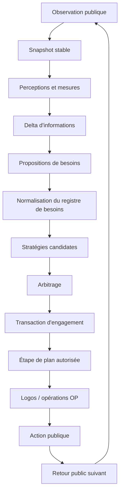

# Architecture V8 de l'intelligence configurable par l'humain

**Statut :** proposition normative, version 0.1  
**Date :** 12 novembre 2026  
**Projet :** SRA Playground / ARC-3-AGENT  
**Moteur :** Logos Engine  
**Branche de rédaction :** `architecture/v8-human-configurable-intelligence-20261112`  
**Baseline d'intégration :** `recovery/site109-reconstruction-20261112`

---

## 1. Finalité

Cette architecture vise une finalité plus ambitieuse qu'un nouvel agent de jeu :

> permettre à un être humain de concevoir, configurer, observer, tester, corriger et transmettre de l'intelligence sous une forme explicite.

L'objectif n'est pas de fournir une interface décorative autour d'un mécanisme opaque. L'objectif est que les éléments déterminants de l'intelligence soient réellement représentés, exécutés et inspectables sous les perspectives suivantes :

1. **Perceptions**
2. **Informations**
3. **Stratégies**
4. **Objectifs**
5. **Plans d'actions**

Ces cinq perspectives ne sont pas cinq moteurs indépendants. Elles sont cinq projections d'un même état cognitif canonique.

Le système introduit aussi un concept transversal, le **besoin**, qui exprime ce qui manque pour progresser. Un besoin n'est pas une sixième perspective principale. Il relie les cinq perspectives et explique pourquoi un raisonnement doit continuer, changer de méthode ou créer un sous-objectif.

L'ambition de transformer la manière dont l'intelligence artificielle est construite impose une exigence particulière : cette architecture doit être plus rigoureuse, plus testable et plus compréhensible qu'un prototype de recherche ordinaire. Cette ambition est traitée ici comme une obligation d'ingénierie, pas comme une affirmation marketing.

---

## 2. Thèse architecturale

Le système repose sur cinq structures complémentaires :

| Structure | Rôle |
|---|---|
| **Graphe d'informations** | Représenter ce qui est observé, appris, supposé, prédit, contredit ou encore inconnu |
| **Registre de besoins** | Représenter ce qui manque pour progresser, sans transformer automatiquement chaque manque en objectif |
| **Agenda de stratégies** | Déterminer quelles méthodes peuvent répondre aux besoins actuels |
| **Arbre d'engagements** | Représenter ce que l'agent a effectivement décidé de poursuivre et où il doit revenir |
| **Journal sémantique** | Conserver ce qui s'est réellement produit, dans quel ordre, avec quelles preuves |

À ces structures s'ajoutent :

- des **machines à états** pour les cycles de vie ;
- un **token de concentration** pour l'engagement actif ;
- une **transaction cognitive** pour appliquer les décisions sans état intermédiaire incohérent ;
- un **bac à sable de simulation** séparé du monde observé ;
- un **langage déclaratif de contrats** destiné aux auteurs humains ;
- des **primitives TypeScript pures et typées** pour les calculs qui ne peuvent pas être exprimés déclarativement.

La formule centrale est :

> Le graphe représente ce qui peut être vrai.  
> Le registre de besoins représente ce qui manque.  
> L'agenda représente ce qui peut être fait.  
> L'arbre d'engagements représente ce que l'agent a décidé de poursuivre.  
> Le journal représente ce qui s'est réellement passé.

---

## 3. Principes normatifs

Les mots **DOIT**, **NE DOIT PAS**, **DEVRAIT** et **PEUT** sont utilisés au sens normatif.

### 3.1 Principes fondamentaux

1. **Tout objectif actif DOIT être émis par une stratégie identifiable.**
2. **Toute stratégie sélectionnée DOIT être justifiée par des informations et un besoin.**
3. **Tout plan actif DOIT être rattaché à un objectif.**
4. **Toute action physique DOIT provenir d'une étape de plan autorisée et revalidée.**
5. **Tout résultat observé DOIT être acquis avant la décision suivante qui prétend l'utiliser.**
6. **Une simulation NE DOIT PAS être présentée comme une observation.**
7. **Une hypothèse NE DOIT PAS être présentée comme une connaissance confirmée.**
8. **Un besoin proposé NE DOIT PAS devenir automatiquement un objectif.**
9. **Un nœud NE DOIT PAS modifier directement un autre nœud en dehors d'une transaction cognitive.**
10. **Une règle lit un snapshot stable et produit une proposition ou un delta.**
11. **Chaque état métier DOIT avoir un propriétaire unique.**
12. **Chaque élément persistant DOIT déclarer sa portée, son origine, ses preuves et ses règles d'invalidation.**
13. **Une recherche interrompue NE DOIT PAS être présentée comme une impossibilité démontrée.**
14. **Une absence de changement visible NE DOIT PAS être généralisée en absence d'effet sans contrat suffisant.**
15. **Le système DOIT pouvoir expliquer pourquoi un élément est apparu, pourquoi il est actif, ce qui le satisferait et ce qui le rendrait périmé.**

### 3.2 Principe de parallélisme contrôlé

Le système autorise le parallélisme pour :

- percevoir ;
- mesurer ;
- produire des hypothèses ;
- produire des propositions de besoins ;
- produire des stratégies candidates ;
- simuler des scénarios indépendants ;
- préparer des propositions.

Le système sérialise :

- l'admission des besoins ;
- la sélection d'une stratégie ;
- la création ou la modification d'un engagement ;
- la libération d'une action ;
- l'acquisition du retour qui clôt cette action.

> Parallélisme pour comprendre et proposer. Sérialisation pour choisir et agir.

### 3.3 Principe de compatibilité humaine

Un auteur humain DEVRAIT pouvoir configurer une nouvelle capacité sans écrire de code lorsque cette capacité peut être décrite avec :

- des types existants ;
- des conditions déclaratives ;
- des opérations existantes ;
- des objectifs et plans paramétrés ;
- des règles de portée, d'invalidation et de priorité.

Du code TypeScript supplémentaire est requis seulement pour une nouvelle primitive de calcul, un nouveau détecteur perceptif ou un nouvel effet non exprimable avec les primitives existantes.

---

## 4. Périmètre et non-objectifs

### 4.1 Dans le périmètre

Cette spécification couvre :

- la représentation des cinq perspectives ;
- les besoins typés ;
- la sélection des stratégies ;
- la production des objectifs ;
- la construction et l'exécution des plans ;
- la concentration et la reprise des objectifs parents ;
- les hypothèses et simulations ;
- les opérations OP01 à OP31 comme services de raisonnement ;
- la persistance et la restauration ;
- l'explication humaine ;
- la configuration déclarative ;
- la validation statique et dynamique ;
- la migration progressive depuis le TypeScript courant ;
- les performances et la stabilité.

### 4.2 Hors périmètre initial

La première mise en œuvre ne vise pas :

- plusieurs agents autonomes négociant entre eux ;
- plusieurs tokens de concentration actifs par défaut ;
- l'apprentissage automatique de nouvelles primitives exécutables sans validation humaine ;
- la génération libre de code de production par un LLM ;
- la migration immédiate de toutes les familles V5/V6 ;
- le remplacement simultané de tout le runtime courant ;
- une ontologie universelle figée à l'avance.

Ces sujets restent compatibles avec l'architecture, mais ne doivent pas élargir le premier incrément au point de le rendre impossible à vérifier.

---

## 5. Vocabulaire

### 5.1 Nœud

Un **nœud** est une entité canonique possédant :

- une identité stable ;
- un type ;
- une révision ;
- un statut ;
- une portée ;
- une origine ;
- des preuves ;
- des dépendances ;
- des règles d'invalidation.

Une vue de l'interface peut afficher un nœud dans plusieurs perspectives sans le dupliquer.

### 5.2 Signal

Un **signal** est une sortie éphémère produite pendant un cycle. Il ne modifie pas l'état canonique.

Exemples :

- changement perceptif ;
- contradiction détectée ;
- précondition manquante ;
- objectif satisfait ;
- étape devenue inexécutable.

### 5.3 Proposition de besoin

Une **proposition de besoin** est un signal typé indiquant qu'un résultat serait utile ou nécessaire.

Elle peut être :

- fusionnée avec un besoin existant ;
- satisfaite immédiatement ;
- conservée comme latente ;
- admise ;
- rejetée ;
- expirée.

### 5.4 Besoin

Un **besoin** est une insuffisance canonique admise par le gestionnaire des besoins.

Exemples :

- connaître l'effet d'une commande ;
- obtenir une preuve d'identité ;
- satisfaire une précondition ;
- rendre un espace accessible ;
- départager plusieurs hypothèses ;
- restaurer le point de reprise d'un plan parent.

Un besoin demande un **résultat sémantique**, pas une perspective particulière.

### 5.5 Stratégie

Une **stratégie** est une méthode réutilisable capable de répondre à certains types de besoins sous certaines conditions.

Elle ne commande pas directement une action. Elle propose :

- un objectif ;
- un plan ou un constructeur de plan ;
- des demandes perceptives ;
- des simulations ;
- des besoins dérivés bornés.

### 5.6 Objectif

Un **objectif** est un engagement à obtenir un résultat vérifiable.

Un objectif actif possède obligatoirement :

- une stratégie émettrice ;
- un besoin servi ;
- un objectif parent ou une stratégie racine ;
- une condition de réussite ;
- une condition d'échec ou de réfutation ;
- une condition de suspension ;
- un point de reprise ;
- une portée ;
- un budget.

### 5.7 Plan d'actions

Un **plan d'actions** est l'application concrète d'une stratégie à un objectif et un contexte.

Un plan peut être :

- partiel ;
- conditionnel ;
- révisable ;
- hiérarchique ;
- interrompu ;
- repris.

### 5.8 Engagement

Un **engagement** est l'ensemble cohérent :

`stratégie sélectionnée + objectif + plan + point de reprise + token de concentration`

### 5.9 Contribution

Une **contribution** est un résultat qui satisfait, réduit, réfute ou transforme un besoin.

Une contribution peut venir :

- d'une perception ;
- d'une information déjà acquise ;
- d'une inférence ;
- d'une simulation ;
- d'un objectif atteint ;
- d'un retour d'action.

---

## 6. Les cinq perspectives

## 6.1 Perceptions

La perspective **Perceptions** répond à :

> Qu'est-ce que l'agent extrait de ce qui est actuellement observable ?

Elle contient notamment :

- objets détectés ;
- positions ;
- formes ;
- couleurs ;
- relations spatiales ;
- relations temporelles ;
- changements ;
- apparitions et disparitions ;
- frontières ;
- ambiguïtés perceptives ;
- résultats de comparaisons ciblées.

Une perception est liée à :

- une observation publique ;
- un détecteur ;
- une révision ;
- une région ou un objet ;
- une qualité de complétude ;
- une preuve brute consultable.

Une perception peut proposer un besoin seulement à travers un **contrat de détection enregistré**. Elle ne crée jamais directement un objectif.

Exemple :

```text
Perception :
  La pièce P a changé de position de (+0, +1).

Peut contribuer à :
  Need<KnowEffect(command=C, subject=P)>
```

## 6.2 Informations

La perspective **Informations** répond à :

> De quels éléments l'agent dispose-t-il pour raisonner ?

Elle contient :

- faits observés ;
- informations acquises par expérience ;
- relations ;
- méthodes ;
- contraintes ;
- hypothèses ;
- inconnues ;
- contradictions ;
- résultats de simulation ;
- souvenirs ;
- informations périmées mais conservées ;
- réfutations.

Statuts recommandés :

```text
observed
acquired
inferred
hypothesized
simulated
remembered
unknown
contradicted
stale
revalidated
refuted
```

Une information peut :

- satisfaire directement un besoin ;
- réduire l'espace des réponses ;
- proposer un besoin lorsqu'une contradiction ou une inconnue bloque un engagement ;
- être utilisée par une stratégie ;
- être invalidée par un changement de portée.

## 6.3 Stratégies

La perspective **Stratégies** répond à :

> Quelles méthodes peuvent répondre aux besoins actuels et pourquoi ?

Une stratégie déclare :

- les types de besoins auxquels elle répond ;
- ses préconditions ;
- ses inhibitions ;
- les informations consommées ;
- les opérations Logos utilisées ;
- les objectifs qu'elle peut émettre ;
- les plans qu'elle peut construire ;
- ses budgets ;
- ses règles d'expiration ;
- son explication humaine.

Une stratégie candidate ne devient pas automatiquement active.

Son cycle de vie est :

```text
inactive
candidate
selected
suspended
completed
rejected
expired
```

## 6.4 Objectifs

La perspective **Objectifs** répond à :

> Quels résultats l'agent a-t-il décidé de poursuivre ?

Les objectifs peuvent être :

```text
proposed
active
waiting
suspended
achieved
refuted
abandoned
expired
```

Le mot **principal** est relatif. Un objectif principal dans une vue locale peut être une étape d'un engagement supérieur.

Tous les objectifs, y compris l'objectif racine, sont émis par une stratégie :

- une stratégie racine transforme une mission et une observation initiale en objectif global ;
- une stratégie de décomposition produit des objectifs intermédiaires ;
- une stratégie d'information produit un objectif destiné à lever une inconnue ;
- une stratégie de réparation produit un objectif de restauration ou de reconfiguration.

## 6.5 Plans d'actions

La perspective **Plans d'actions** répond à :

> Quelles étapes concrètes sont prévues dans cette situation ?

Cycle de vie d'un plan ou d'une étape :

```text
draft
ready
running
waiting_for_need
verified
failed
replaced
cancelled
```

Chaque étape déclare :

- intention ;
- action ou sous-plan attendu ;
- gardes avant action ;
- effet attendu ;
- observation requise après action ;
- besoin à proposer si une condition manque ;
- stratégie de compensation ou d'abandon ;
- preuve de réussite ;
- point de reprise.

Une étape inexécutable produit au plus une **proposition de besoin**. Elle ne crée pas directement un sous-objectif.

---

## 7. Les besoins comme couture transversale

### 7.1 Pourquoi les besoins sont nécessaires

Sans besoin explicite, les conditions du système tendent à appeler directement des stratégies ou à créer directement des sous-objectifs.

Cela produit :

- dépendances cachées ;
- ordre implicite ;
- oscillations ;
- doublons ;
- effets de bord ;
- difficulté à expliquer pourquoi une stratégie s'est activée.

Le besoin introduit une couture stable :

```text
information ou plan
        ↓
proposition de besoin
        ↓
registre de besoins
        ↓
stratégies compatibles
        ↓
arbitrage
        ↓
objectif et plan
```

### 7.2 Ce que tout nœud peut faire

Tout nœud PEUT :

- référencer un besoin ;
- contribuer à un besoin ;
- signaler qu'un besoin est satisfait ou réfuté ;
- produire une proposition de besoin si son type de nœud et son contrat l'autorisent.

Aucun nœud NE PEUT :

- admettre lui-même son besoin ;
- s'attribuer le token de concentration ;
- créer directement un objectif actif ;
- muter directement un plan ou une information appartenant à un autre propriétaire ;
- déclencher récursivement une cascade dans le même cycle.

### 7.3 Matrice des rôles

| Perspective | Proposition de besoin autorisée | Contribution possible |
|---|---|---|
| Perceptions | ambiguïté, événement attendu absent, frontière, changement à expliquer | preuve observée |
| Informations | inconnue, contradiction, péremption, dépendance non établie | fait, hypothèse, méthode, réfutation |
| Stratégies | prérequis méthodologique ou besoin dérivé borné | méthode et construction d'engagement |
| Objectifs | condition de réussite non satisfaite ou dépendance de résultat | résultat atteint pour un besoin parent |
| Plans | précondition manquante, accès requis, ressource absente, étape inexécutable | changement concret produit par une étape |

---

## 8. Modèle canonique minimal

Les interfaces suivantes sont normatives au niveau sémantique. Leur syntaxe TypeScript exacte peut évoluer.

```ts
type NodeId = string;
type Revision = number;
type EpisodeId = string;
type ObservationId = string;

interface ScopeRef {
  episodeId: EpisodeId;
  levelEpoch?: string | number;
  observationId?: ObservationId;
  observationRevision?: number;
  entityRefs?: NodeId[];
  regionRefs?: NodeId[];
  contextRefs?: NodeId[];
}

interface EvidenceRef {
  id: NodeId;
  kind: 'public_observation' | 'derived_measure' | 'action_return'
    | 'simulation' | 'memory' | 'human_authored_rule';
  sourceRef: string;
  revision: Revision;
}

interface CanonicalNode {
  id: NodeId;
  kind: string;
  revision: Revision;
  status: string;
  scope: ScopeRef;
  originRefs: NodeId[];
  evidenceRefs: EvidenceRef[];
  dependencyRefs: NodeId[];
  invalidatedBy: string[];
  createdAtCycle: number;
  updatedAtCycle: number;
}
```

### 8.1 Proposition de besoin

```ts
interface NeedProposal {
  idempotencyKey: string;
  kind: string;
  requestedResult: string;
  subjectRefs: NodeId[];
  scope: ScopeRef;
  causedByRef: NodeId;
  blocksRefs: NodeId[];
  evidenceRefs: EvidenceRef[];
  satisfactionContractRef: string;
  urgencyBandHint?: string;
  maxDepth: number;
  budgetRef?: string;
}
```

### 8.2 Besoin admis

```ts
type NeedStatus =
  | 'latent'
  | 'admitted'
  | 'assigned'
  | 'waiting'
  | 'satisfied'
  | 'refuted'
  | 'expired'
  | 'cancelled';

interface NeedRecord extends CanonicalNode {
  kind: 'need';
  needKind: string;
  requestedResult: string;
  status: NeedStatus;
  subjectRefs: NodeId[];
  blocksRefs: NodeId[];
  satisfactionContractRef: string;
  assignedStrategyRef?: NodeId;
  contributionRefs: NodeId[];
  depth: number;
  budgetRef?: string;
}
```

### 8.3 Contribution

```ts
interface NeedContribution extends CanonicalNode {
  kind: 'need_contribution';
  needRef: NodeId;
  contributionKind:
    | 'evidence'
    | 'method'
    | 'narrowing'
    | 'objective_result'
    | 'plan_result'
    | 'refutation';
  completeness: 'complete' | 'partial' | 'unknown';
  payloadRef: NodeId;
}
```

### 8.4 Stratégie

```ts
interface StrategyDefinition {
  id: string;
  version: string;
  respondsToNeedKinds: string[];
  requires: string[];
  inhibits: string[];
  operations: string[];
  objectiveTemplateRef: string;
  planTemplateRef: string;
  priorityBand: string;
  tieBreakers: string[];
  expiresOn: string[];
  maxDerivedNeeds: number;
  maxDerivedDepth: number;
  explanationTemplate: string;
}
```

### 8.5 Objectif et plan

```ts
interface ObjectiveInstance extends CanonicalNode {
  kind: 'objective';
  emitterStrategyRef: NodeId;
  servesNeedRef: NodeId;
  parentObjectiveRef?: NodeId;
  successContractRef: string;
  failureContractRef?: string;
  suspensionContractRef?: string;
  resumeRef?: NodeId;
  planRef?: NodeId;
  focusStatus: 'none' | 'focused' | 'suspended';
}

interface PlanInstance extends CanonicalNode {
  kind: 'plan';
  objectiveRef: NodeId;
  strategyRef: NodeId;
  stepRefs: NodeId[];
  currentStepRef?: NodeId;
}

interface PlanStep extends CanonicalNode {
  kind: 'plan_step';
  planRef: NodeId;
  intention: string;
  actionIntentRef?: NodeId;
  childNeedRefs: NodeId[];
  beforeGuardRef?: string;
  expectedEffectRef?: string;
  afterObservationRef?: string;
  resumeRef?: NodeId;
}
```

---

## 9. Cycle cognitif synchronisé

Le moteur suit un cycle inspiré des automates industriels, des circuits synchrones et des transactions de base de données.



### 9.1 Phases

1. **Capture**
   - valider l'observation publique ;
   - attribuer session, séquence et époque ;
   - figer le snapshot.

2. **Perception**
   - exécuter les détecteurs admissibles ;
   - produire uniquement des résultats et signaux purs.

3. **Révision des informations**
   - normaliser les perceptions ;
   - créer ou réviser les informations ;
   - conserver contradictions et inconnues.

4. **Proposition de besoins**
   - examiner les plans bloqués, objectifs, informations et perceptions ;
   - produire des propositions idempotentes.

5. **Normalisation**
   - dédupliquer ;
   - fusionner ;
   - satisfaire immédiatement si possible ;
   - expirer les besoins périmés ;
   - détecter les cycles.

6. **Candidature des stratégies**
   - rechercher les stratégies répondant aux besoins admis ;
   - appliquer gardes et inhibitions ;
   - produire des candidatures, sans mutation.

7. **Arbitrage**
   - appliquer les bandes de priorité ;
   - départager de façon déterministe ;
   - sélectionner au plus un nouvel engagement focal.

8. **Transaction d'engagement**
   - créer ensemble stratégie sélectionnée, objectif, plan et point de reprise ;
   - attribuer le token de concentration ;
   - appliquer le delta de manière atomique.

9. **Libération de l'étape**
   - revalider la portée ;
   - appeler les OP utiles ;
   - produire une action ou rester explicitement bloqué/ambigu.

10. **Retour**
    - l'action reste en attente jusqu'à l'observation suivante ;
    - le retour est acquis avant toute nouvelle décision ;
    - les informations, objectifs et plans sont révisés au cycle suivant.

### 9.2 Barrière de cycle

Les nouveaux besoins dérivés pendant le cycle N ne deviennent éligibles à l'arbitrage qu'au cycle N+1.

Exception : une garde critique peut empêcher immédiatement une action devenue invalide, mais elle ne crée pas un nouvel engagement dans le même cycle.

---

## 10. Gestionnaire des besoins

### 10.1 Responsabilités

Le `NeedRegistry` est l'unique propriétaire des besoins canoniques.

Il doit :

- valider les propositions ;
- calculer l'identité idempotente ;
- dédupliquer ;
- fusionner les preuves ;
- déterminer la portée ;
- détecter la satisfaction immédiate ;
- conserver les besoins latents ;
- admettre les besoins pertinents ;
- expirer les besoins ;
- détecter les cycles ;
- borner la profondeur ;
- conserver les contributions ;
- produire une explication.

### 10.2 Échelle de résolution

Avant de créer un objectif, le registre et l'agenda essaient, dans cet ordre :

1. information actuelle déjà suffisante ;
2. connaissance mémorisée revalidable ;
3. inférence locale certaine ;
4. observation passive attendue ;
5. perception ciblée ;
6. simulation bornée ;
7. expérience active ;
8. exploration plus large.

Un objectif est créé seulement lorsqu'une stratégie sélectionnée doit engager des ressources pour obtenir le résultat.

### 10.3 Identité et déduplication

Une identité de besoin doit inclure au minimum :

- type de besoin ;
- sujets ;
- portée ;
- contrat de satisfaction ;
- parent bloqué ;
- révisions pertinentes.

Deux propositions équivalentes dans la même portée fusionnent leurs preuves.

Une proposition identique ne doit pas créer plusieurs objectifs.

### 10.4 Cycles

Le registre doit détecter :

```text
Need A → Strategy X → Need B → Strategy Y → Need A
```

Réponses possibles :

- fusion avec le besoin ancêtre ;
- suspension ;
- changement de stratégie ;
- élévation explicite d'un méta-besoin ;
- abandon avec trace.

Aucune boucle ne doit continuer silencieusement.

---

## 11. Agenda des stratégies

### 11.1 Bandes de priorité

L'agenda utilise des bandes ordonnées, pas un score pondéré opaque.

Ordre recommandé :

1. **Préserver les invariants et empêcher une action invalide**
2. **Acquérir le retour d'une action déjà engagée**
3. **Continuer un engagement encore valide**
4. **Débloquer l'objectif focal**
5. **Acquérir une information décisive**
6. **Préparer une alternative**
7. **Explorer de façon opportuniste**

### 11.2 Départage déterministe

À l'intérieur d'une bande :

1. lien avec l'objectif focal ;
2. capacité à satisfaire complètement le besoin ;
3. qualité des preuves ;
4. risque ;
5. coût estimé ;
6. valeur d'information ;
7. ancienneté ;
8. identifiant stable.

Le départage est lexicographique. Les coefficients numériques globaux sont évités par défaut.

### 11.3 Ambiguïté

Si plusieurs stratégies restent équivalentes après les critères autorisés :

- le résultat reste `ambiguous` ;
- aucune stratégie cachée ne tranche ;
- une stratégie de désambiguïsation peut proposer un besoin d'information ;
- l'interface montre les alternatives.

### 11.4 Famine et équité

Un besoin latent ne doit pas devenir prioritaire uniquement parce qu'il est ancien. L'ancienneté intervient après pertinence, preuve, risque et coût.

Le moteur doit néanmoins détecter :

- besoin admissible jamais servi ;
- stratégie toujours inhibée ;
- objectif suspendu sans reprise possible ;
- priorité inversée.

---

## 12. Token de concentration et arbre d'engagements

### 12.1 Règle par défaut

Un seul objectif possède le token de concentration.

Les perceptions, acquisitions passives et calculs de fond peuvent continuer sans token.

### 12.2 Arbre d'engagements

```text
Stratégie racine
└── Objectif global
    └── Stratégie choisie
        └── Plan
            ├── Étape terminée
            ├── Étape focalisée
            │   └── Besoin bloquant
            │       └── Stratégie locale
            │           └── Sous-objectif
            │               └── Plan local
            └── Étape future
```

Chaque sous-objectif conserve :

- origine du besoin ;
- parent ;
- étape bloquée ;
- condition de retour ;
- état du parent ;
- preuves acquises.

### 12.3 Délégation, retour et réorientation

Le token peut être :

- **délégué** à un sous-objectif ;
- **retourné** au parent lorsque le besoin est satisfait ou réfuté ;
- **réorienté** si la stratégie ou le contexte est invalidé.

Aucun retour ne doit dépendre d'une convention implicite de pile d'appels.

---

## 13. Hypothèses et simulations

### 13.1 Hypothèses

Une hypothèse est une information provisoire.

Elle reste dans la perspective Informations, avec :

- origine ;
- domaine ;
- observations favorables ;
- contradictions ;
- tests discriminants possibles ;
- objectifs et plans qui en dépendent ;
- statut.

Une stratégie peut décider de produire un objectif pour examiner une hypothèse. L'hypothèse n'est pas dupliquée dans Objectifs : l'objectif la référence.

### 13.2 Simulations

Une simulation est une activité de raisonnement exécutée dans un fork immuable du snapshot.

Elle doit déclarer :

- modèle utilisé ;
- hypothèses d'entrée ;
- état initial ;
- actions simulées ;
- budget ;
- résultat ;
- complétude ;
- divergences possibles ;
- provenance.

Le résultat est enregistré comme information `simulated`.

Une simulation ne satisfait pas un besoin exigeant une preuve observée, sauf si le contrat de satisfaction autorise explicitement une preuve de modèle.

### 13.3 Séparation des mondes

Le système doit distinguer :

- monde observé ;
- mémoire ;
- hypothèses ;
- mondes simulés ;
- plans futurs.

Aucun identifiant d'objet simulé ne peut être confondu avec un objet observé sans relation de correspondance explicite.

---

## 14. Transaction cognitive

Une transaction cognitive est un delta atomique.

Elle peut contenir :

- admissions/expirations de besoins ;
- sélection d'une stratégie ;
- création d'un objectif ;
- création d'un plan ;
- attribution du token ;
- suspension d'un parent ;
- mise à jour d'informations ;
- liens de reprise ;
- événements de journal.

Elle doit vérifier avant commit :

- révisions attendues ;
- propriétaires ;
- portée ;
- absence de conflit ;
- absence de cycle interdit ;
- disponibilité du token ;
- invariants métier.

Si une vérification échoue, aucun changement partiel n'est appliqué.

---

## 15. Journal sémantique

Le journal conserve les événements significatifs :

```text
perception_added
information_revised
hypothesis_proposed
hypothesis_refuted
need_proposed
need_admitted
need_merged
need_satisfied
strategy_candidate
strategy_selected
objective_created
objective_suspended
objective_achieved
plan_created
plan_step_blocked
action_released
action_return_observed
simulation_started
simulation_completed
focus_delegated
focus_returned
focus_reoriented
```

Chaque événement doit permettre de répondre :

- pourquoi maintenant ?
- produit par quoi ?
- à partir de quelles preuves ?
- dans quelle portée ?
- pour quel besoin ?
- quel consommateur ?
- quel effet sur la décision ?

Le journal est borné en mémoire active et peut être compacté en snapshots persistants. Les compteurs ne remplacent pas les événements requis pour l'explication.

---

## 16. Portée, invalidation et révision

Chaque élément doit déclarer ce qui l'invalide.

Exemples :

- changement de session ;
- frontière de niveau ;
- changement d'identité d'objet ;
- changement de palette ou de géométrie ;
- nouvelle révision d'une dépendance ;
- action disponible retirée ;
- hypothèse réfutée ;
- objectif parent abandonné ;
- budget expiré.

La conservation et l'applicabilité sont séparées :

> Une information peut être conservée comme prior sans être applicable au nouveau contexte.

Toute réutilisation inter-niveaux ou inter-objets exige une revalidation explicite.

---

## 17. OP01 à OP31 comme services de besoins

Les OP ne sont pas des étapes obligatoires d'un pipeline fixe. Elles sont des services déclenchés par des besoins et consommés par des décisions.

Exemples prioritaires :

| Besoin | OP candidate | Consommateur attendu |
|---|---|---|
| vérifier les préconditions | OP03 | garde de stratégie ou étape |
| trouver un producteur de condition | OP08 | stratégie de décomposition |
| identifier l'inconnue bloquante | OP12 | agenda / stratégie d'information |
| explorer une question ouverte | OP18 | plan d'expérience |
| sélectionner un objectif intermédiaire | OP15 / OP25 | stratégie |
| trouver un accès admissible | OP26 | planification |
| réaliser un intermédiaire | OP28 | autorité d'action |
| comparer attendu et observé | OP29 | acquisition |
| réviser une composition | OP30 | mémoire/modèle |
| réexaminer l'objectif | OP31 | propriétaire d'objectif |

Le contrat obligatoire est :

```text
besoin
→ producteur de données
→ appel OP
→ résultat
→ consommateur
→ effet sémantique
```

Un appel sans consommateur démontré est un usage incomplet.

Une fonction spécialisée peut répondre au besoin sans OP générique si :

- l'équivalence de contrat est documentée ;
- les preuves et limitations sont conservées ;
- la redondance est évitée.

---

## 18. Configuration humaine

## 18.1 Intelligence Pack

L'unité de configuration humaine est un **Intelligence Pack** versionné.

```text
pack/
  manifest.yaml
  terms.yaml
  types.yaml
  perceptions/
  information/
  needs/
  strategies/
  objectives/
  plans/
  operations/
  policies/
  tests/
  explanations/
```

Un pack déclare :

- vocabulaire ;
- types ;
- détecteurs disponibles ;
- types de besoins ;
- stratégies ;
- objectifs ;
- plans ;
- opérations ;
- politiques d'arbitrage ;
- invariants ;
- tests ;
- textes d'explication ;
- version et dépendances.

### 18.2 Exemple de stratégie déclarative

```yaml
strategy:
  id: learn-control-effect
  version: 1.0.0

  responds_to:
    - need: know_control_effect

  requires:
    - information: control_visible
    - information: subject_observable_after_action
    - action: control_action_available

  inhibits:
    - need: same_scope_experiment_pending
    - information: subject_identity_ambiguous
    - policy: risk_unbounded

  uses_operations:
    - OP18
    - OP29
    - OP30
    - OP31

  emits:
    objective: establish-control-effect
    plan: controlled-effect-experiment

  priority:
    band: unblock_focused_objective
    tie_breakers:
      - parent_relevance
      - evidence_quality
      - expected_information_gain
      - risk
      - cost
      - stable_id

  limits:
    max_derived_needs: 2
    max_depth: 2
    max_actions: 3
    max_compute_ms: 25

  expires_on:
    - control_identity_changed
    - subject_identity_changed
    - level_epoch_changed

  explanation:
    fr: >
      L'effet de cette commande doit être établi pour reprendre l'étape
      bloquée du plan parent.
```

### 18.3 Contrat de besoin déclaratif

```yaml
need:
  id: know_control_effect
  result_type: attributed_effect

  identity:
    - control_ref
    - subject_ref
    - level_epoch
    - satisfaction_contract

  satisfaction:
    any:
      - observed_attributed_effect
      - explicit_contextual_refutation

  does_not_accept:
    - simulation_without_observation
    - visual_similarity_only
    - unrelated_action_return

  expires_on:
    - level_epoch_changed
    - control_ref_invalidated
    - subject_ref_invalidated
```

### 18.4 Limite entre configuration et code

La configuration doit rester :

- déclarative ;
- déterministe ;
- validable statiquement ;
- non Turing-complète par défaut ;
- bornée ;
- versionnée.

Le code TypeScript fournit :

- primitives de perception ;
- algorithmes géométriques ;
- recherche ;
- simulation ;
- opérations OP ;
- sérialisation ;
- runtime ;
- validateurs ;
- plugins bornés.

Une primitive TypeScript ne peut pas créer directement un objectif ou libérer une action. Elle retourne un résultat typé au noyau.

---

## 19. Atelier de création d'intelligence

L'interface auteur doit guider un humain dans cet ordre :

1. **Définir le vocabulaire**
   - objets, relations, événements, propriétés.

2. **Définir ce qui est observable**
   - détecteurs, mesures, ambiguïtés, preuves.

3. **Définir les informations**
   - statuts, portée, révision, conservation.

4. **Définir les besoins**
   - résultat demandé, satisfaction, expiration, identité.

5. **Définir les stratégies**
   - besoins servis, gardes, inhibitions, opérations.

6. **Définir les objectifs**
   - réussite, échec, suspension, retour.

7. **Définir les plans**
   - étapes, gardes, effets attendus, besoins dérivés.

8. **Définir les politiques**
   - priorité, budgets, risques, invariants éthiques.

9. **Écrire les tests**
   - cas positif, refus, ambiguïté, contradiction, frontière, restauration.

10. **Compiler et lint**
    - références ;
    - cycles ;
    - propriétaires ;
    - bornes ;
    - ambiguïtés ;
    - règles inatteignables.

11. **Exécuter en shadow**
    - aucune autorité réelle ;
    - comparaison avec le runtime courant.

12. **Promouvoir**
    - feature flag ;
    - canary ;
    - preuve ;
    - révision ;
    - rollback.

### 19.1 Vues de l'atelier

L'atelier expose :

- éditeur de contrats ;
- graphe de dépendances ;
- arbre d'engagements ;
- chronologie ;
- simulateur ;
- comparateur de versions ;
- explorateur de preuves ;
- matrice besoins/stratégies ;
- couverture de tests ;
- coût estimé et mesuré ;
- rapport de contradictions.

### 19.2 Questions disponibles partout

Chaque élément doit offrir :

- **Pourquoi existe-t-il ?**
- **Pourquoi maintenant ?**
- **Quelle preuve ?**
- **Que manque-t-il ?**
- **Qu'est-ce qui le rendrait faux ?**
- **Qui le consomme ?**
- **Que se passerait-il s'il était désactivé ?**
- **À quel objectif supérieur contribue-t-il ?**

---

## 20. Validation statique

Le compilateur doit refuser ou avertir sur :

- référence inconnue ;
- besoin sans stratégie possible ;
- stratégie sans besoin servi ;
- objectif sans stratégie émettrice ;
- plan sans objectif ;
- étape sans réussite observable ;
- propriétaire multiple ;
- mutation croisée directe ;
- portée absente ;
- invalidation absente ;
- récursion non bornée ;
- cycle de besoins non géré ;
- priorité non déterministe ;
- budget absent ;
- opération sans consommateur ;
- résultat de simulation présenté comme observation ;
- configuration inatteignable ;
- contrat de satisfaction contradictoire ;
- dépendance de version incompatible.

---

## 21. Tests et preuves

### 21.1 Niveaux de test

1. **Schéma**
   - parsing, types, références.

2. **Contrat**
   - activation, refus, expiration.

3. **Propriété**
   - idempotence, déduplication, absence de mutation.

4. **Machine à états**
   - transitions autorisées et interdites.

5. **Cycle cognitif**
   - snapshot, propositions, arbitrage, transaction.

6. **Shadow parity**
   - décisions actuelles vs propositions V8.

7. **Scénario intégré**
   - perception → besoin → stratégie → objectif → plan → retour.

8. **Restauration**
   - snapshot, reprise, portée.

9. **Régression**
   - jeux et capacités existantes.

10. **Performance**
    - coût désactivé, shadow, autorité active.

### 21.2 Cas obligatoires pour chaque capacité

- besoin présent ;
- besoin absent ;
- information suffisante ;
- information insuffisante ;
- ambiguïté ;
- contradiction ;
- frontière ;
- restauration ;
- expiration ;
- duplication ;
- cycle ;
- budget épuisé ;
- retour inattendu ;
- action devenue indisponible.

### 21.3 Propriétés globales

Le système doit démontrer :

- aucun objectif actif sans stratégie ;
- aucune action sans plan ;
- aucun plan sans objectif ;
- aucune stratégie sélectionnée sans besoin ;
- aucun besoin dupliqué dans une même portée ;
- aucune simulation confondue avec le monde ;
- aucun état partiellement commit ;
- aucune reprise sans point de retour ;
- aucune OP utile sans producteur et consommateur ;
- aucune décision cachée dans un fallback.

---

## 22. Performance

### 22.1 Critère historique du projet

Pour les jeux de référence :

- STCK global strictement inférieur à +10 % ;
- SMLP global strictement inférieur à +10 % ;
- jeux séparés ;
- aucune compensation ;
- une phase peut dépasser +10 % si le global du même jeu reste conforme.

### 22.2 Budgets V8

Les seuils suivants sont des cibles d'ingénierie, pas un remplacement du critère historique :

- V8 désactivé : coût nul hors branchement constant ;
- journal en compteurs : cible inférieure à +1 % ;
- mode shadow complet : cible inférieure à +3 % ;
- première boucle active : préserver le seuil global historique ;
- chaque phase doit suivre le coût cumulé depuis la baseline de départ.

### 22.3 Techniques

- snapshots immuables partagés ;
- deltas ;
- calcul à la demande ;
- index par type de besoin ;
- index par portée ;
- caches avec révisions exactes ;
- trace bornée ;
- simulation bornée ;
- annulation coopérative ;
- budgets de calcul ;
- aucun scan global à chaque action ;
- aucun rendu de l'inspecteur dans le chemin critique lorsque fermé.

---

## 23. Persistance et restauration

Le snapshot persistant doit contenir :

- informations persistantes ;
- hypothèses et réfutations utiles ;
- besoins persistants admis ;
- arbre d'engagements ;
- objectifs suspendus ;
- plans et points de reprise ;
- stratégie sélectionnée ;
- token de concentration ;
- identités et révisions ;
- journal compacté ;
- versions des packs.

Il ne doit pas contenir comme autorité :

- caches recalculables ;
- objets DOM ;
- fonctions ;
- handles Worker ;
- état caché du jeu ;
- solutions enregistrées ;
- objets simulés non matérialisés.

Après restauration :

1. valider les versions ;
2. restaurer le graphe ;
3. revalider la portée courante ;
4. expirer ce qui est devenu obsolète ;
5. renouveler les autorisations d'action ;
6. reprendre le token seulement si l'engagement reste valide.

---

## 24. Éthique, responsabilité et sécurité

Une intelligence configurable par l'humain doit rendre visible :

- qui a défini une règle ;
- quand elle a été révisée ;
- quelles valeurs ou contraintes elle protège ;
- quelles actions elle interdit ;
- quelles preuves elle exige ;
- quel humain ou processus a approuvé sa promotion.

Le système doit séparer :

- règle de valeur ;
- stratégie ;
- objectif ;
- action ;
- preuve.

Un LLM éventuel peut :

- proposer une formulation ;
- rechercher des contrats pertinents ;
- résumer un journal ;
- suggérer un test ;
- produire une proposition non autoritative.

Un LLM ne doit pas :

- modifier silencieusement les règles ;
- créer un objectif actif ;
- libérer une action physique ;
- transformer une hypothèse en fait ;
- contourner les gardes ;
- masquer l'origine d'une décision.

---

## 25. Intégration avec le TypeScript courant

Les composants actuels offrent déjà des coutures utiles :

- `AgentObservation` fournit une frontière publique typée ;
- `CommonCampaignOwner` conserve `needId`, ambiguïté, attente et acquisition du retour ;
- `OperationTraceSink` distingue besoin, appel OP et consommation ;
- les bundles OP18/OP28 fournissent une autorité d'action ;
- OP29/OP30/OP31 fournissent la boucle de retour ;
- les propriétaires de familles fournissent des candidats spécialisés.

V8 ne doit pas dupliquer ces mécanismes. Il doit :

1. généraliser les besoins ;
2. relier les propriétaires à un registre commun ;
3. ajouter l'agenda ;
4. formaliser objectifs et plans ;
5. rendre les engagements persistants ;
6. transformer les traces en projections humaines.

### 25.1 Correspondance initiale

| Composant courant | Rôle V8 futur |
|---|---|
| `AgentObservation` | snapshot public |
| owner de famille | producteur de perception, information ou stratégie candidate |
| `needId` campagne | identité de besoin ou de contribution |
| `NeutralCommonCaller` | précurseur de collecte sans classement caché |
| `CommonCampaignOwner` | précurseur du gestionnaire d'engagement/action |
| `CompositionBundle` | proposition d'étape autorisable |
| OP18/OP28 | exploration/réalisation |
| OP29/OP30/OP31 | comparaison/révision/réexamen |
| `OperationTraceSink` | précurseur du journal sémantique |
| `FieldStock` | exemple d'information conservée mais revalidée |

---

## 26. Mise en place itérative

## Phase V8-0 : spécification et ADR

**But :** figer le vocabulaire et les invariants sans changer le runtime.

Livrables :

- ce document ;
- ADR sur besoins ;
- ADR sur token de concentration ;
- ADR sur langage déclaratif ;
- schémas JSON/TypeScript préliminaires ;
- matrice familles actuelles → rôles V8.

Critères de fin :

- aucun terme critique ambigu ;
- revue humaine ;
- exemples positifs et négatifs ;
- aucune modification de décision ;
- coût nul.

## Phase V8-1 : journal sémantique et identités

**But :** observer le runtime actuel.

Ajouter :

- identités stables ;
- événements sémantiques ;
- liens preuve/producteur/consommateur ;
- projections des cinq perspectives en lecture seule.

Critères :

- décisions identiques au runtime actuel ;
- journal borné ;
- restauration du journal compacté ;
- coût mesuré ;
- cible compteurs < +1 %.

## Phase V8-2 : propositions de besoins en shadow

**But :** faire produire des `NeedProposal` sans autorité.

Ajouter :

- types de besoins initiaux ;
- producteurs depuis plans, informations et perceptions ;
- déduplication temporaire ;
- tableau de couverture.

Critères :

- aucune création d'objectif V8 ;
- aucune action influencée ;
- propositions explicables ;
- aucun doublon incontrôlé ;
- tests de portée, cycle et expiration.

## Phase V8-3 : registre de besoins

**But :** créer le graphe canonique des besoins.

Ajouter :

- `NeedRegistry` ;
- identité idempotente ;
- admission/latent/satisfaction ;
- contributions ;
- cycle detection ;
- profondeur et budgets ;
- persistance.

Critères :

- propriété unique ;
- transactions ;
- restauration ;
- aucune influence sur la décision ;
- coût shadow cumulé mesuré.

## Phase V8-4 : agenda de stratégies en shadow

**But :** produire et départager les stratégies candidates sans autorité.

Ajouter :

- registre des stratégies ;
- bandes de priorité ;
- départage déterministe ;
- ambiguïté explicite ;
- comparaison avec les choix actuels.

Critères :

- chaque candidat justifié ;
- divergence expliquée ;
- aucune action réelle ;
- aucune formule opaque ;
- starvation détectée.

## Phase V8-5 : objectifs et plans en shadow

**But :** construire l'arbre d'engagements parallèle.

Ajouter :

- objectifs ;
- plans ;
- étapes ;
- points de reprise ;
- token simulé ;
- projection UI.

Critères :

- tout objectif a une stratégie ;
- tout plan a un objectif ;
- chaque interruption a un retour ;
- shadow parity sur des traces réelles.

## Phase V8-6 : première boucle active

**Boucle recommandée :**

```text
effet de commande inconnu
→ besoin
→ stratégie d'expérience contrôlée
→ objectif d'information
→ plan local
→ OP18/OP28
→ action
→ OP29/OP30/OP31
→ information acquise
→ reprise du parent
```

Déploiement :

- feature flag ;
- un seul jeu/capacité ;
- fallback explicite, jamais silencieux ;
- comparaison A/B ;
- rollback.

Critères :

- contribution réelle ;
- aucun objectif magique ;
- retour parent démontré ;
- restauration ;
- performance conforme.

## Phase V8-7 : liaison OP03/OP08/OP12/OP26

**But :** démontrer la composition de besoins.

Scénario cible :

```text
plan bloqué
→ OP03 précondition manquante
→ OP12 inconnue bloquante
→ OP08 composition productrice
→ OP26 accès admissible
→ sous-objectif
→ reprise
```

Critères :

- producteur et consommateur démontrés ;
- aucun appel artificiel ;
- inconnue conservée si données incomplètes ;
- coût borné.

## Phase V8-8 : Intelligence Packs et compilateur

Ajouter :

- manifeste ;
- schémas ;
- compilateur ;
- linter ;
- validation ;
- versioning ;
- signature ;
- tests pack ;
- chargement dynamique contrôlé.

Critères :

- une stratégie simple créée sans code ;
- erreurs compréhensibles ;
- compilation déterministe ;
- pack incompatible refusé ;
- provenance complète.

## Phase V8-9 : atelier humain

Ajouter :

- éditeur visuel ;
- graphe ;
- arbre d'engagements ;
- timeline ;
- simulateur ;
- tests ;
- promotion ;
- rollback ;
- comparaison de révisions.

Critères :

- un humain peut créer une capacité simple ;
- comprendre ses activations ;
- la tester ;
- la désactiver ;
- expliquer une décision ;
- retrouver la preuve.

## Phase V8-10 : migration progressive des familles

Pour chaque famille :

1. classifier ses responsabilités ;
2. produire perceptions/informations/besoins/stratégies ;
3. exécuter en shadow ;
4. comparer ;
5. activer ;
6. retirer seulement les conditions remplacées ;
7. mesurer ;
8. documenter.

La migration n'est pas un big bang.

## Phase V8-11 : déclaration V8

Le runtime est déclaré V8 lorsque :

- l'agenda est l'autorité principale ;
- les objectifs sont toujours émis par des stratégies ;
- les plans portent toutes les actions ;
- les besoins sont canoniques et persistants ;
- l'interface expose les cinq perspectives ;
- l'atelier produit au moins une capacité utile sans code spécifique ;
- les principales familles ont migré ;
- les performances restent conformes ;
- les anciennes voies directes restantes sont explicitement inventoriées.

---

## 27. Ordre recommandé des premiers besoins

1. `know_control_effect`
2. `satisfy_precondition`
3. `disambiguate_identity`
4. `reach_location`
5. `restore_parent_commitment`
6. `validate_method_in_scope`
7. `find_admissible_access`
8. `compare_expected_observed`

Ces besoins couvrent un grand nombre de familles existantes sans imposer une ontologie trop large au départ.

---

## 28. Risques et réponses

| Risque | Réponse |
|---|---|
| Explosion du nombre de besoins | déduplication, portée, latence, budgets |
| Oscillation des stratégies | hystérésis, cycle de vie, cooldown, engagements persistants |
| Priorité opaque | bandes et départage lexicographique |
| Configuration trop puissante | DSL non Turing-complète et plugins bornés |
| Effets de bord | snapshots, propositions, transactions |
| Besoins récursifs infinis | profondeur, cycle detection, budget |
| Mémoire obsolète | portée et revalidation |
| Simulation prise pour réalité | provenance et types distincts |
| Objectifs orphelins | stratégie émettrice obligatoire |
| Plans sans retour | point de reprise obligatoire |
| Migration instable | shadow, feature flags, comparaison et rollback |
| Interface trop technique | noms humains, résumés, détails à la demande |
| Coût excessif | index, cache, delta, bornes et mesure cumulative |
| LLM opaque | rôle consultatif non autoritatif |

---

## 29. Décisions ouvertes à traiter par ADR

Ces questions ne bloquent pas V8-0 à V8-3, mais doivent être décidées avant l'autorité complète.

### ADR-1 : nom du langage

Proposition : **Logos Cognitive Contracts**, extension des TERMS, CLAIMS, TYPES, CONTRACTS et opérations Logos existantes.

### ADR-2 : représentation de la mission racine

Défaut proposé :

- la mission est un contrat externe persistant ;
- une stratégie racine transforme mission + observation en objectif ;
- la mission elle-même n'est pas un objectif.

### ADR-3 : nombre de tokens de concentration

Défaut : un seul token.  
Extension future : plusieurs tokens seulement pour des domaines prouvés indépendants.

### ADR-4 : confiance

Défaut : éviter un score global unique. Utiliser :

- statut ;
- type de preuve ;
- complétude ;
- contradictions ;
- domaine ;
- révision.

### ADR-5 : formalisation

Décider jusqu'où utiliser :

- vérification de machines à états ;
- property-based testing ;
- SAT/SMT pour certains contrats ;
- model checking pour les invariants critiques.

### ADR-6 : promotion humaine

Définir les rôles :

- auteur ;
- réviseur ;
- approbateur ;
- opérateur ;
- observateur.

### ADR-7 : apprentissage de nouveaux contrats

Défaut : l'agent peut proposer un contrat, mais un humain ou une politique explicite doit l'approuver avant qu'il devienne exécutable.

### ADR-8 : frontières entre packs

Définir import, surcharge, priorité, compatibilité et résolution de conflits.

---

## 30. Définition de réussite

La réussite ne se mesure pas uniquement au nombre de jeux résolus.

Le système atteint sa finalité lorsqu'un humain peut :

1. définir un vocabulaire ;
2. déclarer ce qui est perceptible ;
3. représenter des informations et hypothèses ;
4. définir un besoin ;
5. associer plusieurs stratégies ;
6. définir les objectifs qu'elles produisent ;
7. définir des plans conditionnels ;
8. tester sur des situations positives et négatives ;
9. voir exactement pourquoi la stratégie s'active ;
10. suivre l'objectif et le plan ;
11. voir l'action et son retour ;
12. corriger une règle sans effets de bord imprévisibles ;
13. comparer deux révisions ;
14. publier une version vérifiable ;
15. assumer la responsabilité de l'intelligence conçue.

La promesse centrale est alors concrète :

> l'intelligence n'est plus seulement entraînée ou invoquée ; elle peut être conçue, inspectée, testée et transmise.

---

## 31. Première tranche recommandée

La première tranche de travail doit rester petite et démontrable.

### Livrables

- types `NeedProposal`, `NeedRecord`, `NeedContribution` ;
- journal sémantique étendu ;
- `NeedRegistry` en shadow ;
- un producteur depuis une étape bloquée ;
- un producteur depuis une information inconnue ;
- un répondant `learn-control-effect` ;
- projection en lecture seule des cinq perspectives ;
- tests de déduplication, portée, cycle et expiration ;
- aucun changement d'action réelle.

### Scénario de démonstration

```text
Le plan courant veut déplacer une pièce.
L'effet de la commande est inconnu.
Le plan propose un besoin.
Le registre l'admet.
La stratégie d'expérience devient candidate.
L'agenda explique pourquoi elle serait choisie.
Un objectif et un plan sont construits en shadow.
Le runtime actuel garde l'autorité.
Les deux raisonnements sont comparés.
```

### Critère de promotion vers la première boucle active

La tranche shadow doit démontrer :

- stabilité ;
- explication humaine ;
- absence de duplication ;
- restauration ;
- absence d'effet sur les actions ;
- coût mesuré ;
- divergences comprises.

---

## 32. Règle de migration finale

Aucun ancien mécanisme n'est supprimé parce que V8 possède une structure plus élégante.

Il est supprimé seulement lorsque :

1. son comportement est identifié ;
2. son équivalent V8 est implémenté ;
3. les tests positifs et négatifs passent ;
4. les traces montrent la même responsabilité ;
5. la restauration est vérifiée ;
6. les performances sont conformes ;
7. le fallback n'est plus utilisé ;
8. la documentation est mise à jour.

Cette règle évite qu'une refonte conceptuelle détruise des capacités acquises.

---

## 33. Conclusion

L'arbre V5 répondait à un problème réel : trop de conditions parallèles pouvaient agir sans ordre, sans propriétaire et sans point de reprise explicite.

V8 conserve l'intuition fondamentale de cet arbre, mais répartit les responsabilités :

- le graphe pour la connaissance ;
- les besoins pour les manques ;
- l'agenda pour les possibilités ;
- l'arbre d'engagements pour les décisions ;
- les machines à états pour le temps ;
- le journal pour la preuve ;
- les contrats déclaratifs pour la création humaine.

Le système n'interdit pas aux nœuds de faire émerger de nouveaux besoins. Il interdit qu'ils transforment directement ces besoins en engagements incontrôlés.

C'est cette asymétrie qui rend possible une intelligence à la fois ouverte, récursive, stable et configurable par l'humain.
