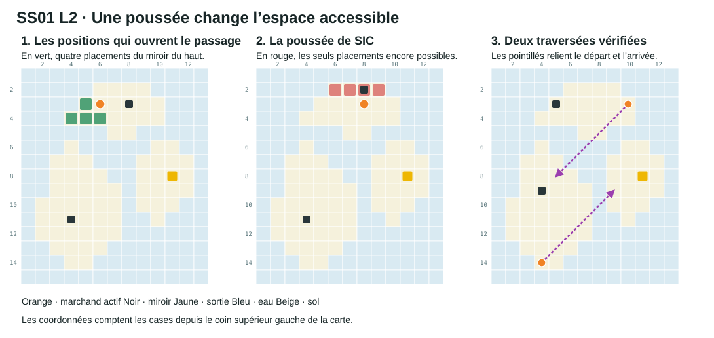

# SS01 · Où le raisonnement de SIC Fallback se rompt

**La première rupture observable concerne l’identité de ce que SIC déplace.** Dans la campagne partie du L1, la commande 210 téléporte bien le marchand actif. SIC vérifie le mouvement de l’autre marchand et conclut que son expérience n’a rien confirmé. Dans le L2 lancé directement, le suivi du marchand orange se fragmente dès le premier changement d’orientation. Les 22 plans territoriaux ultérieurs prennent tous pour voyageur la croix grise qui indique où le marchand pourrait apparaître.

**La commande 172 est le premier point de non-retour du candidat en L2.** Elle pousse le miroir vers le nord. Avant cette commande, une traversée restait possible. Après, les 72 configurations encore atteignables restent sur l’îlot du haut. J’avais précédemment rapporté « zéro placement » sans préciser assez clairement le périmètre du compteur. Le candidat a réellement poussé le miroir **trois fois**. Aucun de ces mouvements n’a satisfait une prédiction de placement territorial annoncée avant la commande.



## Ce qui a été comparé

| Exécution avec le moteur `f4d28aee` | Expérience du L1 disponible à l’entrée | Résultat officiel |
|---|---|---|
| Candidat figé `fc74c10a` démarré en L2 | Chargement direct du L2, nouveau service agent, zéro commande antérieure | 596 commandes, aucune victoire |
| Témoin figé `7f2cb3eb` démarré dans la même image | Même procédure | 655 commandes, aucune victoire |
| Même candidat figé, campagne lancée en L1 avec le L2 comme niveau suivant | Le candidat joue lui-même le L1 | 807 commandes, arrêt au budget de temps actif en L1 |
| Branche de diagnostic à partir des 54 premières commandes du candidat en L2 | Je choisis ensuite les commandes à partir de l’hypothèse proposée par l’utilisateur | L2 officiellement terminé à la commande 78 |

Les trois exécutions autonomes n’ont effectué aucune remise à zéro. Le replay contrôle l’empreinte de l’image avant et après chaque commande. Les expériences dirigées, le masquage de l’aperçu et l’examen des règles ont été effectués après le gel. Ils expliquent le comportement du candidat. Le trajet dirigé ne compte pas comme victoire de SIC. SS09 L2 reste en réserve. [Chargement du niveau et création de l’agent](https://github.com/yannick-fontan-1981/sra-playground/blob/fc74c10aec27dd9e1f58ab3d97e9d919c8e4e942/scripts/compare-source100.mjs#L61)

## Niveau 1 · validation de chaque constat

Les coordonnées `(x,y)` sont en **cases**. La première case du rectangle de la carte est `(1,1)`, l’est augmente `x` et le sud augmente `y`. Une case occupe trois pixels de côté dans l’observation publique.

| № | Constat proposé | Ce que confirme le moteur | Ce que fait ou établit le candidat |
|---|---|---|---|
| 1 | Je contrôle les déplacements du curseur orange. | Le marchand sélectionné répond aux quatre directions. Sa pointe blanche change avec son orientation. | La commande 1 déplace le marchand vers le nord. À la commande 2, il part à l’ouest. Le module qui mesure les déplacements ne raccorde déjà plus ses deux silhouettes orange. SIC a effectué 336 pas physiques au L1. |
| 2 | Le curseur ne peut pas marcher sur l’eau. | L’eau ordinaire bloque le pas. Le marchand reste sur sa case. | Premier blocage contre l’eau à la commande 20, puis 150 commandes de marche bloquées par l’eau au total. La trace atteste le blocage, sans démontrer une règle générale formulée par SIC. |
| 3 | Il faut atteindre la cellule jaune. | Le L1 testé s’appelle **Deux Marchands, deux destinations**. Les deux cases jaunes, `(17,5)` et `(15,8)`, doivent être occupées simultanément. | SIC change 14 fois de marchand et occupe une première destination à la commande 618. Le maximum simultané reste une destination sur deux. Il n’entre jamais en L2 dans cette campagne. |
| 4 | Un miroir occupe une cellule. | Le L1 contient un miroir en `(6,6)`. Il occupe une case logique, dessinée avec plusieurs pixels. | L’image le rend observable. La trace n’établit aucune identification qui relie explicitement ce miroir au déplacement du bon marchand lors de la commande 210. |
| 5 | Le miroir transpose une distance verticale en distance horizontale. | Un essai dirigé donne `(6,12) → (12,6)`, à distance 6 du miroir. | **À la commande 210**, SIC réalise `(6,9) → (9,6)`, à distance 3. Mais l’expérience lit `(6,13) → (6,13)`, qui est la position de l’autre marchand. Son verdict enregistré est `activation_unconfirmed`. |
| 6 | Il transpose aussi une distance horizontale en distance verticale. | Une seconde activation dans le même essai renvoie `(12,6) → (6,12)`. | Sur ses 38 activations en L1, SIC effectue un seul transfert physique de marchand, celui de la commande 210. Il ne démontre pas le sens inverse dans sa campagne. |
| 7 | Cette capacité permet de traverser l’eau entre deux rives. | L’essai de référence traverse et valide officiellement le L1. | Le marchand de SIC traverse effectivement à la commande 210. Le verdict sur le mauvais sujet empêche cette expérience précise de valider la capacité du marchand qui vient de traverser. |
| 8 | La téléportation exige une case de sol vide. | L’arrivée du marchand doit être supportée et les rayons praticables. Un essai en `(6,11)` vise l’eau en `(11,6)` et échoue. **« Vide » est trop strict au L1**. J’ai reproduit un échange simultané entre deux marchands occupant `(6,12)` et `(12,6)`. Au L2 il n’y a qu’un marchand. | Aucun test de la campagne ne démontre l’ensemble de ces conditions. |
| 9 | Le miroir du L1 échange le sud et l’est. | Oui. À distance positive `d`, il échange `(mx,my+d)` et `(mx+d,my)` lorsque le trajet et l’arrivée sont autorisés. | SIC rencontre un exemple dans le sens sud → est. Aucune prédiction vérifiée dans les deux sens et à plusieurs distances, liée au bon marchand et à ce miroir, n’est établie par ce run. |

Le point décisif au L1 est testable dans le journal. L’expérience de la commande 210 avait choisi à l’avance un rôle situé en `(6,13)`. Ce rôle est bien resté immobile. Le marchand sélectionné était en `(6,9)`. Cette erreur de sujet suffit à expliquer le verdict de **cette** expérience. [Règles de réflexion et transferts simultanés](https://github.com/yannick-fontan-1981/sra-playground/blob/f4d28aee9ebbb35533bb97a26968efd22887473d/src/games/sinking-star/core.ts#L140) · [Configurations initiales](https://github.com/yannick-fontan-1981/sra-playground/blob/f4d28aee9ebbb35533bb97a26968efd22887473d/src/games/sinking-star/levels.ts#L3)

## Niveau 2 · validation de chaque déduction

| № | Déduction proposée | Validation physique | Où en est SIC dans le run de 596 commandes |
|---|---|---|---|
| 1 | Il y a trois îlots. | Le terrain a trois composantes de sol. Haut **19 cases**, gauche **37**, droite **18**, avant déduction des cases occupées. | Le premier plan territorial arrive à la commande 369. Il vise bien une case de gauche, `(4,6)`, mais suit la croix d’arrivée. Aucune carte vérifiée des trois îlots pour le marchand orange. |
| 2 | Le curseur et le premier miroir commencent en haut. | Marchand en `(6,3)`, miroir en `(8,3)`. | La première commande est un pas réel. La commande 2, contre l’eau, change son orientation et sa signature visuelle. À la commande 3, le marchand revient en `(6,3)` et le module de mouvement ne relie pas les deux observations. |
| 3 | Le deuxième miroir est sur l’îlot gauche. | Il est en `(4,11)`. | Le candidat ne rejoint jamais cet îlot et ne déplace jamais ce miroir. Aucun usage de sa fonction n’est validé. |
| 4 | La sortie est sur l’îlot droit. | L’unique sortie jaune est en `(11,8)`. | Les points visés par les 22 plans territoriaux sont `(4,6)` ou `(5,3)`. Aucun n’achève une chaîne de deux traversées jusqu’à la sortie. |
| 5 | Les deux miroirs échangent le sud et l’est. | Les deux ont l’orientation SE. Le trajet gagnant utilise le premier dans le sens est → sud, le second dans le sens sud → est. | SIC finit par utiliser le premier miroir dans les deux sens, pour la première fois aux commandes 557 et 592 respectivement dans les sens sud → est et est → sud. Toutes ses six téléportations restent en haut, à distance 1. |
| 6 | Avec les miroirs fixes, 18 cases et des téléportations locales à distance 1 ou 2 sont accessibles. | L’énumération exhaustive retrouve **18** positions. Les deux paires sont `(8,4) ↔ (9,3)` et `(8,5) ↔ (10,3)`. | Avant le premier déplacement du miroir, SIC visite **11** des 18 cases. Il dispose de **six occasions** d’activer une téléportation valide et en laisse passer six. La première est la commande 55. |
| 7 | La configuration initiale est une impasse si les mécanismes restent fixes. | Oui. L’ensemble accessible avec les miroirs immobiles reste intégralement sur l’îlot du haut, même en incluant toutes les activations. | Aucune fermeture correcte des 18 positions du **marchand à miroirs fixes** n’est vérifiée. Quand un plan annonce plus tard une zone de taille 18, le miroir a déjà changé de place et le voyageur suivi est la croix grise. |
| 8 | Il existe quatre placements du miroir du haut ouvrant un passage vers la gauche. | Oui. L’énumération de toutes les poussées et marches réalisables en haut trouve **quatre placements** et **onze couples départ–arrivée**. Le départ le plus à droite de chaque rangée convient dans les quatre cas. D’autres départs fonctionnent aussi. | Le miroir réel n’atteint **aucun** des quatre placements. La coordonnée utile `(5,3)` apparaît parmi les options consignées après la commande 172. SIC n’en vérifie ni l’accessibilité ni le départ et l’arrivée conjoints. |
| 9 | Le même principe sur l’îlot gauche peut ouvrir l’îlot droit. | Oui. Après reconfiguration du second miroir, le jeu autorise le passage gauche → droite. | La première traversée manque. Aucun transfert de la relation au deuxième miroir n’est testé sur place. |
| 10 | La première expérience de manipulation naturelle est une poussée, avant traction ou entraînement latéral. | La poussée par contact est suffisante dans les deux îlots. | **Le premier contact directionnel avec le miroir le pousse vraiment**, commande 172. Il est enregistré comme une étape de retour d’une autre expérience. La direction choisie est précisément celle qui supprime toute traversée ultérieure. |
| 11 | Pousser le premier miroir à gauche, se décaler à droite et activer fait passer à gauche. | Vérifié depuis le même préfixe de 54 commandes que SIC. Miroir en `(5,3)`, marchand en `(10,3)`, arrivée en `(5,8)`. | SIC pousse au nord à 172, puis à l’ouest à 368 et 369, sur la mauvaise rangée. Ses quatre positions successives de miroir sont `(8,3)`, `(8,2)`, `(7,2)`, `(6,2)`. |
| 12 | En poussant le miroir gauche de deux cases vers le haut, puis en allant en bas, on peut passer à droite. | Vérifié. Le miroir passe de `(4,11)` à `(4,9)`. Une activation depuis `(4,14)` conduit en `(9,9)`. | Aucune exécution autonome de cette étape. |
| 13 | Une fois à droite, la sortie est accessible à pied. | Depuis `(9,9)`, nord, est, est atteint `(11,8)`. Le moteur enregistre la réussite officielle du niveau. | Le candidat termine avec zéro niveau validé et toutes ses positions sur l’îlot du haut. |

### Les quatre dispositions qui ouvrent le passage

| Miroir du haut | Départs possibles à l’est sur sa rangée | Arrivées correspondantes à gauche, dans le même ordre |
|---|---|---|
| `(5,3)` | `(9,3)`, `(10,3)` | `(5,7)`, `(5,8)` |
| `(4,4)` | `(6,4)` à `(10,4)` | `(4,6)` à `(4,10)` |
| `(5,4)` | `(8,4)` à `(10,4)` | `(5,7)` à `(5,9)` |
| `(6,4)` | `(10,4)` | `(6,8)` |

### Comment SIC en vient à suivre la croix grise

Le sprite du marchand orange change avec son orientation. Dans le L2, les quatre orientations produisent quatre signatures distinctes dans l’observateur. Le module de déplacement utilisé pour construire les territoires exige de retrouver une même signature non ambiguë de part et d’autre d’une commande. En rejouant ce module figé, il rattache correctement **59 des 300 déplacements physiques du marchand**, téléportations incluses. L’écart apparaît à la commande 3. Cette mesure concerne ce module, les autres modules pouvant traiter d’autres indices. [Mesure des déplacements](https://github.com/yannick-fontan-1981/sra-playground/blob/fc74c10aec27dd9e1f58ab3d97e9d919c8e4e942/src/sic/preparation-experiments.ts#L269) · [Construction des territoires](https://github.com/yannick-fontan-1981/sra-playground/blob/fc74c10aec27dd9e1f58ab3d97e9d919c8e4e942/src/sic/controllable-territory.ts#L35)

J’ai vérifié l’identité annoncée au départ de **chacun des 22 plans**. Dans les 22 cas, son ancre se trouve sur la case que le moteur prévisualise, à une autre position que le marchand. Sur le même état, j’ai rendu l’image une deuxième fois en désactivant uniquement l’aperçu de réflexion. Les cinq pixels gris de ce rôle disparaissent dans les 22 cas. Le composant orange reste observable. À la commande 369, par exemple, le joueur réel part de `(8,2)` alors que le plan entreprend de faire voyager l’objet situé en `(7,3)`. [Dessin du marchand et de l’aperçu](https://github.com/yannick-fontan-1981/sra-playground/blob/f4d28aee9ebbb35533bb97a26968efd22887473d/src/games/sinking-star/core.ts#L280)

La croix constitue pourtant un bon indice. Avant la commande 55, elle indique `(9,3)` alors que le marchand se trouve en `(8,4)`. L’expérience qui distingue leurs rôles consiste à annoncer « si j’active maintenant, le marchand arrive là où se trouve la croix », puis à mesurer le marchand à l’arrivée. Le raisonnement inverse peut ensuite chercher où mettre le miroir **et** où placer le marchand pour que cette arrivée tombe sur un autre îlot. Cette relation entre les trois positions manque aux décisions vérifiées.

### Pourquoi 172 est un seuil irréversible dans cet épisode

Avant la commande 172, le marchand se tient en `(8,4)`, immédiatement au sud du miroir `(8,3)`. J’ai calculé les suites possibles pour chacune des cinq commandes depuis cet état exact.

| Commande 172 | Résultat immédiat | Un passage vers la gauche reste-t-il possible ensuite ? |
|---|---|---|
| Nord, choix de SIC | Le miroir monte en `(8,2)` | **Non** |
| Sud | Le marchand va en `(8,5)` | Oui |
| Ouest | Il va en `(7,4)` | Oui |
| Est | Il va en `(9,4)` | Oui |
| Activer le miroir | Il est téléporté en `(9,3)`, du côté qui permet de pousser à gauche | Oui |

Après la poussée nord, il faudrait pouvoir se placer au-dessus du miroir pour le repousser vers le sud. Cette rangée est dans l’eau. L’énumération du moteur épuise **72 configurations** de marchand et de miroirs depuis cet état. Le premier miroir peut encore occuper quatre cases de la rangée 2, de `(6,2)` à `(9,2)`. Aucune ne permet de quitter l’îlot. L’énumération tient compte des cinq commandes, y compris la téléportation, et conserve les états distingués par les positions du marchand et des deux miroirs. L’orientation du marchand et l’indicateur visuel d’échec n’interviennent pas dans ces transitions. Le témoin rencontre la même impasse à sa commande 229. [Règles de poussée et d’activation](https://github.com/yannick-fontan-1981/sra-playground/blob/f4d28aee9ebbb35533bb97a26968efd22887473d/src/games/sinking-star/core.ts#L209)

Les six gestes auxquels le candidat avait explicitement associé un **placement prévu** sont les commandes 402, 549, 555, 558, 582 et 594. Ils surviennent tous après la perte de la solution. Aux commandes 558 et 594, il est bien à droite du miroir, mais son geste vers l’ouest voudrait maintenant pousser le miroir de `(6,2)` dans l’eau en `(5,2)`. Le compteur « zéro sur six » et le replay « trois poussées réelles » décrivent donc deux événements différents.

### Rejouer la bifurcation gagnante

J’ai conservé à l’identique les 54 premières commandes du candidat. À la commande 55, SIC était allé à l’ouest. En activant le miroir à la place, le marchand arrive immédiatement à l’est du miroir. Trois poussées vers l’ouest placent alors le miroir en `(5,3)`. Quatre pas vers l’est portent le marchand en `(10,3)`. Dans cette branche, les deux traversées ont lieu aux commandes **63** et **75**, et la sortie est atteinte à la **78**. Un deuxième trajet partant directement de l’état initial termine le niveau en 27 commandes. Ces deux témoins vérifient la faisabilité de la stratégie décrite.

L’audit utilise le moteur figé, les trajectoires publiques déjà enregistrées et les prévisions scellées du candidat. Les compteurs de jeu, les trois vraies poussées, les positions des rôles, les alternatives à 172 et les deux trajets dirigés figurent dans les [mesures](mesures.json). Le [script de reproduction](audit.mjs) reste dans le répertoire de diagnostic, en dehors du solveur. Il prend en arguments le checkout du moteur, le répertoire d’étude contenant les deux traces du L2 et l’export figé du candidat, le fichier de sortie et la trace de la campagne commencée en L1.

```sh
node audit.mjs <moteur> <répertoire-étude> mesures.json <répertoire-étude>/explain19-chron.jsonl
```

Les journaux de commandes complets restent dans le répertoire d’étude local. Les empreintes des trajectoires figurent dans les mesures publiées.

