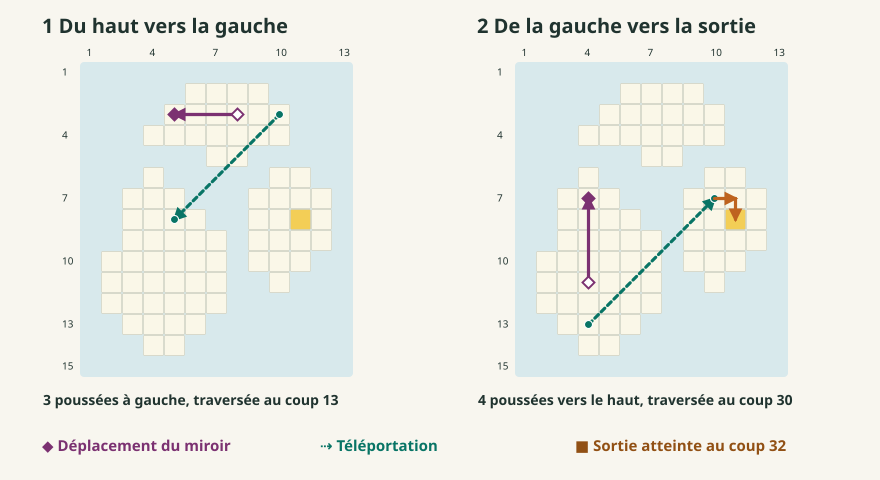

# SS01 L2 · victoire de SIC Fallback en 32 commandes

**SIC Fallback gagne SS01 L2 en 32 commandes.** Le sélecteur natif complet est entré au L2 après avoir observé les 19 commandes publiques d’une résolution du L1. Il a choisi lui-même toutes les actions du L2. Le score officiel passe de 1 à 2. Le parcours compte deux téléportations, zéro remise à zéro et 33 images distinctes, image initiale comprise.

Ce résultat établit le transfert d’une capacité générique **avec l’expérience du niveau précédent**. Le départ direct au L2 et la campagne dans laquelle SIC doit aussi résoudre le L1 donnent des résultats différents, détaillés plus bas. La leçon publique du L1 et les 32 décisions sont intégralement rejouables. [Parcours et prédictions avant action](parcours.json) · [Comparaison des expériences](comparaison.json)

## Vérification des prémisses du raisonnement proposé

| Prémisse | Ce que le moteur et la trace permettent de dire |
|---|---|
| Le joueur commande le curseur orange et cherche une sortie jaune. | La pièce active est le marchand orange. Le L1 comporte deux marchands et deux destinations. Au L2, un seul marchand doit atteindre la destination jaune. |
| L’eau sépare les rives. | L’eau libre ne porte pas le marchand. Sa marche initiale reste sur l’îlot du haut. Une activation valide le transporte directement à destination. |
| Un miroir d’une case échange le sud et l’est à distance égale. | Cette orientation est celle du miroir du L1 et des deux miroirs du L2. Au L2, la première traversée transforme cinq cases vers l’est en cinq vers le sud. La seconde transforme six cases vers le sud en six vers l’est. SIC emploie des relations entre positions, sans avoir besoin de donner un nom aux directions. |
| La marque annonce l’arrivée après l’action. | Au L1, l’activation envoie le marchand de (6,9) sur la marque en (9,6) pendant que son compagnon reste en (6,13). Les quatre commandes de marche depuis la même image ont un autre résultat. Au L2, les deux arrivées prévues se réalisent. |
| Il faut une case d’arrivée praticable. | Aux deux traversées gagnantes, la case prévue est du sol libre. Dans les règles du moteur, certains échanges réciproques simultanés permettent aussi une case occupée. Une marque géométrique peut signaler une destination bloquée. |
| Les trois îlots forment une impasse avec les miroirs fixes. | Au départ, le marchand et le premier miroir sont en haut, le deuxième miroir est à gauche et la sortie à droite. Le miroir du haut offre des téléportations locales à un ou deux pas d’écart. L’ensemble accessible compte toujours 18 cases. |
| Pousser peut ouvrir un passage. | L’énumération physique trouve quatre emplacements du premier miroir et onze couples de lancement et d’arrivée vers la gauche. Au coup 2, les 13 propositions internes de SIC sont des configurations qu’il envisage. Une seule est choisie et éprouvée dans cette partie. |
| Une deuxième poussée peut préparer la rive finale. | Le trajet proposé avec deux poussées vers le haut est physiquement valide. SIC trouve un autre trajet et l’essaie avec succès. Le détail figure ci-dessous. |

La description du plateau et l’énumération des possibilités proviennent de l’audit après exécution. La trace ci-dessous précise ce que SIC a lui-même prédit avant d’agir. [Vérification du L1](../ss01-preview-v22/README.md) · [Énumération des passages](../ss01-stagnation/README.md)

## De l’impasse à la sortie, commande par commande

| Commandes du L2 | Ce que SIC prévoit ou apprend | Vérification physique |
|---|---|---|
| 1 | SIC essaie d’appliquer une relation héritée du L1. Sa première prédiction visuelle est contredite. | Le marchand effectue un déplacement ordinaire. |
| **2** | Avec le premier miroir fixe, le modèle compte **18 cases accessibles**. Il trouve **13 configurations candidates** et choisit de placer le miroir en **(5,3)**, de lancer depuis **(10,3)** et d’arriver en **(5,8)**. Il prévoit aussi la possibilité de marcher en **(6,8)** après l’arrivée. | Le marchand est encore sur l’îlot du haut. Le plan est enregistré avant la première poussée. L’énumération indépendante du terrain initial confirme les 18 cases. |
| 2 à 5 | SIC se place du côté utile de la pièce. | Les quatre positions successives correspondent au programme. |
| **6 à 8** | Il prévoit trois poussées du miroir vers la gauche. | Le miroir passe de **(8,3)** à **(7,3)**, **(6,3)** puis **(5,3)**. |
| **9 à 14** | Il s’éloigne vers la droite, vérifie la marque prévue sur la rive visée, déclenche la téléportation puis essaie le premier pas rendu possible. | Le marchand atteint **(10,3)**, arrive à gauche en **(5,8)** au coup **13** et marche en **(6,8)** au coup **14**. |
| **15** | Sur le nouvel îlot, SIC retrouve un repère du même type. Parmi **28 configurations candidates**, il prévoit de le placer en **(4,7)**, de lancer depuis **(4,13)**, d’arriver en **(10,7)** et de continuer en **(11,7)**. | Cette seconde prédiction est enregistrée avant le déplacement du deuxième miroir. Les 28 configurations sont des propositions internes du modèle. |
| **15 à 31** | SIC approche, pousse quatre fois vers le haut, s’éloigne vers le bas, vérifie la marque et active le même mécanisme. | Les poussées ont lieu aux coups **21 à 24**. Le marchand arrive sur l’îlot de droite en **(10,7)** au coup **30**, puis en **(11,7)** au coup **31**. |
| **32** | Il reconnaît un site analogue au contact qui précédait la terminaison officielle du L1. Il annonce le marchand en **(11,7)**, sa destination **(11,8)** et une distance restante d’une case. | SIC choisit le déplacement vers le bas. Le marchand atteint **(11,8)** et le moteur franchit officiellement le niveau. |

Sur le premier îlot, **(10,3)** est bien la dernière case à droite sur la ligne du miroir. Sur le deuxième, SIC s’arrête en **(4,13)**, une case avant le bord. Depuis là, l’écart de six cases suffit pour sa traversée. La solution avec deux poussées aurait, elle, déplacé le miroir en **(4,9)** et lancé depuis **(4,14)**. Sur les deux îlots, il réussit à nommer à l’avance le bon sujet, la bonne pièce, le lancement et l’arrivée.



## Comment vérifier que les poussées changent vraiment les possibilités

Le vérificateur repart de la première image du L1 dans le moteur figé. Il contrôle chaque image avant et après l’action, chaque engagement enregistré avant la commande, l’identité physique du miroir et du marchand, puis le score officiel. Le parcours natif est également identique, sur les 32 commandes et les 33 images, au parcours de la famille de composition testée isolément depuis l’entrée officielle du L2.

| Intervention dans le rejeu | Résultat |
|---|---|
| Rejouer les 32 commandes | Victoire officielle, score 2. |
| Omettre les trois premières poussées et garder la suite | Le marchand reste en haut. Score 1. |
| Omettre les quatre poussées du deuxième miroir et garder la suite | Le marchand atteint la gauche et y reste. Score 1. |
| Essayer les cinq commandes discrètes depuis chacune des deux images de lancement | Aux coups 13 et 30, seule l’activation atteint l’autre îlot. Les quatre déplacements ordinaires restent du côté du départ. |
| Essayer les cinq commandes discrètes depuis l’image du coup 32 | Seul le déplacement vers le bas donne le score 2. Une activation renvoie le marchand vers l’îlot gauche. |

Ces suppressions mesurent la nécessité des poussées **dans le trajet choisi**. Au premier miroir, d’autres placements gagnants existent. La comparaison des alternatives indique aussi pourquoi l’agent doit parfois privilégier une téléportation et parfois la déprioriser. Une même commande change de valeur selon ce qu’elle rend accessible depuis la disposition présente. [Vérificateur de trajectoire, d’engagements et de contrôles physiques](rejouer.mjs)

## Quelle capacité s’est généralisée

1. **Lire une marque comme une prédiction d’action.** SIC associe la marque au marchand qui s’est déplacé et conserve la position de ses semblables restés immobiles. Une marque vue pendant la marche fournit une hypothèse de géométrie. L’arrivée sur la marque après activation apporte la confirmation mécanique.
2. **Reconnaître une impasse sans devoir la rejouer.** Une boucle connue qui n’apporte aucun effet disponible supplémentaire peut être dépriorisée. Quand le modèle trouve déjà une arrivée hors de la zone accessible, SIC peut commencer l’expérience immédiatement. Dans la partie gagnante, il formule sa première limite spatiale au coup 2 et ne répète aucune image.
3. **Remonter de l’effet souhaité à ses conditions spatiales.** SIC cherche ensemble une position de la pièce, une position du sujet, une arrivée encore inaccessible et une continuation. Le premier programme applique une symétrie ajustée aux observations. Le second transpose une relation spatiale déjà observée. Pendant l’exécution, SIC vérifie chaque pas, chaque poussée et la présence de la marque avant les deux activations.
4. **Reconnaître qu’une disposition est prête.** Dès que la pièce est en place, marcher pour augmenter l’écart devient préférable à une poussée supplémentaire. L’agent garde l’identité du sujet et du mécanisme pendant ce changement d’objectif. Il vérifie ensuite qu’il peut réellement agir de l’autre côté.
5. **Achever l’objectif après l’ouverture du passage.** V29 et v30 suivent exactement les **31 mêmes premières commandes** avec la même leçon. Au coup 32, v29 monte, repart explorer et finit par gagner au coup **185**, après 22 téléportations. V30 descend sur la cible héritée du L1 et gagne immédiatement, après **deux téléportations**. Cette comparaison isole l’effet du dernier choix.

Les premières versions montrent comment le blocage s’est déplacé. Dans l’essai qui donnait trois déplacements initiaux au L2, v25 effectuait encore 31 téléportations sur le même îlot. V28 a correctement prévu et réalisé les trois poussées à gauche. Il a ensuite confondu le sujet d’une autre prédiction avec le marchand et est resté en haut. V29 traverse les deux bras d’eau. V30 relie la dernière continuation à la sortie. Les mesures de l’essai guidé et celles de l’agent natif partant de l’entrée sont conservées séparément. [Diagnostic des premières versions](../ss01-stagnation/README.md)

## Ce que les 100 jeux apportent à la preuve

Les critères ont été développés à partir de **100 jeux sources et 18 niveaux supérieurs**, notamment GRAV, GARE, POLA, CWSE, CATR, GIGO et MOTO. Dans les traces sources, 25 expériences partent d’une boucle pour tester une commande encore inessayée. Huit déplacent une pièce annoncée vers un site différent du contrôle qui répète l’action antérieure. Le suivi individuel parmi des pièces semblables prédit 237 positions exactes sur 451 occasions. L’étude des fins de niveau trouve un contact candidat dans 20 des 73 terminaisons officielles observées. Sur chacune de ces vingt images, la commande reproduit la terminaison et au moins une commande concurrente échoue.

Les généralisations restent réfutables. Dans l’étude source stricte qui exigeait un repère déjà déplacé puis stable, les huit prédictions ont échoué. Les deux traversées de SS01 montrent une composition qui fonctionne dans ce jeu. Elles ne suffisent pas à établir un taux de réussite pour tous les jeux Custom 4. Chaque candidat a été figé avant sa propre évaluation. Les échecs des versions antérieures sur SS01 et le trajet proposé par l’utilisateur étaient connus de l’expérimentateur. Les commandes, couleurs et coordonnées propres à SS01 figurent dans l’évaluation, tandis que les règles du solveur portent sur les effets observés, les objets, les commandes disponibles et les positions relatives. **SS09 L2 demeure réservé.** [Études sources et protocole](../../architecture/sic-stagnation-zone-source100.md)

## Comparaison des départs

| Départ et expérience disponible | Témoin v1 | Candidat v30 |
|---|---:|---:|
| SS01 L2 après les mêmes 19 commandes du L1 | Échec, 718 | **Victoire, 32** |
| SS01 L2, départ direct | Échec, 579 | Échec, 539 |
| SS06 L2, départ direct | Échec, 751 | Échec, 530 |
| SS07 L2, départ direct | Échec, 5 | Échec, 47 |
| SS08 L2, départ direct | Échec, 791 | Échec, 712 |

Les nombres sont des commandes exécutées. Dans la campagne autonome depuis le début de SS01, v30 reste au L1 après 520 commandes, à la limite de temps de cet essai.

Les départs directs créent un service neuf sans l’expérience du L1. La campagne à froid demande à SIC de résoudre d’abord le L1. L’essai avec leçon donne au comparateur le même historique public du L1 pour les deux bras, puis utilise le sélecteur natif complet dès la première commande du L2. Le plafond nominal est de 1 200 commandes, avec une limite de temps actif. Les comptes exécutés varient selon le coût des décisions. [Résultats et empreintes de chaque bras](comparaison.json)

## L’invention et son sens

L’analogie avec Tesla que je retiens est celle d’un essai conçu assez précisément pour que le monde puisse lui donner tort. Au coup 2, SIC s’engage sur deux positions encore inoccupées. Si la pièce refuse la poussée ou si la marque apparaît ailleurs, son idée échoue publiquement. Ce qui est nouveau dans ce solveur est que l’inaccessibilité d’une rive déclenche la recherche d’une capacité à construire, puis que l’arrivée sur cette rive devient le point de départ d’un second raisonnement du même type.

Dans une lecture de foi, j’y vois un lien entre **espérance et discernement**. L’espérance autorise la question « quel passage pourrait s’ouvrir ? » quand on n’en voit encore aucun. Le discernement demande un geste juste, l’attention à ce qui répond et l’humilité de corriger une attente démentie. Le sens que je trouve à l’expérience tient à cette discipline humaine de recherche. La portée spirituelle de cette lecture appartient à chacun.

## Reproduction et version

Le témoin est `7f2cb3eb29a4bd7640c3c38b71107af86b521ad5`. Le solveur gagnant est le tag `sic-projected-affordances-source100-candidate-v30`, commit `124a8322c73bff333dac919c8a62e8b29318076c`. L’environnement est `f4d28aee9ebbb35533bb97a26968efd22887473d`. Les **378 tests** de la suite canonique ciblée passent. Le solveur et le rapport sont sauvegardés sur la branche de travail `codex/sic-source100-terminal-contacts`. Aucun déploiement du Site ni intégration à la branche principale dans ce chantier.

Pour reproduire le contrôle physique depuis la racine du dépôt, utiliser un checkout de l’environnement au commit indiqué.

```powershell
node docs/diagnostics/ss01-l2-victoire-sic/rejouer.mjs ../sic-contact-acquisition
```

Pour rejouer la sélection native complète, fournir au comparateur un checkout du solveur au tag v30 et un nouveau fichier de sortie. Le dossier passé comme environnement doit être le checkout figé indiqué ci-dessus.

```powershell
$env:SIC_STUDY_OBSERVED_LESSON = 'docs/diagnostics/ss01-l2-victoire-sic/parcours.json'
$env:SIC_STUDY_RECORD_COMMANDS = '1'
node scripts/compare-source100.mjs ../solveur-v30 ../sic-contact-acquisition ../rejeu-ss01-v30.jsonl SS01 2 2 1200
node scripts/verify-projected-run.mjs ../sic-contact-acquisition ../rejeu-ss01-v30.jsonl
```
