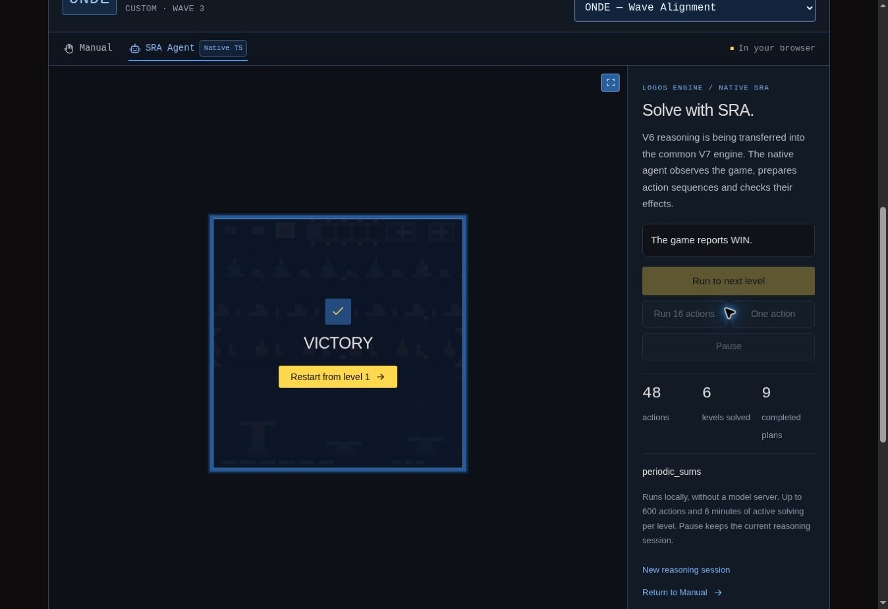

# V32: native support navigation and public occurrence recall

## Status and evidence boundary

This milestone connects the native `SupportNavigation` coordinator, all thirteen
of its declared child families, and `public_occurrence_recall` to Logos Engine's
V7 runtime. The common caller, WHY/ACT admission, public observations, acquired
events and authoritative family nodes remain on the TypeScript execution path.
The immutable reference is V6 commit
`786dcf51ca57773d8e3a8948ce9ea3655e7baf8e`.

**The migration remains incomplete.** The current connection metric is
**35.5%: 27 of 76 explicit DRM subquestion entries are connected**. This is a
count of entry points in four source declaration lists, not a percentage of
behavioral parity, source code transferred, games solved or expected ARC score.
The runtime continues to declare `fullV6Parity: false`.

**The final native source is frozen at digest
`b72de816a5c707ef0b41515a22fcd52f1ffd797ab006d9f5daa39f15ae2e6710`
(107 implementation files).** ONDE has a complete native six-level victory, and
HANO has a complete four-level victory on that source. The memory correction
reduces retained heap by 77.83% at the same 65-action SYME diagnostic boundary,
with identical public trajectories and retained graph counts. All 2,267 selected
component tests pass. Initial campaigns and their two heap failures remain
archived separately; they are not relabeled as final-source validation.

The authoritative inventories are [the transfer map](../../migration/v6-transfer-map.json),
[the conservative coverage report](v6-coverage.json) and
[the entry-point audit](v6-entry-point-progress.json). This document supplements
[the migration requirements and earlier milestone](v6-native-transfer.md);
historical campaign evidence retains its original scope.

## What the percentage measures

| Ordered source DRM list | Connected entries | Declared entries |
| --- | ---: | ---: |
| `goal_access_subquestions` | 6 | 12 |
| `window_constraints.ordered_subquestions` | 4 | 21 |
| `program_construction.ordered_subquestions` | 8 | 10 |
| `factored_material_return.ordered_subquestions` | 9 | 33 |
| **Total** | **27** | **76** |

Each declaration entry has equal weight. A family appearing in two lists
represents two declared entry points. The common coordinator and direct groups
outside these lists are outside this denominator. The audit checks actual
runtime registrations and records missing entries; it does not infer completion
from a file name or an exported declaration. Reproduce it with
`node scripts/audit-v6-entry-points.ts`. See the audit's `qualification`,
`sharedSeriesMemory`, `pendingSupportSubcompositions` and `fullV6Parity` fields.

## Public occurrence recall and source priority

The transferred recall provider covers the public scene measurements, occurrence
matching and candidates, acquired recall models, refusal and ambiguity handling,
physical guards, public program-packet observation, and restoration of the
retained event history. The native implementation is split across
[`v6-occurrence-recall.ts`](../../src/logos-engine/v6-occurrence-recall.ts),
[`v6-occurrence-scene.ts`](../../src/logos-engine/v6-occurrence-scene.ts) and
[`v6-occurrence-program-observer.ts`](../../src/logos-engine/v6-occurrence-program-observer.ts).
Its source entry is `observed_occurrence_recall`; its native family identifier
is `public_occurrence_recall`.

The provider keeps the source selection order. On the reference scene where
`SlotSubstitution` can already propose an action, the original common router
chooses recall in the earlier `window_constraints` group. The native runtime
does the same, with `field_subquestion: observed_occurrence_recall`; the
selection receipt has not visited `surface`, where SlotSubstitution is
registered. SlotSubstitution is therefore not forced ahead of recall to obtain
a preferred demonstration. This is explicitly exercised by
[`v6-support-caller-integration.test.ts`](../../tests/v6-support-caller-integration.test.ts).

Acquisition uses the original result envelope and source fact keys:
`window_constraint:<revision>` for the selected result and
`repeated_series_state` for retained recall memory. The event is acquired once
per witnessed transition; the passive path does not acquire a second copy when
recall was selected. Retained state has the source `{ events, digest }` shape.
Restoration replays the events and validates the resulting digest before
replacing the memory. Tests cover learned recall, positive and rejected
candidates, ambiguous cases, altered physical bindings, and reconstruction
after every operation.

### Shared series memory remains a partial transfer

The original `ObservedCompositionConstraint` is a much larger shared object
than this recall provider. Its other composition providers and their additional
event producers have not all been transferred. The runtime states this
explicitly:

```text
sharedSeriesMemory:
  occurrence_recall_and_its_ancestors_only; remaining ObservedCompositionConstraint providers pending
fullV6Parity: false
```

For example, the unchanged full original caller acquires a
`coupled_pair_epoch_anchor` event on the first MEMO prefix, in addition to the
recall event. The recall closure does not fabricate this unrelated producer.
The integration test compares the recall event, its source fact, the decision
order and all eight common caller component states, and explicitly asserts the
additional original event and the outstanding migration gap. It does **not**
claim equality of the complete original shared series history or digest.

The `repeated_series_state` key retains its original meaning and name; the
coverage limitation is reported separately. Missing producers are not replaced
by metadata inserted into the source event state.

## SupportNavigation and its thirteen children

The coordinator now contains real native children in the original order below.
The same instances participate in router selection and passive acquisition;
there is no second hidden set of solvers. Empty refusing placeholders are not
counted as implementations. Its retained state contains its own support
knowledge and references to the registered children, while each child has its
own authoritative V7 family-state node.

| Source child order | Native family | Native implementation |
| ---: | --- | --- |
| 1 | `oriented_coupling` | `v6-oriented-coupling.ts`, `v6-oriented-handoff-mechanics.ts` |
| 2 | `invited_reduction` | `v6-invited-reduction.ts`, `v6-ray-capture-domain.ts` |
| 3 | `joint_transport` | `v6-joint-transport.ts` |
| 4 | `configured_arrivals` | `v6-configured-arrivals.ts`, `v6-arrival-mechanics.ts`, `v6-periodic-cell-grids.ts` |
| 5 | `metric_composition` | `v6-metric-composition.ts`, `v6-metric-stack-mechanics.ts` |
| 6 | `sliding_cavity` | `v6-sliding-cavity.ts`, `v6-cavity-clock.ts`, `v6-cavity-measurements.ts`, `v6-cavity-kinematics.ts` |
| 7 | `ordered_support_transfer` | Existing `v6-ordered-support.ts` transfer reused |
| 8 | `animated_contact` | `v6-animated-contact.ts`, `v6-transient-contact-memory.ts`, `v6-transient-measurements.ts` |
| 9 | `fixed_origin` | `v6-fixed-origin.ts`, `v6-fixed-program-calculation.ts` |
| 10 | `subset_diagnosis` | `v6-subset-diagnosis.ts` |
| 11 | `contextual_compartments` | `v6-contextual-compartments.ts` |
| 12 | `periodic_sums` | `v6-periodic-sums.ts` |
| 13 | `reflected_cover` | `v6-reflected-cover.ts`, `v6-reflection-audit.ts` |

Paths in this table are under `src/logos-engine/`. The coordinator and shared
measurements are
[`v6-support-navigation.ts`](../../src/logos-engine/v6-support-navigation.ts),
[`v6-support-navigation-domain.ts`](../../src/logos-engine/v6-support-navigation-domain.ts)
and [`v6-support-measurements.ts`](../../src/logos-engine/v6-support-measurements.ts).
The implementation preserves conditional roles, measured control effects,
underlays, counterexamples, source subquestion bindings, interruption guards,
public animation packets and lossless state restoration. Selected support
events and passive observations run once per sealed witnessed transition, with
the corresponding source support and child-state facts retained by the common
runtime.

### Family coverage is not whole-library coverage

The V6 family implementations and the dependency operations they actually call
have been transferred. Several inherited V5 modules are broader reusable
libraries, so a transferred family must not mark their unused capabilities as
complete. The important limits are:

| Area | Transferred scope and remaining boundary |
| --- | --- |
| Support navigation geometry | The called support-domain measurement and support geometry are transferred. Unused annotation functionality is not included. Periodic cell-grid enumeration preserves candidate geometry and retention; unused cell-pattern and crop representations are not claimed. |
| Configured arrivals | The V6 class and the two consumed mechanical calculations are transferred. This does not replace every general request or Pydantic contract in the source library. |
| Sliding cavity | The `SlidingCavity` and `CavityClock` classes and the consumed open-cavity helpers are transferred. Wrap-slide contracts are the V6 single-body `SLIDE`/`WRAP_ANCHOR` cases without paint, backing or pairs. Patrol-body support covers the constructed composite without captures, at cadence and phase one. |
| Oriented coupling | The V6 family is transferred. The inherited handoff closure covers actors, cargo, geometry work, masks, blocking, movement and interaction front conditions; unrelated library entry points are not claimed. |
| Metric composition | The V6 family and its packet fingerprint, bounded work/results, control fitting, target-domain enumeration, injective assignment, exposure dependencies, adjacency and stack transitions are transferred. Contract schemas are those reached by this family. |
| Animated contact | The V6 family, access layer, neutral fallback and transient contact memory are transferred. The inherited transition closure is the consumed ballistic/scalar/path functions and nested helpers listed in the transfer map. Only the consumed `ballistic_contact_solution` and `ballistic_curve_disclosure` DRM projections are included. |
| Fixed origin | The V6 family is transferred, including acquisition, ports, links, execution evidence and guards. The inherited fixed-program calculation covers the consumed `robust_origin_domain` and `program_image` operations, including cancellation, repeat, hazard and inverse relations. Other general signatures remain outside this port. |
| Subset diagnosis | The V6 family is transferred with conditional singleton-ANY filtering, partitioning, information questions, navigation, receipts and guards. General ALL/COUNT/PARITY predicates and unrelated hierarchical query signatures are not claimed. |
| Periodic sums | The V6 family is transferred, including bootstrap, authorization, correlated phase/focus planning and individual/collective acquisition. The inherited preimage library covers the consumed `INVERSE_DOMAIN` projection and its bounded refusals; general FIT/EVALUATE signatures are not claimed. |
| Reflected cover | The V6 family and the full reflection audit it consumes are transferred. This is not a claim that the entire general reflection-structure library has been migrated. |

The transfer map retains individual source-to-target mappings and proofs. A
later coverage update must keep these operation-level qualifications rather
than promoting an entire inherited module because one consumer now works.

## Differential and integration evidence

Python is used only to capture development reference outputs from unchanged,
hash-verified source. The website's agent does not run the Python reference.
Native tests consume retained fixtures and require no Python solver. The
existing game engines remain separate environments; only their public frames,
animation packets, available commands and official progression cross into the
agent. No hidden level state or expected solution path is an agent input.

The following component proofs retain their specified scope. Their tests also
pass in the final 2,267-test component run; full real-game outcomes are reported
separately below.

| Evidence | Recorded scope | Reproduction |
| --- | --- | --- |
| Recall | 41 passing tests: 27 comparison cases, 11 event journals, provenance and native graph/guard checks | [Recall tests](../../tests/v6-occurrence-recall.test.ts), [fixture](../../tests/fixtures/v6-occurrence-reference.json), [exporter](../../scripts/export-v6-occurrence-reference.py) |
| Fixed origin, subset diagnosis, periodic sums, reflected cover | 108 passing tests: 86 comparisons and 21 journals, with lossless restoration after operations | [Procedure tests](../../tests/v6-support-procedures.test.ts), [fixture](../../tests/fixtures/v6-support-procedures-reference.json.gz), [exporter](../../scripts/export-v6-support-procedures-reference.py) |
| Support coordinator, configured arrivals, sliding cavity | 307 passing tests: 102, 133 and 72 respectively; positive paths, refusals, guards and restore | [Support tests](../../tests/v6-support-navigation.test.ts), [arrival tests](../../tests/v6-configured-arrivals.test.ts), [cavity tests](../../tests/v6-sliding-cavity.test.ts) |
| Oriented coupling and metric composition | 133 passing tests; controlled source comparisons, no solved-game claim | [Coupling/metric tests](../../tests/v6-coupling-metric.test.ts), [fixture](../../tests/fixtures/v6-coupling-metric-reference.json) |
| Animated contact | 156 passing tests; complete selected-event and retained-authorization comparisons, no solved-game claim | [Animated tests](../../tests/v6-animated-contact.test.ts), [fixture](../../tests/fixtures/v6-animated-contact-reference.json) |
| Joint transport, invited reduction, contextual compartments | Original family trajectories, mechanical domains, source guards and retained V7 state | [Extension tests](../../tests/v6-support-extensions.test.ts), [fixture](../../tests/fixtures/v6-support-extensions-reference.json.gz) |
| Connected common caller | Recall priority over SlotSubstitution; MEMO and ONDE source prefixes; SKBN and DAME selected support acquisition | [Integration tests](../../tests/v6-support-caller-integration.test.ts), [MEMO prefix](../../tests/fixtures/v6-native-caller/memo-first-prefix.json), [ONDE prefix](../../tests/fixtures/v6-native-caller/onde-first-prefix.json) |

Component trajectories must retain their qualification. For example, the
isolated recall family completes three MEMO levels and then refuses at level
four; this is not an integrated MEMO victory. The SubsetDiagnosis DICO trace
reaches six levels after two explicit public control experiments, so it is not
an autonomous common-caller victory. The FixedOrigin GLOB trace completes one
level after explicit priming. By contrast, the PeriodicSums ONDE trace has no
priming, and ONDE is also verified as a full native common-runtime campaign
below.

## Final real-game campaigns on the corrected source

All six final reports use the same 107-file native source digest above, attest
`sourceUnchangedDuringRun: true`, load no Python agent modules and retain one
continuous session. Together they record **19 completed levels, 319 actual
commands, 319 acquired transitions and 186 sealed prefixes**. Every sealed
prefix retains the caller/frontier acquisition evidence and OP29/OP30/OP31.

| Game | Requested target | Final result | Actions | Evidence |
| --- | --- | --- | ---: | --- |
| **ONDE — Wave Alignment** | All 6 levels | **6/6, official `WIN`** | **48** | [Final report](native-campaigns-v32/onde.json); level actions 2, 4, 12, 6, 7, 17. |
| **HANO — Tower of Hanoi** | All 4 levels | **4/4, official `WIN`** | **60** | [Final report](native-campaigns-v32/hano.json); level actions 6, 10, 14, 30. |
| SKBN — Sokoban | First 3 levels | **3 levels**, requested partial target reached | 51 | [Final report](native-campaigns-v32/skbn.json); level 4 remains `NOT_FINISHED`. |
| SYME — Symmetry Repair | All 6 levels | **3/6**, active-time budget reached in level 4 | 81 | [Final report](native-campaigns-v32/syme.json); 81 transitions acquired, normal stop, no heap crash. |
| DNOI — Pattern Denoising | All 6 levels | **3/6**, active-time budget reached in level 4 | 72 | [Final report](native-campaigns-v32/dnoi.json); 72 transitions acquired, normal stop, no heap crash. |
| MEMO — Memory Recall | First 3 levels | **0**, `frontier_unknown` identical to original | 7 | [Final report](native-campaigns-v32/memo.json), [31 source comparisons](native-campaigns-v32/memo-original-comparison.json). |

ONDE is the newly completed custom Playground game. These outcomes are not an
ARC competition score. The failed six-level targets stay failed: resolving their
first three levels is not a complete-game victory. The active time budget is
360 seconds per level and the action cap remains 600. A running acquisition
finishes before the budget stop is observed: the final level-four active times
are 360.52 seconds for SYME and 361.25 seconds for DNOI.

The four campaigns with a normally finalized initial V32 report (HANO, ONDE,
SKBN, MEMO) retain every command, complete packet, selected family and decision
index after the memory changes. The original reference-prefix assertions also
pass for HANO (30 commands / 31 packets), SYME (36 / 37) and DNOI (17 / 18).
Those prefixes do not cover the newly tested later levels. The helper's
`baseline.passed` flag is assigned after the entire requested campaign passes;
it therefore remains false on the later SYME/DNOI budget stops even though the
individual recorded reference comparisons succeeded. The counters increment
only after their assertions pass.

The final long runs establish normal budget termination on this source, not an
unbounded-memory guarantee. DNOI stops at 72 actions, before its earlier
73-action crash boundary; SYME reaches the same observed 81 actions as its
earlier aborted run. The direct memory comparison is the matched 65-action
diagnostic below. No action or time budget was enlarged to obtain these results.

The [campaign summary](native-campaigns-v32/summary.json) retains source and
report hashes, exact counts, failure reasons, reproduction limits and the
connection to component, memory and browser evidence. Timings in these parallel
campaigns are budget observations rather than controlled speed comparisons.

## First frozen V32 game campaigns

The four normally completed reports below share source digest
`aba20e40256a364dde30662a759e029b2f51af92695f9c13ea55a61c45b6d5d0`
over 106 tracked implementation files. Each records one continuous session,
`sourceUnchangedDuringRun: true` and an empty `pythonAgentModules` list. These
attestations belong to that captured source. SYME and DNOI aborted before their
final attestations could run, and their postmortems explicitly retain null
attestation values.

| Game | Requested target | Observed result | Actions | Qualification and evidence |
| --- | --- | --- | ---: | --- |
| **ONDE** | All 6 levels | **6 completed, official `WIN`** | **48** | New complete native victory. Level actions: 2, 4, 12, 6, 7, 17. [Report](native-campaigns-v32/before-memory-fix/onde.json). |
| **HANO** | All 4 levels | **4 completed, official `WIN`** | **60** | Complete native victory. Level actions: 6, 10, 14, 30. The available original reference covers the first 30 commands; the remaining level is live campaign evidence. [Report](native-campaigns-v32/before-memory-fix/hano.json). |
| SKBN | First 3 levels | 3 completed; level 4 `NOT_FINISHED` | 51 | The requested three-level objective passed: 22, 10, 19 actions. This is not a complete-game victory. [Report](native-campaigns-v32/before-memory-fix/skbn.json). |
| MEMO | First 3 levels | 0 completed; level 1 `NOT_FINISHED` | 7 | `frontier_unknown`, reproduced by the unchanged original full caller. [Report](native-campaigns-v32/before-memory-fix/memo.json), [source comparison](native-campaigns-v32/before-memory-fix/memo-original-comparison.json). |
| SYME | All 6 levels | 3 completed; process aborted in level 4 | 81 observed | Node heap exhausted. Exit 134; the normal final report and attestations were not produced. [Pre-correction postmortem](native-campaigns-v32/before-memory-fix/syme-abort.json). |
| DNOI | All 6 levels | 3 completed; process aborted in level 4 | 73 observed | Node heap exhausted. Exit 134; the normal final report and attestations were not produced. [Pre-correction postmortem](native-campaigns-v32/before-memory-fix/dnoi-abort.json). |

The two aborted campaigns are failures of the requested six-level objectives.
The three successful levels in each do not establish completion of either game.
The common smoke runner is
[`v6-agent-native.smoke.ts`](../../tests/v6-agent-native.smoke.ts), backed by
[`v6-live-game-campaign.ts`](../../tests/helpers/v6-live-game-campaign.ts).

### MEMO agrees with the original failure

The unchanged complete original caller and the native runtime execute the same
first six recall actions. Both then select AnimatedContact through `goal_access`
and execute `ACTION6` at `(37, 13)`. Both stop after seven actions with
`frontier_unknown`, zero completed levels and the same final public frame hash,
`2a3d4526501f6a7f`.

The [retained final-source comparison](native-campaigns-v32/memo-original-comparison.json)
contains **31 passing checks** for all seven physical commands, the animation
proposal, source selection receipt fields, retained authorization and acquired
animation event. The original failure report is included. The reference ran
without source transformation or decision interception; the native replay did
not load original plans or memory. The comparison explicitly documents browser
command-name mapping and the source/native execution-metadata distinction.

This is a reproduced source limitation on this trace, not evidence of MEMO
success or total V6 equivalence. Changing the source priority solely to recover
the isolated recall trajectory would be a behavioral change and is not included
in the faithful transfer claim.

## Memory and delta processing

The first extended SYME and DNOI campaigns exhausted the JavaScript heap during
level four. Profiling identified two avoidable amplifications: the canonical
cache kept serialized text for many nested subtrees of every retained revision,
and encoded immutable state branches were copied again when entering the V7
store. Weak cache keys alone were insufficient because the revision journal
correctly kept those historical nodes alive.

The correction preserves the entire learned history:

- Native retained facts share their unchanged branches. Acquired checks and
  counterexamples create new branches; public state reads remain independent.
- State encoding reuses validated immutable subtrees and re-emits their complete
  fragment dependencies for each destination store.
- Encoded nodes enter the existing immutable ownership boundary when constructed.
  Parents and subsequent stored revisions therefore share their approved children.
- The canonical text cache is bounded at 16 MiB of conservative accounting and
  4,096 entries. Internal encoded-state text is bounded at 4 MiB and 2,048 entries.
  Eviction removes only recomputable text. The ordering table retains weak keys,
  integer weights and tokens, without holding cache values alive.
- The complete canonical digest still validates each Kernel write, including
  warmed depth and size bounds. Historical hashes, atomic rollback, fragment
  integrity and explicit graph revisions remain authoritative.

No fact, hypothesis, acquired rule, counterexample, episode, graph node, old
revision or action/time budget was removed to obtain the reduction. The complete
learned history may still grow; these limits apply to redundant computed caches,
not to a claim that total agent memory is constant.

### Same-trajectory retention measurement

The diagnostic runs the real SYME game with public pixel packets and production
budgets, then stops explicitly before action 66. GC between completed requests
allows retained JavaScript heap to be measured. This is a bounded diagnostic,
not a six-level game victory.

| Stage | Retained JavaScript heap at 65 actions |
| --- | ---: |
| Initial V32 source | 1,427.47 MiB |
| Bounded computed caches | 354.40 MiB |
| Bounded caches and actual immutable branch sharing | **316.46 MiB** |

The final reduction is **77.83%**. All three runs retain the same 65 commands,
65 complete public packets including animations, initial packet, three completed
levels, 43 sealed prefixes, 1,333 nodes, 4,599 revisions and 602 hydrated roots.
Their sources stay unchanged during each run and no Python agent modules load.
The diagnostic uses GC, heap sampling and concurrent validation jobs, so these
profiles do not support a speedup claim. Cross-session graph-chain equality is
not claimed: session identities and trace timestamps differ. Separate fixed
commit scenarios do retain their exact pre-correction chain hashes.

[The complete measurement](native-campaigns-v32/memory-retention.json) records
checkpoints, source hashes, allocation sites, comparisons and qualifications.
It includes a [reconstruction patch](native-campaigns-v32/memory-fix.patch),
[source hashes](native-campaigns-v32/memory-fix-source-hashes.json) and the
[reproducible diagnostic](../../scripts/profile-v6-native-retention.ts).

A narrower passive-acquisition check on the first 36 public SYME transitions
measured at most 3,987 serialized bytes across the new Support/Recall states,
with no events acquired by those families. This helped exclude those states as
the source of the large early amplification. Its scope excludes planning and
level-four exploration; see the
[passive-state diagnostic](native-campaigns-v32/syme-passive-memory-analysis.json).

### Final integrated product timing

After the long campaigns and component tests had finished, HANO's first two
levels were run alone on the final product, with CPU profiling enabled as in the
v31 baseline. There was no other project campaign, build or test suite running
during the final measurement.

| HANO measurement | v31 baseline | Final integrated product |
| --- | ---: | ---: |
| Level 1 active seconds | 17.56 | 6.81 |
| Level 2 active seconds | 67.72 | 14.83 |
| Total active seconds | **85.29** | **21.64** |
| Physical commands / complete public packets | 16 / 17 | 16 / 17 |
| Retained nodes / revisions | 304 / 783 | 348 / 943 |

The commands and all packets are identical, the game assets and budgets match,
and the final source remains unchanged. The observed active-time reduction is
**74.63% (3.94 times faster)**. The final product has more connected families and
a richer graph, so equality of graph counts is neither expected nor claimed.
This is one measured run on this environment, not a hardware-independent timing
guarantee or an estimate for all levels. The
[complete timing report](native-campaigns-v32/final-hano2-timing.json) retains the
qualification, game report, profiling identity and comparison evidence.

### Earlier isolated delta timing

Before the new families were integrated, a controlled v31 comparison retained
16 identical HANO commands, 17 identical packets, 304 nodes and 783 revisions.
Two levels changed from 85.29 to 9.80 active seconds with the delta improvements
alone (8.70 times faster in that measured environment). The
[isolated timing report](native-campaigns/performance-v32/summary.json) records
its source scope and profiling conditions. This is not presented as the timing
of the larger final integrated product, or a guarantee on another computer.

## Victory screen and optional inspection

The final game outcome displays **VICTORY** in uppercase directly over the game
board. Intermediate agent level completions retain the normal continuation flow.
Restart stays disabled until the final acquired prefix is sealed.

Reasoning inspection starts collapsed. The graph panel is created only when
opened; closed plan and trace panels do not stringify retained evidence or
rebuild their DOM on every agent update. Closing inspection releases its
detached graph view and rendered details, without deleting agent knowledge.
An in-flight inspector read cannot restore a closed view afterward.

The corrected application was replayed through the actual browser controls:
ONDE completed all six levels in one continuous session, with 48 actions and
nine completed plans. The game reported `WIN`, the uppercase overlay appeared,
and inspection stayed closed throughout. The
[browser verification record](native-campaigns-v32/browser-verification.json)
retains the UI source hashes and screenshot identity.



## Final validation

The final component run passes **2,267 tests**, with zero failures, cancellations
or todo cases. The command is:

```sh
node --test --test-concurrency=1 --test-skip-pattern='native SRC/service/controller replays' tests/*.test.ts
```

The three recorded HANO/SYME/DNOI full-caller replays are excluded by selection
and replaced by the separately reported real-game campaigns. This runner does
not count filtered tests as skipped; the 2,267 count includes only executed
tests. It is not described as an unqualified `npm test` result. TypeScript
checking and `git diff --check` also pass. See
[validation.json](native-campaigns-v32/validation.json) for commands and log hashes.

The selected tests include original-source family comparisons, prefix acquisition,
original provider priorities, native authority, edited programs and activations,
retained learning, lossless restoration, Unicode and numeric envelopes, integrity,
cache eviction and both positive and refused proposals. Passing them establishes
those described domains, not every missing V6 capability.

## Next migration step

Complete the remaining shared `ObservedCompositionConstraint` event producers
and providers, including the missing occurrence-series anchors, in their source
priority order. Then compare the unresolved later SYME/DNOI scenes with the
unchanged complete caller to identify which missing capability must be connected
next. Preserve the same delta acquisition, editable V7 graph, physical guards,
budgets and full-game verification throughout. `fullV6Parity` stays false until
the remaining declared behaviors and their dependencies are transferred and
validated.
