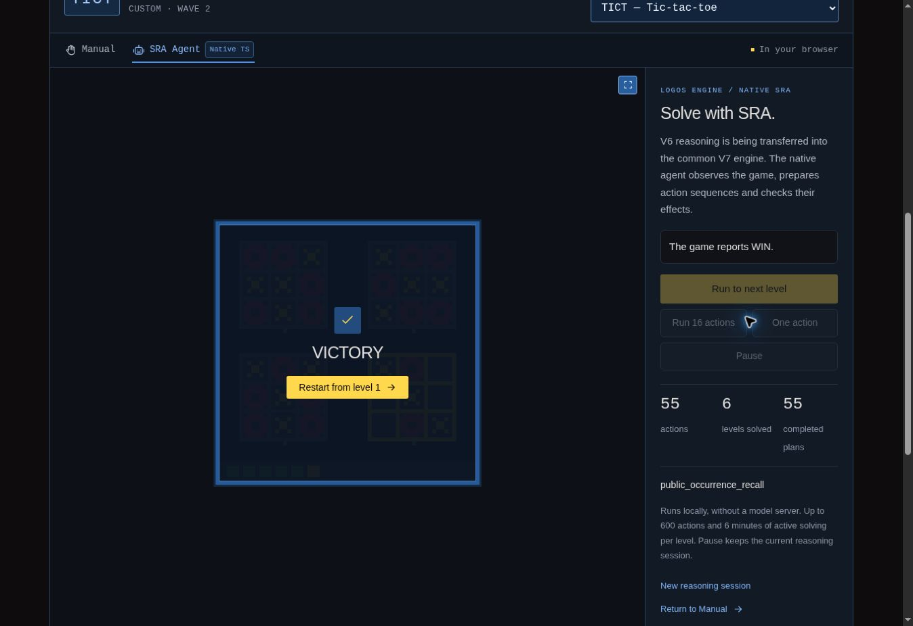

# Cell-patch composition and complete TICT campaign, v38

## Result

The native common Logos Engine agent completes **all six TICT levels**, starting
from a fresh level-1 session and ending with the game's official **`WIN`**.
The [complete campaign](native-campaigns-v38/tict-six-levels.json) records **55
physical actions**, 55 acquired prefixes and five natural boundary replays.
Every selected prefix is a `cell_patch_placement` proposal through the actual
common SRC selection, WHY/ACT authorization and V7 knowledge store.

| Completed level | Physical actions | Active seconds in this run |
| --- | ---: | ---: |
| 1 | 3 | 3.004 |
| 2 | 12 | 12.284 |
| 3 | 7 | 9.288 |
| 4 | 7 | 10.744 |
| 5 | 12 | 26.444 |
| 6 | 14 | 43.653 |
| Total | 55 | 105.416 |

The outer campaign took 125.047 seconds. These are observations in this
execution environment, with other verification processes running during parts
of the campaign. They are not an isolated speed benchmark or a guarantee for
another browser or computer. The result establishes six completed levels;
it does not establish constant-cost acquisition as a session grows.

The campaign retains one reasoning session, checks every physical action's
common and frontier acquisition, and verifies OP29/OP30/OP31 at each sealed
prefix. It supplies only public frames, complete animation packets, commands,
state and level counts. There are no injected controls, learned roles, solution
paths, level jumps, resets or undo requests. Python hosts only the game;
the campaign confirms that zero Python agent modules are loaded.

All 123 native source files remain unchanged throughout the run. Their manifest
digest is `9cc53ae5b79cdbd6a751ecea4d25698c6eca46a0f84d44ae79a6b325635483d5`.
The runtime implementation is
`logos-engine.typescript.v6.native-migration/0.8.0`.

## What was transferred

The reference remains the unchanged V6 source at
`786dcf51ca57773d8e3a8948ce9ea3655e7baf8e`. The source
`cell_placement_access.py` was also retrieved from the connected GitHub
repository at that exact commit: its Git blob SHA
`b2efb69fc802b61afe152e265a506fad1f5a65df` matches the retained reference file.

- **Cell-patch observation:** current rectangular separators and perimeters,
  measured repeated supports, exact patch identities, uniform-empty hypotheses
  and current pixel centers. Palette values alone do not assign roles.
- **Dated role acquisition:** a stable local-only patch must precede a strictly
  later stable local-plus-remote response in the public animation packet.
  Simultaneous or unstable changes do not supply that evidence.
- **Conditional line preparation:** the existing finite line-search algorithm,
  source tie ordering, search horizon, empty-cell bound and original hypothesis
  qualifications. The visible full-span goal and symmetric adverse response
  remain hypotheses; official progression establishes success.
- **Observed-return contrasts:** a closed publicly observed return records which
  equally ranked preparation has already returned, permitting a different tied
  choice while preserving the candidate role model when dated evidence warrants it.
- **Current-action guards:** exact epoch, score, observation, complete current
  raster, point, command and source-bound support. The physical response seals
  the one-action experiment and is reconciled before another action is planned.

The implementation is in
[`v6-cell-patch-observation.ts`](../../src/logos-engine/v6-cell-patch-observation.ts),
[`v6-supported-lines.ts`](../../src/logos-engine/v6-supported-lines.ts) and
[`v6-cell-placement.ts`](../../src/logos-engine/v6-cell-placement.ts).
No new module branches on a game identifier, an authored level, a fixed role
palette or an opponent's private implementation.

## Shared-owner integration and retention

`cell_patch_composition` and `observed_occurrence_recall` are distinct explicit
entries at their original `window_constraints` positions. Both consult the
existing `public_occurrence_recall` provider, registered once. Coupled support
and alternating graph retain their earlier goal-access entries.

The shared owner acquires occurrence ancestry, the cell action record, then
graph/pair/support records, followed by occurrence-packet and cell-packet
observations. Dispatch preserves support → pair → graph → cell → occurrence
guard precedence. The raw cell wrapper retains original output; the strategy
adapter adds its routing metadata at the source-equivalent stage.

Cell reducers participate in the native revision guard. Unchanged owned
checkpoints reuse their validated immutable values. A changed reducer forces
verified reconstruction, and rejected journal edits leave the live learned
state intact. Public projections and returned events remain independent
copies. The existing bounded weak caches and trusted canonical-property reuse
from v37 are preserved. Cell outcome checks hash the later frame once, and
vacant-cell membership is computed once per candidate rather than repeatedly
inside a sort comparator.

The qualified digest scope advances to
`native_recall_ancestors_cell_placement_alternating_graph_and_coupled_support_v5`.
It explicitly describes the transferred closure; it is not the full digest of
the original, still partly untransferred inheritance chain.

## Differential and integration evidence

The [reference exporter](../../scripts/export-v6-cell-placement-reference.py)
executes the original Python source and verifies all 823 imported reference
source files against the retained manifest. Its synthetic public observations
are contract evidence, separate from the real-game campaign above.

The new tests comprise **119 source-contract comparisons and two native
integration tests**. Their evidence includes 19 measurement cases, 18 line
operation/search cases, 28 acquired calls, 20 proposal/refusal cases, 21 guards,
two bind cases and five unfiltered full original common acquisition envelopes.
Search comparisons include exact ranking, coordinate ties, values and node
counts. Own and remote marks in the positive packet deliberately share palette
values while having different shapes.

Negative packet cases include simultaneous additions, unstable phases, reversed
order, a uniform local patch, identical motifs, multiple remote changes, missing
payloads, off-center clicks and an occupied-cell bootstrap. The return journal
checks model preservation and a changed choice among tied line preparations.

The final full repository batch passes **3,177 tests across 68 test files**,
with zero failures, skips or cancellations. Type checking, the production build,
game-asset identity checks and `git diff --check` pass as well.

The integration tests start the actual native common caller with empty memory.
They verify source selection, WHY/ACT release, exactly-once acquisition, the
authoritative repeated-series fact, planning from acquired packet evidence,
checkpoint reuse and atomic rejection of corrupted evidence. Complete gate
results and artifact hashes are retained in the
[validation record](native-campaigns-v38/validation.json).

## Prior-version comparison and regression scope

The independent [v37 TICT baseline](native-campaigns-v38/tict-v37-baseline.json)
uses the unchanged prior native source. It completes levels 1 and 2 in 10 and
46 actions, then exhausts the active-time budget on level 3, with 145 actions
in total. Its target was three levels; the new campaign targets all six.
This comparison establishes the observed improvement in completed levels and
physical action use, not a matched-workload timing ratio.

Regression campaigns use the same unchanged new native source manifest:

| Game | Newly repeated scope | Physical actions | Result |
| --- | --- | ---: | --- |
| HANO | All four levels | 60: 6 / 10 / 14 / 30 | `WIN` |
| ELAS | First three levels | 33: 2 / 9 / 22 | Three completed; entry to level 4 |
| TU93 | First three levels | 67: 32 / 10 / 25 | Three completed; entry to level 4 |

ELAS and TU93 each pass eleven explicit comparisons against v37: all 100
physical commands and 102 complete public packets, prefix descriptions,
acquisition counters and reported ancestral projections agree. The expanded
shared digest and graph revisions are intentionally outside that comparison;
the new cell event/model projections are independently checked empty on these
regression prefixes. These comparisons make no timing claim.

The actual browser interface also completes TICT from level 1 through six
successive **Run to next level** requests in the same session. It displays
**VICTORY**, **55 actions**, **6 levels solved** and **55 completed plans**.
Inspection is closed by default. This browser check runs on the managed
development preview; production publication is verified by the deployment result.

## Migration scope and next step

The reproducible [entry audit](v6-entry-point-progress.json) now counts **30 of
76 declared entries connected, 39.5%**, up from 29. This counts equally weighted
DRM entry connections, not code volume, game score or complete V6 parity.
The full-transfer completion gates remain false.

Large conditional-line scores outside JavaScript's exact integer domain are
explicitly refused before action selection. This is a native portability limit,
not a source-game refutation or parity with Python's unbounded integer domain.
The queued-field dependency is qualified as geometry-only, and untransferred
ancestor planners remain pending.

The next declared pending entry after cell composition and the already connected
occurrence recall is **`observed_program_composition`**. **STCK — Card Stack**
is a plausible next candidate: the unchanged source wrapper proposes a marked
collection edit on its existing public initial fixture. That observation is
candidate selection only, not a solved-level claim. The next transfer should
cover marked edit acquisition, fitted program planning, current input support,
guards and retained evidence in the same shared owner, followed by a fresh
common-agent campaign targeting at least three levels.
