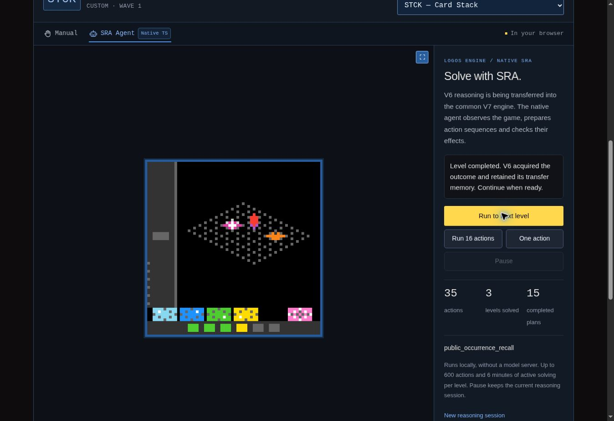

# Composition de programmes observés et STCK, v39

## Résultat obtenu

Le Logos Engine natif réussit **les trois premiers niveaux de STCK · Card Stack
en 35 actions physiques**, depuis une session neuve au niveau 1. La
[campagne de référence de cette étape](native-campaigns-v39/stck-three-levels.json)
atteint sa cible de trois niveaux, avec **15 préfixes acquis**, **deux reprises
de frontière naturelle** et **une seule session de raisonnement**.

| Niveau réussi | Actions du niveau | Total cumulé | Temps actif observé |
| --- | ---: | ---: | ---: |
| 1 | 3 | 3 | 3,795 s |
| 2 | 7 | 10 | 5,807 s |
| 3 | 25 | 35 | 32,937 s |
| Total | 35 | 35 | 42,539 s |

Le jeu termine cette campagne à l'entrée du **niveau 4**, avec
`levelsCompleted = 3` et `state = NOT_FINISHED`. Le coordinateur s'arrête pour
`target_levels_completed`. Le résultat validé porte donc sur les trois premiers
niveaux ; aucune victoire complète `WIN` n'est revendiquée pour STCK.

Le temps total de la campagne est de 62,195 secondes. Ces durées décrivent cet
environnement pendant les vérifications de développement, dont certaines sont
concurrentes. Elles ne constituent pas un benchmark isolé ni une garantie de
durée dans un autre navigateur.

Les **130 fichiers du périmètre natif** restent identiques pendant toute la
campagne. Le digest de leur manifeste est
`67c248a865bcd079855367624a39a53027c92611275e8fd2802c637a2a4e56cf`.
L'implémentation exécutée est
`logos-engine.typescript.v6.native-migration/0.9.0`.

Le harnais utilise le véritable agent du navigateur, son service, le caller
commun, la sélection SRC et la mémoire V7. Chaque action physique est acquise
par le caller et la frontière, puis chaque préfixe est analysé par
**OP29 / OP30 / OP31**. Les seules entrées de l'agent sont les images publiques,
leurs animations complètes, les commandes disponibles, le statut et les
compteurs publics. Aucun contrôle appris, trajet de solution, état privé,
changement de niveau artificiel, reset ou undo n'est injecté. Python héberge
le jeu ; la liste des modules d'agent Python chargés est vide. Ces contrôles
sont consignés dans le rapport de campagne et sa
[trace publique](native-campaigns-v39/stck-public-trace.json.gz).

## Savoir transféré

La référence demeure le dépôt V6 épinglé au commit
`786dcf51ca57773d8e3a8948ce9ea3655e7baf8e`. Ses fichiers Python et ses
déclarations DRM restent inchangés. L'entrée transférée est
**`observed_program_composition`**.

| Capacité | Comportement transféré | Implémentation native principale |
| --- | --- | --- |
| Collection et commandes homologues | Mesurer les membres rectangulaires, les glyphes de contrôle et leurs marques ; proposer une suppression, une insertion ou l'essai de l'unique commande discrète après un effet confirmé | [Observation](../../src/logos-engine/v6-occurrence-program-observer.ts), [accès](../../src/logos-engine/v6-program-composition-access.ts) |
| Géométrie et modèle d'opérations | Relier une édition visible à la représentation extrudée d'un mot ; ajuster une correspondance entre glyphes et déplacements observés dans les phases publiques | [Géométrie](../../src/logos-engine/v6-program-geometry.ts), [composition](../../src/logos-engine/v6-program-compositions.ts) |
| Construction conditionnelle | Préparer un mot à partir des opérations acquises et des surfaces attestées ; recontrôler chaque édition et le retour complet avant de poursuivre | [Composition](../../src/logos-engine/v6-program-compositions.ts), [accès](../../src/logos-engine/v6-program-composition-access.ts) |
| Autres porteurs et ordre des effets | Tester des opérations sur d'autres porteurs visibles, conserver l'ordre observé et comparer quatre hypothèses sur la réduction des mots et la portée des interactions | [Observations des répondants](../../src/logos-engine/v6-program-respondent-observations.ts), [recherche](../../src/logos-engine/v6-program-respondent-search.ts) |
| Accès aux commandes | Acquérir l'apparence d'un support après départ et retour du porteur ; rechercher une apparence correspondante, puis vérifier les commandes réellement revenues | [Supports d'accès](../../src/logos-engine/v6-program-input-access.ts) |
| Refus et continuités | Retenir un refus d'extension dans son contexte exact, conserver les prédictions encore compatibles et arrêter une composition réfutée après son acquisition | [Accès et réconciliation](../../src/logos-engine/v6-program-composition-access.ts), [caller](../../src/logos-engine/v6-native-runtime.ts) |

La campagne commence par trois questions d'édition et d'exécution du premier
niveau. Leur réponse officielle permet d'acquérir un modèle de programme. Les
niveaux suivants réemploient ce modèle tout en mesurant les commandes présentes
et les effets réellement retournés. Le journal final contient notamment
**deux échantillons d'édition**, **deux alignements de phases**, **un modèle de
programme**, **un probe de répondants**, **un modèle d'ordre des répondants**,
**un refus contextuel d'extension** et **un support d'accès aux commandes**.
Les 15 préfixes comprennent trois `marked_collection_edit`, onze
`public_program_composition` et un `public_program_respondent_probe`.

Le modèle acquis comporte trois déplacements observés et un déplacement
extrapolé à partir des glyphes. Cette extrapolation, les réductions sur d'autres
porteurs et l'accès à un support d'apparence correspondante restent des
hypothèses contrôlées. La réussite de chaque niveau est établie par le compteur
officiel du jeu. Aucun nouveau module ne choisit une stratégie à partir d'un
identifiant de jeu, d'une définition de niveau ou d'une palette prescrite.

## Intégration dans le journal commun

Les entrées `cell_patch_composition`, `observed_occurrence_recall` et
`observed_program_composition` conservent leurs positions déclarées dans
`window_constraints`. Elles consultent le même fournisseur
`public_occurrence_recall`, enregistré une seule fois. Les entrées antérieures
de support couplé et de graphe alternant continuent à utiliser ce propriétaire
commun. Le branchement est dans
[`v6-shared-series.ts`](../../src/logos-engine/v6-shared-series.ts).

Les réducteurs des événements de programme existaient déjà dans l'ascendance
retenue de la mémoire de rappel. Cette étape leur ajoute les questions,
contrôles et acquisitions du source. Elle n'introduit pas une seconde mémoire
de programme. L'ordre d'acquisition conserve les couches d'édition, de
composition et de répondants avant le rappel d'occurrences, puis les cellules,
le graphe, les paires et les supports. Le traitement du paquet public suit
cette chaîne : alignement des phases, réconciliation et ajustement du programme,
apprentissage des répondants et des supports d'accès, puis observation du
paquet des cellules.

Les contrôles suivent la priorité de l'héritage transféré : support, paire,
graphe, cellule, occurrence, puis programme et collection. Un point est lié à
l'époque, l'observation, l'image, la valeur de palette et la projection publique
qui le supportent. Les étapes suivantes recontrôlent les membres, les
opérandes, les glyphes et les commandes disponibles avant leur exécution.
Les refus du module de programme sont lus après l'acquisition du préfixe
scellé ; la réussite officielle garde sa priorité.

La mémoire continue à employer les checkpoints immuables et les contrôles de
révision existants. Une modification du réducteur ou du journal impose une
reconstruction vérifiée. Les caches bornés et la conservation des sous-arbres
déjà possédés restent en place. La portée déclarée du digest devient
`native_observed_program_recall_cell_placement_alternating_graph_and_coupled_support_v6`.
Elle décrit cette fermeture transférée ; les autres planificateurs de
l'héritage original restent qualifiés séparément dans l'audit de migration.

### Identités Python des nombres flottants

L'ajustement des glyphes produit en Python une matrice et un centre flottants,
y compris lorsque leurs valeurs sont entières. `2.0` et `2` ne produisent pas
la même représentation JSON ni le même identifiant source. Le nouveau
[`v6-program-identity.ts`](../../src/logos-engine/v6-program-identity.ts)
préserve cette représentation dans les champs typés du modèle de glyphes,
ainsi que dans les modèles, plans et événements qui les contiennent.

Ce traitement est limité à la grammaire du programme ; il ne change pas
l'encodage symbolique général. Le stockage natif conserve ses nombres finis
IEEE-754. Les tests comparent les identifiants et digests Python complets,
avec valeurs fractionnaires, zéro signé et notations décimales ou
scientifiques.

## Collision du caller original et évolution explicite du coordinateur natif

Le premier transfert mécanique réussissait le niveau 1, puis rencontrait une
collision de priorité au niveau 2 : une croix visible suscitait une question
`animated_contact`, alors qu'un programme acquis proposait déjà une préparation
liée aux commandes courantes. L'invitation ne produisait aucun effet, puis son
refus de continuation bloquait les autres familles. Le
[premier essai natif](native-campaigns-v39/diagnostics/stck-first-pass.json)
s'arrêtait ainsi pour `frontier_unknown` après quatre actions.

Le **caller Python original complet et inchangé** a été exécuté séparément
sur ces mêmes paquets publics. Les réponses lui ont été retournées uniquement
lorsque sa commande correspondait exactement à la commande enregistrée. Ses
quatre commandes concordent et son résultat est identique : trois actions
pour réussir le niveau 1, une invitation sans effet au niveau 2, puis
`frontier_unknown`. Le
[diagnostic de collision](native-campaigns-v39/diagnostics/stck-original-caller-collision.json)
conserve les hashes, propositions et vérifications de source ; le
[rapport original](native-campaigns-v39/diagnostics/stck-original-caller-report.json.gz)
et la [trace du caller](native-campaigns-v39/diagnostics/stck-original-caller-oracle.json.gz)
permettent d'en examiner les détails.

La version native ajoute donc une règle de coordination distincte du transfert
des modules Python : **une préparation appuyée sur un modèle de programme acquis
et admise par son contrôle courant peut différer une invitation animée encore
sans effet appris**. Le coordinateur ne remplace pas le résultat par une
proposition artificielle de but. Il laisse la sélection SRC atteindre l'entrée
ordinaire `observed_program_composition` de `window_constraints`.

La proposition examinée est conservée uniquement pour le passage de sélection
courant, afin d'éviter une seconde recherche. Aucun effet n'est acquis pendant
cette anticipation. La règle s'applique aux programmes et probes portant un
modèle conditionnel acquis, avec preuves et contrôle avant action admis ; une
simple édition de collection n'obtient pas cette priorité. Un échec du contrôle,
l'absence de modèle ou un contact animé déjà appris conservent la priorité
antérieure. Les autres refus bloquants du source demeurent appliqués.

La décision est rendue visible dans `strategy_receipt.native_coordination`,
sous la règle `retained_program_preparation_before_unlearned_invitation`, avec
l'observation, les deux propositions, le modèle et la raison d'admission.
Sa portée indique expressément qu'il s'agit d'une extension native. L'ordre
DRM et les sources de référence sont inchangés. Les résultats de cette étape
ne constituent donc pas une revendication de parité globale des décisions du
caller avec le Python original.

## Vérification différentielle et intégration

L'[exporteur de référence](../../scripts/export-v6-program-composition-reference.py)
exécute les fonctions originales et vérifie **823 fichiers source importés**
contre le manifeste conservé. Ses scènes contrôlées servent aux contrats ;
elles sont distinctes des campagnes de jeu. La fixture inclut également les
trois premières commandes et les paquets publics réels de STCK, soit le premier
niveau, avec leur provenance explicite.

Les **233 nouveaux tests ciblés** se répartissent ainsi :

| Groupe | Tests réussis | Portée |
| --- | ---: | --- |
| [Parité des programmes](../../tests/v6-program-composition-parity.test.ts) | 225 | Géométrie, calculs conditionnels, propositions complètes, contrôles, liaison des points, événements, journaux communs originaux, digests et restauration |
| [Intégration du caller](../../tests/v6-program-composition-integration.test.ts) | 3 | Démarrage sans modèle, sélection SRC, WHY/ACT, acquisition unique et ordre des arrêts après préfixe scellé |
| [Priorité native](../../tests/v6-program-priority.test.ts) | 5 | Collision originale, préparation acquise, absence de modèle, veto du contrôle courant et maintien d'un contact déjà appris |

Les comparaisons couvrent notamment les échéances et budgets, l'absence d'une
commande, une modification de glyphe, un contexte ou un support changé, la
réfutation d'une édition, le retour complet, le refus exact d'extension et les
hypothèses concurrentes de répondants. Les tests de priorité commencent par
une acquisition publique réelle ou qualifient explicitement leurs états
contrôlés. Ils ne sont pas présentés comme des victoires supplémentaires.

La suite complète confirmée comporte **3 410 tests réussis dans 71 fichiers**,
avec zéro échec, annulation, test ignoré ou tâche différée. Sa durée observée
est de 204,912 secondes. Le [manifeste de validation](native-campaigns-v39/validation.json)
relie ces résultats aux versions exactes des sources, fixtures et tests utilisés,
ainsi qu'aux sorties de commande conservées. La vérification TypeScript et le
build ont réussi ; le build inclut également `tsc` et termine avec le code 0.
Les 130 fichiers source conservent après build le même digest que les cinq
campagnes. Les ressources de jeu construites correspondent exactement à celles
utilisées pendant ces campagnes.

## Comparaison avec v38 et préservation des résultats antérieurs

La [campagne STCK sous v38](native-campaigns-v39/stck-v38-baseline.json),
exécutée avec les sources précédentes inchangées, termine avec **110 actions et
zéro niveau réussi**, par épuisement du budget actif du premier niveau.
La nouvelle campagne atteint trois niveaux en 35 actions. Cette comparaison
établit le progrès observé en niveaux et en actions ; les durées des deux
exécutions ne sont pas utilisées comme ratio de performance.

Les quatre campagnes de régression de v39 ont également terminé leur cible :

| Jeu | Périmètre rejoué | Actions par niveau | Total | Résultat |
| --- | --- | --- | ---: | --- |
| [TICT](native-campaigns-v39/tict-six-levels.json) | Six niveaux | 3 / 12 / 7 / 7 / 12 / 14 | 55 | `WIN` |
| [HANO](native-campaigns-v39/hano-four-levels.json) | Quatre niveaux | 6 / 10 / 14 / 30 | 60 | `WIN` |
| [ELAS](native-campaigns-v39/elas-three-levels.json) | Trois premiers niveaux | 2 / 9 / 22 | 33 | Trois niveaux réussis, entrée au niveau 4 |
| [TU93](native-campaigns-v39/tu93-three-levels.json) | Trois premiers niveaux | 32 / 10 / 25 | 67 | Trois niveaux réussis, entrée au niveau 4 |

Les comparaisons confirmées de [TICT](native-campaigns-v39/tict-comparison.json)
et [HANO](native-campaigns-v39/hano-comparison.json), ainsi que
[ELAS](native-campaigns-v39/elas-comparison.json) et
[TU93](native-campaigns-v39/tu93-comparison.json), avec v38 passent chacune
**onze contrôles, soit 44 contrôles réussis** : commandes, hashes des paquets publics complets, frontières
primitives, descriptions des préfixes, acquisitions et projections antérieures
concordent. Les projections nouvellement ajoutées pour les programmes restent
vides. Les digests de portée étendue et les révisions de graphe ne sont pas
présentés comme identiques ; les références d'observation sont normalisées dans
les comparaisons qui le requièrent. Aucun résultat temporel n'est déduit de ces
contrôles.

### Vérification dans l'interface

La [vérification dans le navigateur](native-campaigns-v39/browser-verification.json)
est terminée sur la prévisualisation du même checkout figé, avec le mode
**SRA Agent Native TS**. Depuis le niveau 1 et zéro action, trois utilisations
successives de **Run to next level** ont atteint les frontières naturelles aux
compteurs cumulés **3, 10 et 35 actions**. L'interface confirme **trois niveaux
réussis et quinze plans terminés**, avec le niveau 4 dans l'URL. La session
conserve sa mémoire entre ces frontières.

L'inspection est restée fermée. Aucune action manuelle sur le jeu, aucune
réinitialisation de session et aucun saut de niveau n'ont été effectués. Ce
contrôle établit le résultat dans l'interface de prévisualisation ; la
publication du site est une opération séparée. Aucun message de victoire
complète n'est revendiqué pour STCK.

## Limite au niveau 4 et prochaine étape

Un [essai distinct visant les six niveaux](native-campaigns-v39/diagnostics/stck-six-level-attempt.json)
a également réussi les trois premiers en 35 actions. Il a ensuite effectué une
invitation supplémentaire au niveau 4, sans changement de pixels, puis s'est
arrêté pour `frontier_unknown` avec **36 actions et trois niveaux réussis**.
Son statut `failed` décrit sa cible de six niveaux non atteinte. La campagne
canonique à cible trois a été relancée depuis le début et a réussi séparément.

Le [diagnostic public du niveau 4](native-campaigns-v39/diagnostics/stck-level-four-program-diagnosis.json)
rejoue hors ligne les 35 premières commandes avec les propositions et contrôles
du module Python original, puis compare chaque acquisition et digest au natif.
Il ne déclenche aucune nouvelle action physique. À l'entrée naturelle du
niveau 4, le modèle conserve **cinq glyphes de contrôle**, mais seulement
**quatre sont encore présents** et correspondent exactement à leurs images
retenues. L'ancien emplacement du cinquième ne contient plus que le fond.

La fonction `editor` originale exige une correspondance unique pour chacun
des glyphes retenus. Elle retourne donc `None`, comme `programEditor` dans le
transfert TypeScript. Le programme décline avant la liaison d'un membre et
avant toute recherche. Ce constat distingue le problème d'une échéance de
calcul ou d'un simple budget d'actions.

La prochaine capacité à développer est la **revalidation d'un éditeur dont
l'ensemble de commandes a changé** : distinguer les opérateurs retenus de ceux
qui sont actuellement accessibles, limiter les éditions et recherches aux
commandes réellement validées, puis acquérir les nouveaux effets. Accepter
quatre contrôles sur cinq sans ces obligations ne démontrerait pas la résolution
du niveau 4. Aucun succès sur les niveaux 4 à 6 n'est établi par cette étape.

## Portée de la migration

L'[audit des entrées déclarées](v6-entry-point-progress.json) compte désormais
**31 entrées connectées sur 76, soit 40,8 %**, contre 30 sur 76 en v38. Il compte
des entrées DRM de même poids ; il ne mesure ni la proportion de code transféré,
ni un score ARC, ni une parité complète de V6.

L'[audit des modules](v6-coverage.json) conserve 1 369 modules Python dans son
périmètre : **88 vérifiés au niveau composant**, **59 partiellement transférés**
et **1 222 en attente**. Aucun module n'est qualifié de transfert globalement
vérifié. Les portes de complétude et `fullV6Parity` restent fausses. Le transfert
des contrats de programme, son acquisition dans le caller commun et la réussite
des trois premiers niveaux de STCK sont les résultats établis de cette version.
