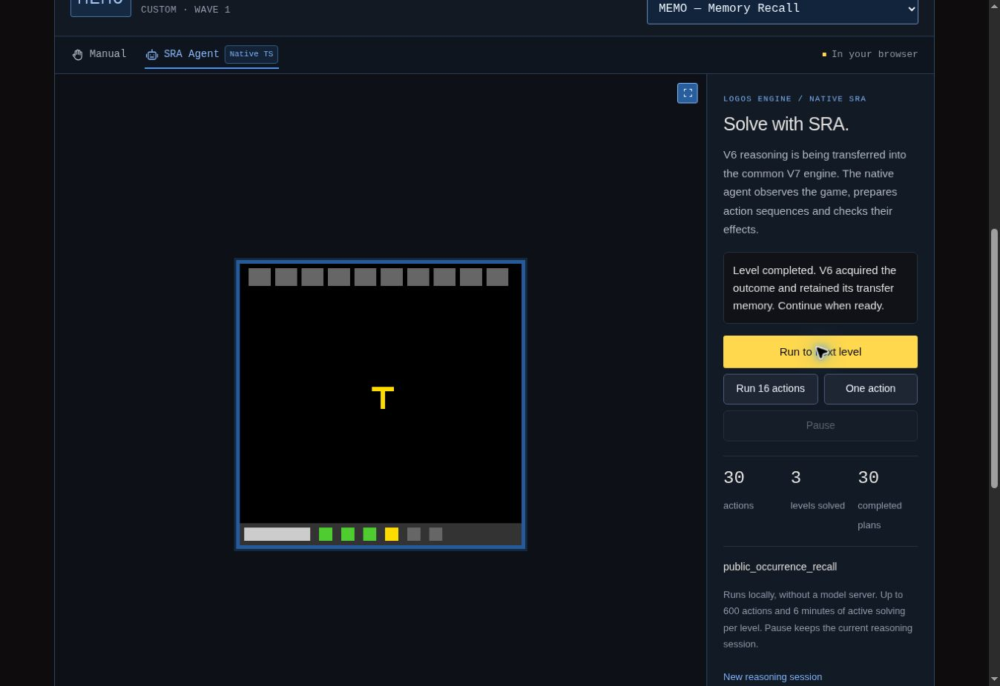

# Préparations acquises, accès courant et MEMO, v40

## Nouveau résultat : les trois premiers niveaux de MEMO

Le Logos Engine natif réussit **les trois premiers niveaux de MEMO · Memory
Recall en 30 actions physiques**, depuis une session neuve au niveau 1. La
[campagne de référence](native-campaigns-v40/memo-three-levels.json) atteint la
cible demandée, avec **10 actions par niveau**, **30 préfixes acquis**, **deux
reprises de frontière naturelle** et **une seule session de raisonnement**.

| Niveau réussi | Actions du niveau | Total cumulé | Temps actif observé |
| --- | ---: | ---: | ---: |
| 1 | 10 | 10 | 9,955 s |
| 2 | 10 | 20 | 12,769 s |
| 3 | 10 | 30 | 16,460 s |
| Total | 30 | 30 | 39,184 s |

La campagne se termine à l'entrée du **niveau 4**, avec
`levelsCompleted = 3`, `state = NOT_FINISHED` et l'arrêt
`target_levels_completed`. Aucun succès sur les niveaux suivants ni victoire
complète `WIN` de MEMO n'est établi ici. Le temps total observé est de
45,241 secondes. Les durées décrivent cette exécution, pendant des vérifications
de développement parfois concurrentes ; elles ne sont pas un benchmark isolé.

L'implémentation exécutée est
`logos-engine.typescript.v6.native-migration/0.10.0`. Ses **132 fichiers du
périmètre natif restent figés pendant la campagne**, sous le digest
`964d11fd1f5d571e32120beca763bd1db4c46618a08ede217ebfb19ea758cb01`.
La version précédente du site est le commit
`e8fee1052d0462a0b44482502a034e1f4a0b2f0f`. La référence Python V6 reste épinglée
au commit `786dcf51ca57773d8e3a8948ce9ea3655e7baf8e`.

Le harnais utilise l'agent de production, son service, le caller commun, la
sélection SRC et le stockage V7. Les 30 actions sont acquises par le caller ;
les 30 préfixes passent par **OP29 / OP30 / OP31**. La
[trace publique](native-campaigns-v40/memo-public-trace.json.gz) conserve les
commandes et les paquets retournés, dont leurs animations. Elle est une sortie
de preuve, pas une entrée donnant la solution à l'agent. Les entrées de
raisonnement sont les images, les actions disponibles, le statut et les
compteurs publics. Python héberge le jeu ; **aucun module d'agent Python n'est
chargé**. Aucune mémoire apprise, suite de coups ou transition de niveau
artificielle n'est injectée dans cette campagne.

## Ce qui bloquait MEMO avant cette étape

La [baseline froide exécutée sous v39](native-campaigns-v40/memo-v39-baseline.json)
s'arrête au niveau 1 pour `frontier_unknown`, après **sept actions et zéro
niveau réussi**. Elle utilise les 130 fichiers natifs de v39 inchangés,
le même paquet public initial, les mêmes ressources de jeu et les mêmes budgets
que la campagne v40.

Les six premières commandes et les hashes de leurs paquets publics complets
sont identiques entre les deux campagnes. La divergence intervient à la
septième décision : v39 choisit une invitation de la famille `animated_contact`,
tandis que v40 laisse passer une correspondance déjà acquise par le rappel
d'occurrences. Le changement est donc localisable dans les preuves de
sélection ; il ne résulte pas d'un autre départ ou d'une mémoire préchargée.

Cette collision était déjà documentée dans
[l'étape v32](v32-support-recall-delta.md) et sa
[comparaison au caller Python original](native-campaigns-v32/memo-original-comparison.json).
Le caller original complet, exécuté sans modification, choisissait lui aussi
l'invitation à la septième action, puis s'arrêtait sans niveau réussi. Les
31 vérifications de cette preuve historique comparent notamment les commandes,
la proposition animée, la sélection et l'acquisition correspondante. La famille
isolée de rappel proposait pourtant une autre occurrence à partir de ses
observations précédentes. Sa trajectoire isolée ne constituait pas une victoire
du caller intégré.

L'[audit public de préparation](native-campaigns-v40/diagnostics/public-preparation-audit.json)
explicite cette distinction. À la septième décision, quatre hypothèses de
correspondance qualifiées convergent vers la même occurrence courante. Elles
sont chacune soutenues par quatre transitions publiques, sans contre-exemple
sur ces soutiens. Le seuil source pour ce contexte à plusieurs antécédents est
de deux observations uniques ; v40 conserve ce seuil. Les hypothèses rivales
déjà réfutées restent enregistrées et ne sont pas comptées comme des soutiens.

### Continuité avec le composant original de rappel

La [comparaison indépendante de la trajectoire](native-campaigns-v40/memo-original-component-comparison.json)
relie la campagne intégrée v40 à la fixture historique du composant original
isolé. Les **30 commandes**, les **31 rasters canoniques** et les **118 images
d'animation contenues dans 31 paquets** concordent exactement, ainsi que les
frontières officielles aux actions 10, 20 et 30. Les 15 fichiers source déclarés
par cette fixture correspondent à leurs hashes et au manifeste de la référence.

La comparaison conserve une différence de domaine public : la fixture
historique expose `ACTION6`, alors que la campagne expose `ACTION6` et `ACTION7`.
Les 31 paquets bruts diffèrent sur ce seul champ ; aucun n'est déclaré
intégralement identique. La projection de comparaison se limite au domaine
d'actions historique. Aucun `ACTION7` n'est exécuté et aucun pixel, commande,
ordre d'animation ou score n'est normalisé.

Il s'agit d'une comparaison hors ligne d'éléments déjà enregistrés, sans
régénération de fixture, nouvelle exécution Python ni nouvelle action de jeu.
Elle établit la conservation du mécanisme de rappel sur cette trajectoire.
La sélection effective de ces propositions par le caller complet reste
l'amélioration native documentée ci-dessous.

## Une priorité générique fondée sur des preuves acquises

La v39 avait introduit une priorité conditionnelle pour les préparations de
programme. La v40 généralise cette règle aux **préparations dont le fournisseur
peut justifier la connaissance déjà acquise**, en distinguant deux contrats :

| Préparation | Justification exigée dans la mémoire retenue | Conditions courantes |
| --- | --- | --- |
| Programme ou expérience sur un autre porteur | Modèle conditionnel réellement acquis, identique à celui du plan, avec références de preuve ; époque non réfutée | Plan lié à l'observation et à l'époque, puis contrôle avant action admis |
| Rappel d'occurrence | Modèles atteignant les seuils source, preuves présentes, aucun contre-exemple pour les modèles qualifiés ; leurs prédictions uniques convergent vers l'occurrence choisie | Antécédent actif, configuration et contexte identiques à la mémoire ; candidats recalculés dans la scène actuelle, puis contrôle avant action admis |

Le contrat est implémenté dans
[`v6-learned-preparation.ts`](../../src/logos-engine/v6-learned-preparation.ts).
Il ne fait pas confiance à une liste de modèles ou à des compteurs inscrits
dans une proposition. Il retrouve les modèles dans la mémoire du fournisseur,
vérifie les preuves et recalcule les candidats courants. Une proposition ancienne
ne crée donc pas sa propre connaissance lorsqu'elle est présentée à une mémoire
vide. Une divergence entre hypothèses encore qualifiées refuse la priorité.
Les nouvelles règles ne sélectionnent pas un comportement par nom de jeu ou
numéro de niveau ; l'époque sert à borner les preuves et la liaison courante.

Le [coordinateur natif](../../src/logos-engine/v6-native-runtime.ts) applique
la règle uniquement à une **invitation animée sans effet appris**. Il examine
les entrées de `window_constraints` dans leur ordre déclaré et s'arrête au
premier choix ordinaire. Si ce choix est encore exploratoire, inconnu, dépourvu
de preuve ou rejeté par son contrôle courant, un candidat appris plus tardif
ne peut pas lui prêter sa priorité. Un fournisseur ne proposant pas ce contrat
de preuve conserve également son ordre ordinaire. Les contacts animés dont
l'effet est déjà appris gardent leur traitement précédent.

Lorsqu'une préparation admissible est trouvée, l'invitation est différée et la
sélection SRC atteint l'entrée ordinaire de la préparation. Les déclarations
DRM et l'ordre des familles ne sont pas réécrits. La proposition est conservée
pour ce seul passage de sélection afin de ne pas lancer deux fois sa recherche.
L'anticipation et la construction du témoin ne créent aucune observation ni
mutation de la mémoire acquise.

La nouvelle règle est rendue visible sous le nom
`retained_learned_preparation_before_unlearned_invitation`. Le reçu
`strategy_receipt.native_coordination` contient l'observation, les identifiants
des deux propositions, le témoin de connaissance, les références de preuve,
la raison du contrôle et la référence au nœud
`family_state:public_occurrence_recall`, avec sa révision réellement lue.
La trace conserve la même décision de coordination.

**Ce témoin justifie une priorité de question ; il n'autorise pas une action.**
La liaison du point, le domaine d'actions actuellement disponibles, les
obligations de préservation et le passage ordinaire par WHY/ACT restent requis.
Le résultat doit ensuite être acquis. Seul le statut officiel du jeu établit
la réussite d'un niveau.

La campagne MEMO comporte **sept reports d'invitation** ainsi justifiés. Tous
ses préfixes exécutés restent des propositions `public_occurrence_recall`.
Elle n'acquiert aucun modèle de programme et n'utilise pas la revalidation
d'éditeur décrite ci-dessous. La nouvelle réussite découle de la coordination
du savoir de rappel déjà transféré.

Cette coordination est une **évolution native explicitement distincte de la
sélection du Python original**. Les fonctions source de rappel et leurs
seuils restent inchangés. La victoire sur trois niveaux ne devient pas une
revendication de parité globale du caller avec toutes les décisions originales.

## STCK : séparer les opérateurs connus des commandes accessibles

Le [diagnostic du niveau 4 conservé en v39](native-campaigns-v39/diagnostics/stck-level-four-program-diagnosis.json)
avait établi une limite précise : le modèle retenait cinq glyphes de contrôle,
mais seulement quatre étaient encore visibles. La fonction `programEditor`
transférée exigeait tous les glyphes et refusait la liaison avant toute
recherche. La v40 conserve cette fonction pour les contrats source et ajoute
une **revalidation native explicite de l'accès courant**, activée par le wrapper
commun avec `currentProgramAccess: true`.

Le nouveau module
[`v6-program-current-access.ts`](../../src/logos-engine/v6-program-current-access.ts)
sépare les faits suivants :

| Fait retenu ou mesuré | Utilisation permise | Limite conservée |
| --- | --- | --- |
| Opérateur acquis et son effet conditionnel | Lire et simuler cet opérateur dans un mot déjà présent, y compris sur un autre porteur | L'absence de son bouton ne réfute pas l'opérateur et ne prouve pas qu'il reste insérable |
| Glyphe appris retrouvé exactement dans l'image courante | Proposer une insertion depuis ce contrôle, après liaison du point et contrôle avant action | Un ancien emplacement ou une ressemblance partielle ne donne pas l'accès |
| Contrôle appris absent | Retenir l'absence d'accès actuellement attesté et sa projection publique | Aucune cause de disparition ni sémantique de remplacement n'est déduite |
| Nouvelle apparence sur la rangée | Conserver sa forme, sa position et son statut non attribué | Aucun rôle d'opérateur ne lui est assigné sans observation d'effet |

L'appariement utilise les composants publics, la couleur et le patch complet
des glyphes. Les correspondances doivent être uniques et compatibles avec une
même translation de l'éditeur. Les trous intérieurs sont possibles ; aucun
nombre fixe de quatre ou cinq commandes n'est codé. Une duplication, des
translations incompatibles ou un glyphe de couleur connue modifié provoquent
un refus. La géométrie des membres reste une hypothèse conditionnelle héritée
de l'éditeur appris.

La preuve `current_program_access` porte l'identité et le digest du modèle
complet, les correspondances de glyphes, les coordonnées actuelles, les labels
insérables, les absences, les apparences non attribuées et la géométrie retenue.
Elle figure dans le plan. Avant chaque action, le guard recontrôle cette preuve
et le layout effectivement utilisé. Une édition attendue de la collection peut
changer les membres ; elle ne peut pas changer silencieusement les contrôles.
L'apparition d'un contrôle précédemment absent impose aussi une nouvelle
planification.

Les [recherches de composition](../../src/logos-engine/v6-program-compositions.ts)
et de [répondants](../../src/logos-engine/v6-program-respondent-search.ts)
limitent **seulement les nouvelles insertions** aux commandes attestées.
Le modèle, la palette des mots et les opérateurs déjà présents restent complets.
Les simulations, objectifs, quatre hypothèses de répondants et conditions de
réconciliation ne sont pas affaiblis. Les continuations conservent leur preuve
d'accès et se reconstruisent depuis le journal commun. La voie source par défaut
n'active pas implicitement cette extension en restaurant une continuation native.

### Ce que la nouvelle tentative de STCK établit

L'[essai frais visant les six niveaux](native-campaigns-v40/diagnostics/stck-current-access-six-level-attempt.json)
réussit les trois premiers en **35 actions**, toujours réparties en
**3 / 7 / 25**, puis s'arrête au niveau 4 pour `frontier_unknown` avec
**37 actions au total**. Sa cible de six niveaux n'est donc pas atteinte.
Sa [trace publique](native-campaigns-v40/diagnostics/stck-current-access-public.json.gz)
conserve les deux actions supplémentaires et leurs réponses.

L'action 36 réalise la liaison d'un membre avec un contrôle actuellement
attesté. Le reçu porte la preuve de quatre commandes accessibles sur cinq
opérateurs connus. L'action 37 est une invitation animée, sans changement
d'image, suivie de l'arrêt. La liaison partielle est ainsi démontrée dans le
véritable caller ; elle ne résout pas le niveau.

Le contrôle absent correspond précisément à l'opérateur de réduction
conditionnelle. Il reste connu et présent dans le mot d'un autre porteur, mais
il ne figure ni dans le mot propre retenu après la liaison ni dans les nouvelles
insertions possibles. Dans le simulateur de cibles stationnaires, aucune des
translations restantes ne peut réduire ces mots. La recherche native peut donc
retourner `unknown`, avec
`no_insertable_or_retained_reduction_operator` et **zéro nœud énuméré**, sans
consommer le budget à explorer cette grammaire. Cette déduction est limitée au
simulateur courant ; elle ne prouve pas l'impossibilité du jeu et n'est pas
appliquée aux répondants mobiles.

Une apparence supplémentaire de la rangée est conservée comme non attribuée.
La prochaine capacité utile serait d'en acquérir l'effet publiquement, puis de
réévaluer les hypothèses de commande et de but. Le changement d'accès ne permet
pas de lui attribuer directement le rôle de l'ancien contrôle. Aucun succès
sur les niveaux 4 à 6 de STCK n'est établi par cette version.

## Vérifications et régressions

Les **45 nouveaux tests ciblés** se répartissent dans trois fichiers :

| Groupe | Tests réussis | Portée |
| --- | ---: | --- |
| [Revalidation de l'accès](../../tests/v6-program-current-access.test.ts) | 18 | Correspondances complètes et partielles, trous, translations, quantités variables, commandes inconnues, ambiguïtés, intégrité du modèle et de la preuve |
| [Intégration de l'accès](../../tests/v6-program-current-access-integration.test.ts) | 7 | Contrats source inchangés, vraie observation publique de L4, guards, conservation des opérateurs, continuation et checkpoint, filtre d'insertion et refus démontré de recherche |
| [Priorité des préparations acquises](../../tests/v6-learned-preparation-priority.test.ts) | 20 | Acquisition froide, ordre SRC, preuve liée au graphe, absence de savoir, veto courant, absence de prêt de priorité, preuves insuffisantes ou incohérentes, invariance par transformation de scène |

Les **225 comparaisons de parité des programmes avec la référence Python**
restent réussies avec le comportement source par défaut. Les tests contrôlés
examinent les contrats et les refus ; ils sont distincts des campagnes de jeu.
En particulier, la relecture d'un paquet L4 conservé n'est pas comptée comme
une nouvelle action physique ni une victoire.

La **suite complète réussit ses 3 455 tests dans 74 fichiers**, avec le code de
sortie 0, en 220,605 secondes, sans échec, annulation, test ignoré ni tâche
différée. Le [manifeste de validation](native-campaigns-v40/validation.json)
relie les versions exactes des sources, tests, fixtures et preuves aux sorties
de commande conservées. La vérification TypeScript et le build réussissent ;
le build inclut lui aussi le contrôle TypeScript et termine avec le code 0.
Les 132 fichiers source conservent après build le même digest que les six
campagnes réussies. Les ressources de jeu de `public/python` et de
`dist/python` correspondent exactement aux ressources utilisées par ces
campagnes.

Les cinq campagnes précédemment réussies ont toutes conservé leur résultat :

| Jeu | Périmètre rejoué | Actions par niveau | Total | Résultat | Comparaison avec v39 |
| --- | --- | --- | ---: | --- | --- |
| [TICT](native-campaigns-v40/tict-six-levels.json) | Six niveaux | 3 / 12 / 7 / 7 / 12 / 14 | 55 | `WIN` | [12 / 12](native-campaigns-v40/tict-comparison.json) |
| [HANO](native-campaigns-v40/hano-four-levels.json) | Quatre niveaux | 6 / 10 / 14 / 30 | 60 | `WIN` | [12 / 12](native-campaigns-v40/hano-comparison.json) |
| [ELAS](native-campaigns-v40/elas-three-levels.json) | Trois premiers niveaux | 2 / 9 / 22 | 33 | Trois niveaux réussis, entrée au niveau 4 | [12 / 12](native-campaigns-v40/elas-comparison.json) |
| [TU93](native-campaigns-v40/tu93-three-levels.json) | Trois premiers niveaux | 32 / 10 / 25 | 67 | Trois niveaux réussis, entrée au niveau 4 | [12 / 12](native-campaigns-v40/tu93-comparison.json) |
| [STCK](native-campaigns-v40/stck-three-levels.json) | Trois premiers niveaux | 3 / 7 / 25 | 35 | Trois niveaux réussis, entrée au niveau 4 | [12 / 12](native-campaigns-v40/stck-comparison.json) |

Ces **60 contrôles réussis** portent au total sur 250 commandes, 255 paquets
publics complets et 134 préfixes. La campagne STCK à cible trois est distincte
de l'essai à cible six documenté plus haut.

Le [comparateur v40](../../scripts/compare-v40-regressions.mjs) applique douze
contrôles par campagne précédente réussie : budgets et ressources, paquet
initial, commandes et hashes des paquets publics complets, frontières des
primitives, préfixes, acquisitions, projections communes, occasions de report,
résultats de requête et état final. Il vérifie également que l'accès partiel
n'est pas nécessaire dans ces anciens préfixes réussis.

Sa portée est délimitée : les noms de session sont normalisés ; les identifiants
hashés de modèles de programme dépendant de ces sessions sont exclus, tandis
que leurs époques d'acquisition, preuves normalisées et comptes d'opérateurs
observés ou inférés restent comparés. Les chaînes et révisions de graphe, ainsi
que les digests hérités, sont exclus. Les reports déjà présents sont comparés
après le renommage explicite de la règle ; le nouveau témoin de connaissance
est vérifié séparément par les tests d'intégration. Les durées sont exclues.
Ces contrôles ne constituent donc ni une parité intégrale de l'état interne,
ni une comparaison de vitesse.

### Vérification dans le navigateur

La [vérification de MEMO dans le navigateur](native-campaigns-v40/browser-verification.json)
est terminée sur la prévisualisation du même checkout figé, en mode
**SRA Agent Native TS**. Le départ était neuf, au niveau 1, avec zéro action et
zéro niveau réussi. Trois utilisations successives de **Run to next level** ont
atteint les frontières naturelles aux compteurs cumulés **10, 20 et 30 actions**.
L'interface confirme **trois niveaux réussis, trente plans terminés** et l'entrée
au niveau 4. Le message de fin de niveau indique que le résultat est acquis et
que la session conserve sa mémoire pour la suite.

L'inspection est restée fermée. Aucune action manuelle sur le jeu, aucune
réinitialisation de session et aucun saut de niveau n'ont été effectués.
Cette preuve établit le résultat dans l'interface de prévisualisation ; la
publication du site est vérifiée séparément. Aucun message de victoire complète
de MEMO n'est revendiqué.

## Portée des graphes et du transfert

Le savoir acquis, les preuves de transition et les checkpoints demeurent dans
le stockage V7 faisant autorité. Le reçu de priorité référence sa véritable
révision de mémoire. Les programmes SRC enregistrés sont relus depuis leurs
nœuds au moment de l'exécution ; le
[stockage natif](../../src/logos-engine/v6-knowledge-store.ts) vérifie les
modules, les révisions et la chaîne de modifications. Les contrôles usuels de
WHY/ACT et de liaison du point continuent à décider si une commande peut être
émise.

Les fonctions de mesure, de recherche et de construction des nouveaux témoins
restent cependant des **primitives TypeScript appelées par ces programmes**.
La règle de coordination décrite ici se trouve dans le runtime TypeScript.
Une preuve représentée dans le graphe n'implique pas que l'intégralité de
l'algorithme qui la produit est un programme de graphe modifiable. La porte
`commonGraphEditingCoversExecutedPrograms` reste fausse. Cette version ne
revendique donc pas un transfert intégral de tous les calculs V6 vers des
programmes déclaratifs éditables.

L'[audit des entrées](v6-entry-point-progress.json) reste à **31 entrées
connectées sur 76, soit 40,8 %**. La v40 ajoute une coordination et une
revalidation natives ; elle ne crée pas artificiellement une nouvelle entrée
DRM transférée. Ce taux compte des entrées déclarées de même poids, pas une
proportion de code, un score ARC ou une garantie de réussite.

L'[audit des modules](v6-coverage.json) conserve **88 modules vérifiés au niveau
composant**, **59 partiellement transférés** et **1 222 en attente**, sur
1 369 modules Python. Aucun module n'est qualifié de transfert globalement
vérifié. Les portes de complétude et `fullV6Parity` demeurent fausses. Le nouveau
résultat établi est la réussite intégrée des trois premiers niveaux de MEMO,
avec une coordination acquise explicite et une limite de STCK désormais
distinguée entre accès aux commandes et capacité de résolution.
