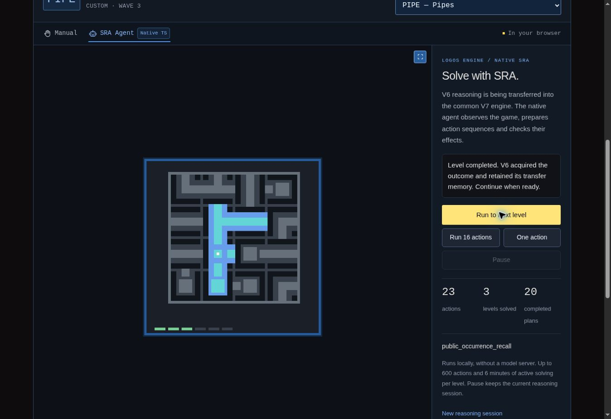

# Ports radiaux, découverte de contrôles et PIPE, v41

## Nouveau résultat : les trois premiers niveaux de PIPE

Le Logos Engine natif réussit **les trois premiers niveaux de PIPE · Pipes en
23 actions**, dans une partie froide et continue. La
[campagne canonique](native-campaigns-v41/pipe-three-levels.json) utilise le
caller commun, les programmes SRC, WHY/ACT et le graphe Kernel ordinaires.

| Niveau terminé | Actions du niveau | Total cumulé |
|---|---:|---:|
| 1 | 4 | 4 |
| 2 | 8 | 12 |
| 3 | 11 | 23 |

La campagne s'arrête à son objectif déclaré, à l'entrée du niveau 4, avec
`NOT_FINISHED`. Il s'agit de trois niveaux réussis ; une victoire complète
`WIN` n'est pas établie. Les 23 transitions sont acquises dans une seule
session, au sein de 20 préfixes, avec deux reprises de frontière naturelle.
Il n'y a ni saut de niveau, ni réinitialisation de mémoire, ni action manuelle.

L'implémentation est `logos-engine.typescript.v6.native-migration/0.11.0`.
Ses **135 fichiers natifs** sont inchangés pendant toutes les campagnes
canoniques. Leur manifeste porte le digest :

`377300aa01f2c942b6150033c61520a7c62292871ee62083ec6b78dde1fc6605`

Aucun module d'agent Python n'est chargé. Le moteur de jeu Python reste un
hôte opaque, exposant ses observations et actions publiques. Le temps observé
de cette campagne est de 30,793 secondes, dont 24,861 secondes d'activité
agent. Ces valeurs proviennent d'un seul essai sur une machine partagée ;
elles ne constituent pas un benchmark de vitesse.

La [trace publique complète](native-campaigns-v41/pipe-public-trace.json.gz)
conserve les commandes, images, animations et frontières officielles. C'est
une sortie de preuve de l'exécution, jamais une entrée du solveur.

## Ce qui a été transféré

L'entrée déclarée `radial_port_composition` est maintenant raccordée à sa
place dans `window_constraints`. Elle s'appuie sur :

- [la mesure des interfaces radiales](../../src/logos-engine/v6-radial-port-observation.ts) ;
- [les questions, acquisitions et gardes de ports](../../src/logos-engine/v6-radial-port-access.ts) ;
- le composant d'assemblage de ports déjà transféré ;
- [le journal partagé réel](../../src/logos-engine/v6-shared-series.ts),
  détenu par `family_state:public_occurrence_recall` dans le Kernel.

Le mécanisme mesure des supports répétés et leurs connexions, émet une
expérience de pointage, puis apprend une rotation uniquement lorsqu'un retour
public atteste une sélection unique et un effet compatible. L'assemblage
recherche une composition fermée, connectée et sans cycle sous hypothèse.
La signification terminale de cet assemblage reste distincte de la règle de
rotation ; seule une frontière officielle établit le progrès du jeu.

Les coordonnées et les valeurs de palette proviennent des observations.
Les modules de production ajoutés ne contiennent aucun identifiant de jeu,
numéro de niveau, parcours prédéfini ou association fixe entre une couleur
et une opération. Le passage à une grille plus grande au troisième niveau
est traité par le même mécanisme de mesure et de revalidation.

### Parité avec la source originale

Les **387 tests de parité** s'appuient sur
[383 cas et 33 scènes exportés](../../tests/fixtures/v6-radial-port-reference.json.gz)
par le [générateur de référence](../../scripts/export-v6-radial-port-reference.py).
Les 746 fichiers source Python utilisés sont vérifiés contre la version
épinglée `786dcf51ca57773d8e3a8948ce9ea3655e7baf8e`.

Ces tests comparent mesures, assemblage, propositions, gardes, acquisition,
reconstruction du journal et digest radial. Ils couvrent également des
permutations de couleurs, translations, réflexions, supports ambigus ou
manquants, actions altérées, changements d'époque et réfutations.

La [comparaison de trajectoire](native-campaigns-v41/pipe-original-component-comparison.json)
établit une identité exacte avec le composant Python original isolé :
**23 commandes, 24 paquets publics complets, 33 images d'animation,
frontières aux actions 4, 12 et 23, et 20 préfixes**. Les domaines d'actions,
y compris leur ordre, concordent aussi. Aucune projection du domaine d'entrée
n'est nécessaire dans cette comparaison. Le
[script de comparaison](../../scripts/compare-v41-radial-component.py) ne
relance ni agent, ni moteur de jeu.

Le port conserve la configuration commune `use_prior_method=false`.
L'import d'une méthode préapprise depuis un fichier n'est pas transféré.
L'héritage complet de `TypedPoseAccess` et les autres producteurs encore
absents ne sont pas déclarés couverts. La carte classe donc l'observation
comme `component_verified`, et l'accès et son wrapper comme
`partial_transfer`. Une trajectoire identique n'établit pas la parité de
tout le caller original.

## Évolution native de la coordination

La [baseline froide v40](native-campaigns-v41/pipe-v40-baseline.json)
ne termine aucun niveau de PIPE avant la limite de temps du niveau 1,
après 120 actions. Le premier raccordement radial termine le niveau 1,
puis une invitation exploratoire interrompt la méthode apprise.

Le [diagnostic du caller Python complet](native-campaigns-v41/diagnostics/pipe-original-caller-collision.json)
reproduit exactement les sept commandes de ce premier essai, puis le même
arrêt `frontier_unknown`. Les 1 786 fichiers du manifeste source sont
vérifiés avant et après ce diagnostic. Il ne reçoit un paquet enregistré
que si sa commande correspond exactement à celle déjà observée. Ce blocage
est donc également présent dans la coordination originale.

La v41 étend explicitement le témoin de préparation acquise de la v40 à
deux situations radiales :

| Témoin | Ce qui est établi | Ce qui reste à vérifier |
|---|---|---|
| `radial_point_method` | Une rotation a été acquise et revalidée pour l'époque et la géométrie courantes. | Chaque action, sa garde et son retour ; la réussite officielle. |
| `radial_point_method_revalidation` | Une rotation a été acquise auparavant, avec deux références publiques et aucune réfutation ultérieure. | Son applicabilité au nouveau contexte, par une seule action réelle. |

Au passage du deuxième au troisième niveau de PIPE, le nombre et la taille
des supports changent. La méthode retenue appartient encore à l'époque
précédente. Le moteur demande une revalidation d'une action, sans la
présenter comme déjà confirmée. Le retour réel suivant permet seulement
alors d'acquérir la méthode dans le nouveau contexte.

Le témoin relit les événements réellement conservés. Une règle copiée,
importée, réfutée, liée à une époque future ou dépourvue de preuves ne suffit
pas. Les actions, points, rotations prédites et états intermédiaires doivent
correspondre au plan. La revalidation ne peut pas autoriser deux actions.
Le candidat doit toujours être le premier non nul dans l'ordre déclaré,
et passer sa garde actuelle. Les points, budgets, préservations et WHY/ACT
s'appliquent ensuite normalement.

Les [12 tests d'intégration radiale](../../tests/v6-radial-port-integration.test.ts)
vérifient ces conditions sur des replays froids de six et douze retours
publics. Le reçu nomme le véritable nœud partagé et sa révision. Cette
coordination est une **évolution native déclarée**, distincte de la parité
des composants Python transférés.

## STCK : le nouveau contrôle est maintenant mesuré

La [campagne froide visant six niveaux](native-campaigns-v41/diagnostics/stck-control-discovery-six-level-attempt.json)
termine à nouveau les trois premiers niveaux en **3, 7 et 25 actions**.
Elle s'arrête ensuite au niveau 4 après 39 actions. **Le quatrième niveau
reste non résolu**. La progression technique est attestée par deux nouvelles
actions réelles et leurs acquisitions :

1. Après la revalidation de l'accès partiel et une invitation sans effet
   public, l'action 38 essaie l'apparence de contrôle non attribuée.
2. Le retour montre une insertion dans la collection. Le moteur apprend
   la liaison entre ce contrôle et le membre réellement inséré, de valeur 7.
   Il ne déduit pas cette valeur de la couleur supposée du bouton.
3. L'action 39 exécute une question distincte dans le contexte ainsi acquis.
   L'animation permet d'isoler une phase du nouveau membre : une autre
   collection se déplace de `[4, 2]`, tandis que la collection porteuse reste
   en place pendant cette phase.

L'[audit des retours publics](native-campaigns-v41/diagnostics/stck-control-discovery-audit.json)
et la [trace complète](native-campaigns-v41/diagnostics/stck-control-discovery-public.json.gz)
documentent les frontières, les commandes et les mesures. Le journal réel
conserve `trial → binding → trial → effect`, soit deux essais, une liaison
et un effet observé. Aucun nouvel opérateur général n'est promu et le modèle
précédent reste conservé. Un déplacement observé dans un contexte ne suffit
pas à établir une loi universelle de poussée, de retrait ou de remplacement.

Cette [découverte générique de contrôles](../../src/logos-engine/v6-program-control-discovery.ts)
est activée explicitement dans le caller natif. Elle exige un contexte
d'éditeur déjà acquis, un accès courant non ambigu et des gardes dédiées.
L'insertion et l'exécution sont deux expériences séparées. Un membre acquis
mais sans sémantique connue ne peut pas disparaître silencieusement du
programme lorsque l'ancien planificateur emploie sa palette historique.

La portée du refus d'une invitation stationnaire est également explicite.
Le Kernel conserve un témoin lié à la véritable transition. Toutes les
images retournées et les champs du protocole doivent être inchangés ;
aucune équivalence d'état caché n'est inférée. En l'absence de modèle de
contact acquis, ce refus local peut laisser passer une autre question
actuellement justifiée, dont l'effet est encore inconnu. Un modèle acquis,
un témoin périmé ou absent, une image intermédiaire modifiée ou une garde
négative préservent le refus.

Les **14 tests de découverte** et **25 tests et sous-tests d'intégration**
couvrent cette séparation, les acquisitions uniques, les checkpoints,
les refus et le véritable chemin WHY/ACT. Un cas contrôlé utilise un membre
de valeur 201 absent de la palette du glyphe pour vérifier que la liaison
vient du retour. Ces variantes contrôlées ne sont pas des résultats de jeu.

La modification d'un ancien glyphe conservant sa couleur connue reste une
limite de l'accès courant. Cette étape couvre les apparences non attribuées
et la mesure d'une phase, pas toutes les transformations possibles ni
l'apprentissage complet de leur sémantique.

## Vérification dans le navigateur

Le [contrôle de l'interface](native-campaigns-v41/browser-verification.json)
reproduit les trois niveaux de PIPE avec trois usages successifs de
**Run to next level**, depuis une session vide. Les compteurs affichés
passent par 4, 12 puis 23 actions, et 1, 2 puis 3 niveaux réussis.
La vue finale affiche 20 plans terminés. L'inspection reste fermée et aucune
action manuelle, réinitialisation ou sélection de niveau n'intervient.

Cette capture provient de la prévisualisation du même checkout figé. La
publication de la version est vérifiée séparément. L'interface ne présente
pas de titre `VICTORY`, puisque l'état officiel est `NOT_FINISHED`.

## Validation et régressions

Le [manifeste de validation](native-campaigns-v41/validation.json) rassemble
les tests, le contrôle TypeScript, la compilation, les empreintes de source
et d'assets, les campagnes et leurs comparaisons. La suite complète termine
avec **3 893 tests réussis, aucun échec ni test ignoré, dans 78 fichiers**.
Les 438 nouveaux tests et sous-tests comprennent la parité radiale et les
extensions natives ; les 225 comparaisons du programme source existant
restent également vertes. Le contrôle TypeScript et la compilation passent.
Trois anciennes attentes de topologie ont été actualisées pour la nouvelle
entrée et le périmètre du digest, puis toute la suite a été réexécutée.
Les six campagnes de
régression comparent les commandes et les paquets publics complets à la v40 :

| Jeu | Résultat attendu de la régression | Actions |
|---|---|---:|
| MEMO | Trois premiers niveaux | 30 |
| TICT | Six niveaux, `WIN` | 55 |
| HANO | Quatre niveaux, `WIN` | 60 |
| ELAS | Trois premiers niveaux | 33 |
| TU93 | Trois premiers niveaux | 67 |
| STCK | Trois premiers niveaux | 35 |

Le [comparateur v41](../../scripts/compare-v41-regressions.mjs) vérifie
13 conditions par campagne : **78 contrôles sur 78 réussissent**, couvrant
280 commandes, 286 paquets publics complets et 164 préfixes. Les références de session sont normalisées ;
les chaînes et révisions du graphe, ainsi que le digest partagé étendu,
ne sont pas comparés comme identiques. Les nouveaux événements radiaux et
de découverte doivent rester absents de ces anciennes trajectoires réussies.
Les durées ne font pas partie de cette comparaison comportementale.

## Avancement et prochaine étape

L'[audit des entrées](v6-entry-point-progress.json) établit
**32 entrées raccordées sur 76, soit 42,1 %**, contre 31 sur 76 en v40.
Le gain est l'entrée radiale. Les extensions natives de coordination et de
découverte n'augmentent pas artificiellement ce compte de transfert Python.

| Liste déclarée | Raccordées | Déclarées |
|---|---:|---:|
| `goal_access` | 8 | 12 |
| `window_constraints` | 7 | 21 |
| `surface` | 8 | 10 |
| `factored_material_return` | 9 | 33 |
| **Total** | **32** | **76** |

Ce pourcentage mesure des entrées déclarées de poids égal, pas le volume de
code traduit, la proportion de jeux gagnés ni la généralité de l'agent.
La carte comporte 89 modules vérifiés au niveau composant, 61 transferts
partiels et 1 219 modules encore en attente. Les six conditions de migration
complète restent fausses.

**Prochaine étape : construire et tester une hypothèse relationnelle
réutilisable à partir de l'effet isolé du nouveau contrôle**, avec ses
conditions d'application, ses preuves et ses contre-exemples, puis la
raccorder à la composition ordinaire. STCK niveau 4 est le premier cas
de validation visé. L'effet mesuré ne sera pas assimilé par convention
à l'ancien contrôle disparu, et la réussite de ce niveau n'est pas anticipée.
