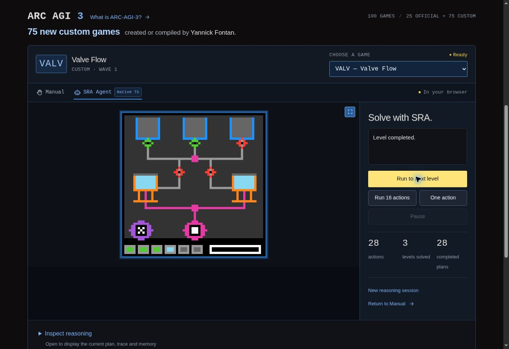

# v51 · Composition de services et transfert entre champs observés

## Nouveau résultat : les trois premiers niveaux de VALV

**Logos Engine termine les niveaux 1, 2 et 3 de VALV en 28 actions**, dans une
session native froide et continue. Le moteur commun raisonne en TypeScript.
Python sert uniquement d'hôte opaque pour le jeu original pendant cette
campagne : aucune fonction d'agent Python, mémoire importée, action manuelle,
remise à zéro ou sélection d'un niveau ultérieur n'est utilisée.

| Niveau terminé | Actions du niveau | Actions cumulées |
| --- | ---: | ---: |
| 1 | 10 | 10 |
| 2 | 10 | 20 |
| 3 | 8 | 28 |

La [campagne réelle](native-campaigns-v51/valv-three-levels.json) conserve
**28 préfixes, 28 acquisitions effectives du Kernel et deux reprises naturelles
de frontière**. Les [29 paquets publics complets](native-campaigns-v51/valv-public-trace.json.gz)
contiennent **238 images**, animations incluses. Le
[reçu d'exécution](native-campaigns-v51/logs/execution-valv.json) lie ces résultats
aux 172 fichiers natifs gelés, inchangés pendant l'exécution.

L'arrêt intervient à la cible déclarée, à l'entrée du niveau 4, avec
`NOT_FINISHED` et `target_levels_completed`. Le niveau 4 n'a pas été tenté dans
cette campagne. Trois niveaux terminés sont établis ; aucune victoire complète
de VALV n'est revendiquée.

## Une capacité générique dans le moteur et le graphe communs

L'entrée source `field_service_composition` rejoint l'architecture existante.
Elle ne reçoit aucun identifiant de jeu et ne sélectionne aucune règle selon
un numéro de niveau. Les positions, couleurs, champs et contrôles sont mesurés
sur l'image présente. Aucune suite de clics n'est fournie à la production.
Le code de campagne utilise le nom VALV uniquement pour sélectionner l'hôte
extérieur à évaluer ; le transport vers l'agent conserve les seuls champs
publics autorisés.

La capacité possède des hypothèses géométriques explicites, issues du source.
Elle n'est pas une méthode universelle capable de résoudre tous les jeux.
En particulier, une apparence de réservoir ou de vanne n'autorise pas à lui
attribuer immédiatement un volume, une capacité, une durée ou une loi physique.

| Couche transférée | Ce qu'elle mesure ou apprend | Ce qui reste conditionnel |
| --- | --- | --- |
| Contrôle imbriqué | Un unique plus petit motif compact, puis son effet local et distant réel | Le rôle de commande et la signification de l'effet |
| Champs persistants | Des changements rectangulaires, leurs profils, une répétition puis une restauration effectivement observée | La polarité des apparences et toute quantité physique |
| Service | Une isolation expérimentale, la préservation de l'autre champ et l'effet d'une entrée déjà observée | La relation causale de passage et l'utilité terminale |
| Transfert | Un rattachement aux formes courantes après une frontière officielle acquise | Les effets du nouveau contexte, à revalider par ses retours |

La restauration est une observation acquise. Le moteur ne reçoit pas une
opération inverse supposée correcte. De même, un champ dont l'apparence change
entièrement reste une hypothèse d'achèvement tant qu'aucune frontière officielle
n'est observée.

Au troisième niveau, le modèle source permet de reconnaître des destinataires
alors que son intermédiaire antérieur n'est pas retrouvé. Il conserve cette
absence comme inconnue, prépare les contrôles actuels reconnus puis teste
l'entrée déjà acquise. Cette branche dépend des mesures présentes et de la
mémoire ; aucun test « niveau 3 » ou « jeu VALV » ne la déclenche.

Les six modules source concernés sont `nested_control_access.py`,
`envelope_fill_observation.py`, `envelope_fill_access.py`,
`field_service_access.py`, `service_transfer_access.py` et
`common_field_service.py`. Les
[mesures natives](../../src/logos-engine/v6-field-service-observation.ts) et la
[mémoire native](../../src/logos-engine/v6-field-service-access.ts) conservent
leurs quatre couches propres. La [carte de transfert](../../migration/v6-transfer-map.json)
qualifie séparément les comportements propres et les héritages encore partiels.

## Acquisition et réutilisation vérifiables

Les quatre journaux rejoignent le même propriétaire
`family_state:public_occurrence_recall`, après Radial et avant Rooted. Les
événements sont acquis à partir des retours réellement reçus. Dans cette
partie, ils comprennent :

| Événement propre | Nombre |
| --- | ---: |
| `nested_control_response` | 28 |
| `envelope_fill_context` | 4 |
| `field_service_context` | 7 |
| `field_service_transfer` | 24 |
| **Total** | **63** |

Chaque proposition lie le point mesuré à l'observation, à son époque, à son
score et à son image complète. Les gardes courants et WHY/ACT restent requis
avant l'action physique. L'effet inconnu ferme l'expérience après cette action,
puis OP29, OP30 et OP31 acquièrent le résultat et réconcilient le préfixe.

Les points ne sont pas transportés comme des coordonnées fixes au niveau
suivant. Une frontière officielle antérieure est nécessaire pour ouvrir la
branche de transfert ; les contrôles et champs doivent ensuite être rattachés
à la géométrie actuelle. Les ambiguïtés, absences et réfutations peuvent arrêter
la préparation. La restauration du journal est atomique : un contenu dont le
digest est modifié ne remplace pas la mémoire apprise.

L'ordre d'acquisition hérité est préservé. Une expérience de service enregistre
la réponse imbriquée sans la confondre avec une nouvelle pulsation de remplissage.
Une expérience de transfert saute les couches remplissage et service, tout en
retenant la réponse imbriquée. Rooted conserve sa coupure de la chaîne des
ancêtres. Les autres couches communes ne sont pas enregistrées deux fois.

Les algorithmes d'observation et de proposition restent des fonctions natives
TypeScript appelées par l'architecture commune. Cette intégration ne signifie
pas que chaque algorithme est déjà un programme intégralement éditable dans
le graphe. Cette condition de migration reste ouverte.

## Référence indépendante et limites de parité

Le [diagnostic v50 conservé](native-campaigns-v51/cold-start-v50.json), réalisé
avant toute modification native, proposait une exploration `observed_frontier`
sur le seul écran initial de VALV. Il n'a exécuté aucune action.

La [campagne Python indépendante](../../tests/fixtures/v6-field-service-original-public.json.gz)
utilise le composant original isolé `FieldServiceConstraint`, sans frontier
ajouté et depuis une mémoire vide. Elle termine les trois niveaux en 28 actions.
La [comparaison indépendante](native-campaigns-v51/valv-original-component-comparison.json)
constate l'égalité des **28 commandes et 29 paquets publics complets** entre
les deux campagnes. Tous les champs propres des 28 enveloppes, les 63 événements,
les 28 états reconstruits et leurs quatre couches de digest sont comparés.

Les **240 recettes d'identité** propres sur la campagne native ont les mêmes
octets canoniques et les mêmes hachages Python et TypeScript, sans substitution
d'identifiant ni tolérance numérique. Le contrat général conserve 430 recettes,
57 cas de mesures, 46 scénarios contrôlés, 104 gardes et les 100 vues initiales.
Le filtre du motif compact s'applique à 11 de ces vues : il n'identifie pas VALV
par son nom.

Ce domaine vérifié utilise des entiers sûrs, textes, booléens, valeurs nulles
et collections. Il ne couvre pas tous les flottants Python possibles. Les
quatre digests propres sont vérifiés en fournissant séparément le digest de
l'ancêtre source ; l'égalité du graphe natif complet et de tout l'héritage Python
n'est pas revendiquée. Le registre global des arrêts pour des histoires mixtes
arbitraires reste également hors de cette preuve propre.

Les **1 786 fichiers source épinglés** au commit
`786dcf51ca57773d8e3a8948ce9ea3655e7baf8e` sont vérifiés avant et après les
comparaisons ; les 755 fichiers source utilisés, modules importés et politique
comprise, sont conservés. Le
composant isolé n'est pas l'appelant stratégique Python complet. Son accord
avec cette trajectoire native ne démontre donc pas la parité globale de cet
appelant. Aucun nouvel arbitrage natif n'est ajouté en v51.

## Vérifications de livraison

Les [tests ciblés](native-campaigns-v51/validation/delta-tests-run.json) sont
réussis : **613 tests sur 613, dans 23 fichiers, sans échec ni test ignoré**.
Ils couvrent les contrats source, l'acquisition commune, les gardes, le transfert, la
reconstruction et les capacités adjacentes touchées. Ils ne relancent pas
l'ensemble de la suite historique.

Les [sept régressions enregistrées](native-campaigns-v51/regression-summary.json)
sont réussies : **341 commandes, 348 paquets publics complets, 234 préfixes et
133 contrôles comparatifs**. Elles recalculent les décisions depuis une mémoire vide avant de fournir les retours
publics conservés de STCK, CATL, SELE, COLM, ZIPP, GRIL et LIFE. Elles comparent
les commandes, les paquets complets, les frontières et les projections de mémoire
déclarées. LIFE conserve une comparaison propre des enveloppes et acquisitions
matérielles, avec recalcul indépendant des identités et restauration explicite
des zéros signés. Ces relectures ne sont pas de nouvelles parties réelles et
ne constituent pas une mesure de vitesse.

Les [contrôles de livraison](native-campaigns-v51/validation/checks-run.json)
conservent les sorties du contrôle de types, des audits, du contrôle de diff et
de la construction du site. Le [validateur de preuves](../../scripts/validate-v51-release.py)
relie les sources, sorties, traces, comparaisons, mesures de navigateur et
artefacts construits ; les preuves v50 restent conservées sans modification.

## Interface compacte et hauteur stable

Une partie supplémentaire dans l'aperçu du site termine également les trois
niveaux en **28 actions et 28 plans**, sans intervention dans le jeu. Les trois
clics servent uniquement à lancer « Run to next level » dans la même session.
Le panneau « Solve with SRA. » garde son statut concis, ses commandes et compteurs ;
les explications détaillées restent dans l'inspection fermée.

La [vérification du navigateur](native-campaigns-v51/valv-browser-verification.json)
conserve sept mesures, avant, pendant et après les trois exécutions :

- bloc du jeu : **442 px** de hauteur ;
- écran canvas : **384 × 384 px** ;
- zone de statut : **98 px** ;
- variation mesurée des dimensions et positions : **0 px**.

Les fichiers d'interface sont identiques à ceux de v50. La mesure concerne
sept états sur le viewport de bureau normal ; elle ne prétend pas mesurer
chaque image, le mobile ou le plein écran.

## Avancement et prochaine étape

L'[audit des entrées](v6-entry-point-progress.json) mesure **42 entrées raccordées
sur 76, soit 55,3 %**, contre 41 sur 76, soit 53,9 %, en v50. L'implémentation
native est `logos-engine.typescript.v6.native-migration/0.21.0`.
Cette mesure compte les entrées des quatre listes déclarées ; elle ne représente
ni la proportion de tous les fichiers traduits, ni le pourcentage de jeux
résolus, ni une parité comportementale complète. Les six conditions de fin de
migration restent fausses.

**Prochaine étape : transférer `observed_framed_transfer`, puis évaluer GARE
dans une session froide visant au moins ses trois premiers niveaux.** Il s'agit
d'acquérir des déplacements consécutifs à un point, des remplacements encadrés
et leurs reçus, puis de rattacher ces relations aux supports présents.
`observed_framed_analogy` devra s'appuyer sur ces acquisitions et ses propres
gardes avant toute priorité de continuation.

La [sélection en lecture seule](native-campaigns-v51/candidate-selection.md)
conserve le résultat négatif du filtre de fenêtre exacte, puis les candidats
HANO, GARE et LKEY pour les bandes parallèles. GARE est une priorité d'évaluation
déclarée parmi deux nouveaux candidats, avec LKEY conservé ; aucune unicité
du candidat n'est inventée. Ces mesures n'exécutent aucune action et ne
revendiquent encore aucun niveau de GARE terminé.
