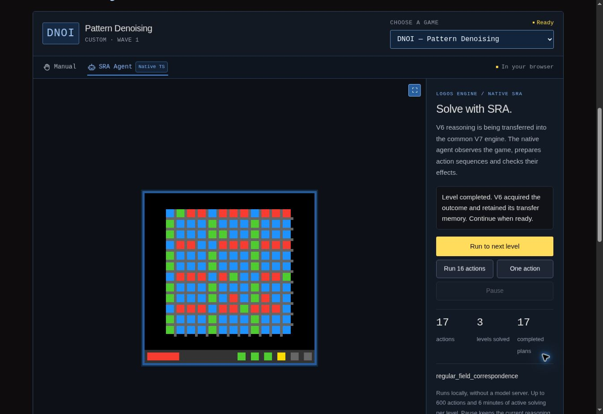

# Complete V6 capability transfer into the V7 architecture

## Required outcome

The accepted target is **100% of the published V6 common symbolic agent's
capabilities transferred from Python to TypeScript**, executed through the
common reasoning architecture developed in V7. A smaller demonstration agent,
a Python worker, a Python service and a game-specific replacement solver do
not satisfy this target.

The migration is **in progress**. The completion flag remains false. The native
modules and verified trajectories below establish progress, not completion.

**Current integrated milestone (v57):** the native common caller completes
**SMLP's first three levels in 15 actions (3, 4, 8)** in one cold continuous
session, with nine acquired prefixes, 15 actual Kernel acquisitions and two
natural boundary replays. The
[actual campaign](native-campaigns-v57/final/smlp-campaign.json.gz) and
[execution receipt](native-campaigns-v57/final/execution-smlp.json) bind this
result to unchanged implementation `0.31.0` and native digest
`f2ec2ff8658290c510a58642612b4f9d4b07a04d8fa6434c91aadda997e6c23e`.
It stops on entry to level 4 with `NOT_FINISHED`. The independent
[browser verification](native-campaigns-v57/final/smlp-browser-verification.json)
confirms the same counters through ordinary controls, with the inspector closed.

The new `topological_recolor` entry connects one six-field owner, the original
local DRM/SRC policy and bounded consumed V5 flood/pocket logic. Recolor records
only selected returns; foreign actions never become its experiments. The
common information caller also regains current motion contrast offers from
public history, with source preservation/resource checks and the already
acquired meter forecast. No new planning-time meter observation or complete
MorphologyAdapter/parent-return transfer is claimed.

The [unchanged V56 comparison](native-campaigns-v57/final/smlp-baseline-public-comparison.json)
matches all 16 public packets, 579 animation frames, 15 commands and nine prefix
selections. SMLP uses existing generic providers; its success is not attributed
to the new Recolor/Motion logic. Their 142 positive and refusal contracts are
separate evidence. The frozen release delta passes 252 checks. The final live
result is reached 11 minutes 38 seconds after the immutable candidate selection,
within the user's 40-minute bound. The entry audit reaches **50/76 (65.8%)**,
including **17/33 material entries**, and the compiled inventory remains 37.
All 13 recorded-public regressions pass 221 historical comparison checks.
The concurrent Motivation/navigation publication is preserved by a normal
merge. Its separate publication validation again passes 252 checks, with an
identical native worker and unchanged frozen campaign inputs. The v57 label
continues to identify the native milestone and its evidence, independently of
the Site publication number. All complete-migration gates remain false. See the
[v57 report](v57-topological-recolor-and-motion-questions.md) for exact scopes,
validation and retained evidence.

**Previous integrated milestone (v56):** the native common caller completes
**GLOB's first three levels in 20 actions (5, 11, 4)** in one cold continuous
session, with 17 acquired prefixes, 20 actual Kernel acquisitions and two
natural boundary replays. The
[actual campaign](native-campaigns-v56/final/glob-campaign.json.gz) and
[execution receipt](native-campaigns-v56/final/execution-glob.json) bind the
result to unchanged implementation `0.30.0` and native digest
`bade8fd58991e6a127abc84f373d539edeaa70d45ab0da94a84a6751fdc92de5`.
The target stops on entry to level 4 with `NOT_FINISHED`. The
[independent browser verification](native-campaigns-v56/final/glob-browser-verification.json)
confirms the same counters through three ordinary Run to next level clicks,
with the inspector closed.

The new `observed_inventory_composition` entry connects one eight-field
ObservedInventory owner, its original 19-rule policy and existing SRC workflow,
V5 current cell / underlay / endpoint measurements, conditional supplier
relations, contact returns and context associations. Meter and collection
acquisition remain separate checkpoint context. Inventory reads that context;
it does not insert the planning observation owned by the still-pending
MorphologyAdapter provider. The exact partial V5 probe domain remains explicit.
Original Python matches all 90 actual source-facing calls, including 13 losing
proposal abstentions, and all 17 full source/context prefix checkpoints on
GLOB. Positive inventory behavior has separate original-source and Kernel
proof; no inventory proposal is selected on this game. The unchanged V55
baseline also succeeds, with the same 21 complete public packets, so the live
success is not attributed to the new inventory logic. The final V56 objective
completes 22 minutes 57 seconds after the original candidate selection, before
its immutable 40-minute deadline. The connection audit reaches 49/76 (64.5%),
with 37 compiled programs. All complete-migration gates remain false. See the
[v56 report](v56-observed-inventory-and-current-context.md) for precise scopes
and retained evidence.

**Previous integrated milestone (v55):** the native common Logos Engine caller
completes **AS66's first three levels in 19 actions (5, 6, 8)** in one cold
continuous session, with 11 acquired prefixes, 19 actual Kernel acquisitions
and two natural boundary replays. The
[actual campaign](native-campaigns-v55/final/as66-campaign.json.gz) and
[execution receipt](native-campaigns-v55/final/execution-as66.json) bind the
result to unchanged implementation `0.29.0`, native digest
`3794fa1b97951b20f3ce06d2d1d11b20d8c2b47132591fb5b8cf6f3e75b661d3`.
The target stops on entry to level 4 with `NOT_FINISHED`. The existing generic
`observed_frontier` and `sliding_cavity` providers supply the trajectory. The
[independent browser observation](native-campaigns-v55/final/as66-browser-verification.json)
confirms all three levels in the same session through ordinary controls.

The newly connected `ordered_reaction` entry retains one original six-field
owner, its material priority and its passive acquisition position among the
already connected providers. Its V5/V6 source closure preserves ordered cell
changes, repeated-square geometry, original conditional policies, current
guards and immutable acquisition checkpoints. No fixed palette, coordinate,
game identifier or stored solution enters the implementation. Original Python
comparison of the retained public AS66 observations passes 19 source record
calls, 11 complete prefix states and checkpoints, and three boundary events.
This is passive family equivalence on that trajectory, not full caller parity.
The unchanged v54 baseline also solves AS66 in 19 actions, so the success is
not attributed to OrderedReaction. CASC remains unresolved after one action;
that candidate was closed after 10 minutes 11 seconds, below the user's
40-minute limit. The connection audit reaches 48/76 (63.2%), with 37 compiled
original workflows; every complete-migration gate remains false. See the
[v55 report](v55-ordered-reactions-and-public-animations.md) for evidence,
bounded source claims and remaining work.

**Previous integrated milestone (v54):** the native common Logos Engine caller
completes **RE86's first three levels in 134 actions (26, 47, 61)** in one cold
continuous session, with 46 acquired prefixes, 134 actual Kernel acquisitions
and two natural boundary replays. The
[actual campaign](native-campaigns-v54/final/re86-campaign.json.gz) and
[execution receipt](native-campaigns-v54/final/execution-re86.json) bind the
result to unchanged implementation `0.28.0`, native digest
`059d6204097fae6749138b9afc650ccc54867886bda3887ef6f978f6afdf393a`.
The target stops on entry to level 4 with `NOT_FINISHED`. All inputs come from
the existing generic `constellation_cover` provider in the common caller.

The newly connected `reactive_contact_continuation` and `reactive_contact`
entries share one original 13-field owner and retain their declared positions.
Their consumed V5/V6 closure includes current contact geometry, parent return,
escape and stationary return, and Source81 preparation and reconciliation.
Generic SRC `SELECT` and declared policy evaluation use the common interpreter
and registry, including original request admission and explicit unresolved ties.
Four original Source81 workflows join the prior 33 unchanged bundle entries.
RE86 success is separate from ReactiveContact's original component comparisons;
the result is not attributed to the newly connected family. The entry audit
reaches 47/76 (61.8%), while every complete-migration gate remains false.
See the [v54 report](v54-reactive-contact-and-declared-selection.md) for source
contracts, actual public evidence, regression scope and the bounded candidate
change before the user's 40-minute limit.

**Previous integrated milestone (v53):** the native common Logos Engine caller
completes **CN04's first three levels in 73 actions (18, 31, 24)** in one cold
continuous session, with 29 acquired prefixes, 73 actual Kernel acquisitions
and two natural boundary replays. The
[actual campaign](native-campaigns-v53/attempt7/cn04-campaign.json.gz) and
[execution receipt](native-campaigns-v53/attempt7/execution-cn04.json) bind the
result to unchanged implementation `0.27.0`, native digest
`d87f952e0db958cf2168c1af68ecdc85f4164e1dda7e75e2874733fa03359b70`.
The target stops on entry to level 4 with `NOT_FINISHED`. The 74 complete public
packets contain 80 frames. All commands come from the existing generic
`rigid_port_assembly` service; no Python agent, baseline, imported learned
state, reset or level jump supplies the run.

The newly connected `observed_outline_service` owns the seven pinned V6 source
fields and consumes the original DRM/SRC policies plus V5 geometry and three
exact recovery subsets. Explicit native extensions separately provide current
public-return context, conditional historical-control rebinding, bounded
observed-body access and a single local question after an actual access
arrival. Source equivalence is asserted only for the tested strict component
contracts. CN04 confirms existing port assembly and is not a three-level
Outline result on ESCT. The [v53 report](v53-outline-service-and-current-relations.md)
retains the successful campaign, unsuccessful experiments and verification scopes.

**Previous integrated milestone (v52):** the native common Logos Engine caller
completes **GARE's first three levels in 53 actions (7, 9, 37)** in one cold
continuous session, with 53 actual Kernel acquisitions and two natural
boundary replays. The [actual campaign](native-campaigns-v52/attempt9/gare-three-levels.json.gz)
stops at its declared target on entry to level 4 with `NOT_FINISHED`.
No reset, level jump, learned-state import or Python agent module supplies
the native trajectory.

The newly connected `observed_framed_transfer` material entry and
`observed_framed_analogy` window entry share one immutable
`public_framed_transfer` owner. The default preserves the pinned original
component. Explicit native extensions retain current point witnesses,
bound ReductionTransport search as unknown, and acquire receptions visible
inside actual public animation packets. A reception after a support settles
retains contextual appearance identity and its signed displacement; those
receipts stay excluded from the original directionless candidate generator.

A current co-carried shape pair can then ask about an independently supported
uniform receiver. Each preparation or reception question is measured again
from current geometry and observed controls. Concurrent offset hypotheses
remain explicit, ambiguous physical tasks are refused across the source and
native domains, and every step still goes through ordinary WHY/ACT. No
following route or successful outcome is assumed.

The [browser verification](native-campaigns-v52/attempt9/gare-browser-verification.json)
independently confirms 53 actions and three completed levels. Seven normal
desktop samples retain the 442 px board column, 384 × 384 px canvas and
98 px status, with zero position or dimension change. The compact UI files
remain byte-identical to v51. Eight prior failed attempts remain under their
own source manifests and do not inherit this result.
See the [v52 report](v52-framed-transfer-and-public-packet-acquisition.md)
for source-comparison scopes, native extensions and their qualifications.

**Previous integrated milestone (v51):** the native common Logos Engine caller
completes **VALV's first three levels in 28 actions (10, 10, 8)** in one cold
continuous session, with 28 actual Kernel acquisitions and two natural boundary
replays. The [actual campaign](native-campaigns-v51/valv-three-levels.json)
stops at its declared target on entry to level 4 with `NOT_FINISHED`.
Its 29 complete public packets contain 238 frames. All 28 prefixes are selected
through the common caller's declared `field_service_composition` entry; no
new coordination rule or game-specific priority is introduced.

The source transfer includes current nested controls, repeated public field
changes, actual restoration, conditional isolation/service and current geometric
rebinding after an acquired official boundary. Four own digest layers retain
63 actual events in `family_state:public_occurrence_recall`, after Radial and
before Rooted. Their current guards, WHY/ACT, journal reconstruction and immutable
checkpoint handling use the existing common architecture. Physical volumes,
capacities, passage laws and universal terminal semantics remain unknown.

The [independent component comparison](native-campaigns-v51/valv-original-component-comparison.json)
verifies the same 28 commands and 29 complete public packets in the separately
executed unchanged Python component campaign. It also verifies all 28 native
own proposal envelopes, 63 own events, 28 reconstructed own states and four
own digest layers with the source ancestor supplied separately. All 240 own
identity recipes on this trace have identical canonical bytes and hashes,
without numeric tolerance or identifier substitution. This checked safe-integer
domain does not establish arbitrary Python float semantics, full inherited
graph parity or the original complete strategic caller's ordering.

The [browser verification](native-campaigns-v51/valv-browser-verification.json)
confirms the same 28 actions and three levels, with seven stable desktop samples:
442 px board column, 384 × 384 px canvas, 98 px status and zero measured position
or dimension change. The compact UI source remains identical to v50.
See [the v51 report](v51-field-service-composition.md) for evidence and limits.

**Previous integrated milestone (v50):** the native common Logos Engine caller
completes **LIFE's first three levels in 49 actions (15, 15, 19)** through one
cold continuous session, 47 prefixes, 49 actual Kernel acquisitions and two
natural boundary replays. The [actual campaign](native-campaigns-v50/life-three-levels-final.json)
stops at its declared target on entry to level 4 with `NOT_FINISHED`. Its
50 complete public packets contain 238 frames. The connected
`typed_material_flow` measures marked supports, acquires their replacements
and descendants, retains observed request associations and tests pose effects
before executing guarded conditional prefixes. Its 68 own events share the
existing `public_occurrence_recall` owner through three retained digest layers.

The [first native attempt](native-campaigns-v50/life-three-levels.json) is
preserved: one contact invitation, four returned frames, zero completed levels
and a global refusal despite a still-current material inquiry. Twelve pixels
change transiently before the final image is restored. A declared native
coordination extension now corroborates the complete public return and the
actual Kernel transition. A cold material inquiry needs a repeated current
relation whose supports avoid the invitation point and all transient pixels;
later inquiries need real acquired event/model references. No hidden-state
equivalence or understood contact effect is inferred, and ordinary current
guards, preservation and WHY/ACT remain necessary.

The final trajectory retains three contact invitations, one at each level,
and 44 material prefixes. The unchanged isolated source provider takes
46 actions (14, 14, 18) and 44 prefixes. Its trajectory diverges from the full
native caller at the first action. The
[independent comparison](native-campaigns-v50/life-original-component-comparison.json)
replays all 49 actual native returns and verifies 44 complete material
envelopes, 68 own events and 49 reconstructed own states, with zero numeric
tolerance under an explicit identity projection. It independently recomputes
328 identity recipes and restores 14 signed-zero paths. Python integer/float
JSON spelling and native Float64 identity are not asserted equal. Controlled
carrier and pose cases also show that lexical hash tie-breaking may select
different alternatives; no such tie occurs in this actual LIFE trace.
Complete original-caller parity and complete inherited digest equality remain
outside this claim. The [v50 report](v50-typed-material-and-returned-inquiries.md)
details the source transfer, native extension, acquired graph and limits.
The [desktop browser verification](native-campaigns-v50/life-browser-verification.json)
also completes three levels in 49 actions and 47 plans. Seven sampled states
retain the closed inspection, 442 px board column, 384 × 384 px canvas and
98 px status height, with zero position or dimension change. This is a
sampled normal-viewport check, not a per-frame, mobile or fullscreen claim.

**Previous integrated milestone (v49):** the native common Logos Engine caller
completes **GRIL's first three levels in 19 actions (5, 5, 9)**, through one
cold continuous session, 19 acquired prefixes and two natural boundary
replays. The [actual campaign](native-campaigns-v49/gril-three-levels.json)
stops at its declared target on entry to level 4 with `NOT_FINISHED`. Its
20 complete public packets contain 23 frames. The newly connected
`occluded_catalogue_composition` measures catalogue/field roles as hypotheses,
acquires reciprocal substrate evidence, preserves all remaining unknown
pixels and intersects finite current pose alternatives. A submitted response
is not treated as individual correctness feedback.

A current ambiguous catalogue can ask for a new view only after an actual
field-changing input has been acquired under the same field structure. The
same common owner records these effects even when another provider chose
the action. No first-view command or prior success is inserted into cold
memory. Fourteen catalogue proposals and 34 own acquired events are retained.
The source common ViewFrontier remains first in the direct `view` group;
the catalogue-view provider is its explicit source fallback.

The unchanged original catalogue/view/frontier subset completes three levels
in 18 actions (5, 5, 8). Its selection differs from the native common caller
at action 9, and the native caller also performs an occurrence-recall question
at action 14 in level 3. The
[independent comparison](native-campaigns-v49/gril-original-component-comparison.json)
replays all 19 actual native transitions through the original component:
14 selected catalogue/view proposals, 34 own events and 19 own-state
comparisons agree exactly, with zero numeric tolerance. For each transition,
the Python own state recomputed from public returns matches the state
reconstructed from retained native own events; the full inherited/global
digest is outside this scope. The first eight
commands and nine packets match between campaigns before the explicit
selection divergence. Full original-caller equivalence remains outside this
comparison. The
[v49 report](v49-occluded-catalogues-and-acquired-views.md) explains these
scopes, current guards, numerical limits and evidence. Python remains the
opaque game host in the native campaign, with no manual priming, reset or
level jump.

**Previous integrated milestone (v48):** the native common Logos Engine caller
completes **COLM's first three levels in 45 actions (17, 17, 11)** through one
cold continuous session, 21 sealed prefixes, 45 actual Kernel acquisitions and
two natural boundary replays. The [actual campaign](native-campaigns-v48/colm-three-levels.json)
stops at its declared target on entry to level 4 with `NOT_FINISHED`. Its
46 complete public packets contain 125 frames. The newly connected
`queued_field_composition` acquires scalar control effects and dated reception
phases, retains compatible automatic-closure hypotheses, and prepares finite
conditional contributions. An estimated removal count is never an official
terminal quota. The unchanged isolated source component and native common
caller agree on all action references and effect parameters, complete public
packets, 21 plans and 39 own-layer acquired events. Source scalar commands omit
the empty transport `data:{}` field, as explicitly recorded in the
[independent comparison](native-campaigns-v48/colm-original-component-comparison.json).

**ZIPP now completes all six levels with official `WIN` in 101 actions**, through
a separate cold continuous session and 40 prefixes. The
[new campaign](native-campaigns-v48/zipp-six-levels.json) retains 101 actual
Kernel acquisitions, 102 public packets and 119 frames. Its first 77 commands,
78 full packets, 36 complete plans and 77 retained trace transitions preserve
the v47 trajectory within the declared comparison scopes. One generic
arbitration at action 78 links a previously successful program to the actual
Kernel score increase, command, released composition and exact provider entry.
The new epoch still begins with two separate observed-effect questions before
the source permits longer conditional prefixes. This explicit native
coordination extension changes no source Trace event or geometric rule and
adds no source entry. See the [v48 report](v48-queued-fields-and-acquired-continuation.md)
for the evidence, numerical identity boundary, current guards and validation
receipts. Both campaigns keep Python restricted to the opaque original game
host; no Python agent, manual priming, reset or level jump participates.

**Previous integrated milestone (v47):** the native common Logos Engine caller
completes **SELE's first three levels in 44 actions (8, 10, 26)**, with one cold
continuous session, 44 prefixes, 44 actual Kernel acquisitions and two natural
boundary replays. The [actual campaign](native-campaigns-v47/sele-three-levels.json)
stops at its declared target on entry to level 4 with `NOT_FINISHED`. Its
45 complete public packets contain 229 frames. No Python agent module, manual
priming, reset or level jump participates.

The newly connected `linked_packet_composition` measures current remote support
selection, reads dated public animation fronts, learns conditional input and
output relations, and evaluates hypothetical visible-support routes through an
exact rational box-intersection kernel. The shared V7 graph preserves every
finite Float64 bit through its existing typed-state codec; portable canonical
values remain integer-only. Python/JavaScript libm equality and float digest
identity are explicitly limited. Native receipts remain immutable, while the
original Python layer aliases and enriches nine earlier event payloads during
the same packet acquisition. The source return tracer and comparison verify
both emission-time payloads and each later enrichment separately.

A source-first structural support interpretation also lets **ZIPP complete its
fifth level in 24 additional actions**, reaching five levels after 77 actions.
The [target-six attempt](native-campaigns-v47/zipp-six-levels.json) remains
`failed` for its declared target: one further animated-contact action in level 6
is followed by `frontier_unknown` at 78 actions. No complete-game `WIN` is
asserted at that checkpoint. The trace observer already measures a bounded
composition at that boundary; the then-unresolved coordination question is
retained with its frozen implementation. See the [v47 report](v47-linked-packets-and-stable-board.md)
for numerical scope, original-component comparisons, trace extension evidence,
UI stability measurements and actual validation receipts.

**Previous integrated milestone (v46):** the native common Logos Engine caller
completes **ZIPP's first four levels in 53 actions (8, 15, 15, 15)**, including
the requested first three levels in 38 actions. The
[fresh native campaign](native-campaigns-v46/zipp-four-levels.json) retains one
cold continuous session, 12 sealed prefixes, 53 actual Kernel acquisitions and
three natural-boundary replays. It stops at its declared four-level target on
entry to level 5, with `NOT_FINISHED`; no full-game `WIN` is claimed.

The new `trace_field_composition` entry occupies its original declared window
position between the earlier labeled entry and the later cell-patch entry. It
measures current cell geometry, distinguishable marks and visible connections,
propagates finite residual-graph necessities, and constructs a bounded simple
cover as an explicit experimental goal. Two distinct actual local extensions
must be acquired before a longer conditional prefix is proposed. Every point
still needs its current support, ordinary WHY/ACT authorization and response
guard. New epochs cannot borrow an old geometry or point-effect qualification.
Changes outside the measured support remain recorded as unknown effects.

The evidence lives in the existing shared-series owner after Labeled and before
Cell acquisition, with immutable checkpoints and atomic journal restoration.
The 152 native source files remain unchanged throughout the campaign, with
digest `793a6b2e57ffbab74e148b1170879cd720387cbe93a2af9977c6303e05c2e731`.
The unchanged isolated Python trace component independently reaches four levels
in the same action counts. Source-component parity and the native common-caller
campaign remain distinct from complete original-caller selection parity.
The independent [trace reference checks](../../tests/v6-trace-field-reference.test.ts)
pass 422 tests over 415 cases, 67 public or controlled scenes and 12 source common
envelopes, with all 53 original-component returns retained. Six separate
[Kernel integration checks](../../tests/v6-trace-field-kernel.test.ts) verify the
cold native selection, actual acquisition, current guards, epoch qualification,
checkpoint reuse and atomic rejection of corrupt journals. The mechanical
transport remains partial for general Pydantic coercion and arbitrary Python
integers; the native request contract uses bounded exact integer fields.

**Previous integrated milestone (v45):** the native common caller completes
all six CATL levels with official **`WIN` in 48 actions, eight per level**,
through one cold continuous session and 48 acquired prefixes. The first
three levels use 24 actions. The [v45 report](v45-composed-predicates-and-reduction.md)
records a generic native AND/OR extension activated only after a complete
atomic contradiction. At level 6, all 6,400 roots of the declared one-layer
language are examined, two expressions survive, and their answers are
re-evaluated for each current query. The campaign reuses training features
42 times and its complete composed fit seven times. Actual Kernel acquisition,
current-point guards and WHY/ACT remain required for each submitted action.

The unchanged Python evaluator independently checks the authored composite
grammar in complete batches; this establishes bounded evaluation agreement,
not that the original Python caller generates those composites. The source
helper's atomic grammar and the source-compatible v44 path remain separate.
The same v45 work connects `supported_ternary_reduction`, with 106 passing
ReductionTransport component checks. **The final native common-caller campaign
completes LF52's first three levels in 104 actions (8, 40, 56), through one cold
session and 71 acquired prefixes.** It stops at its declared target on entry
to level 4 with `NOT_FINISHED`. An explicit native coordination extension
prefers a currently guarded continuation backed by acquired official success
over a wholly unacquired exploration. The first attempt's Cell selection
collision remains recorded separately. The unchanged isolated Reduction
component uses 102 actions; the final native common caller also performs two
observed-effect access actions. These results do not establish complete
trajectory or full original-caller selection parity.

The final 149-source snapshot also passes [nine real regression campaigns](native-campaigns-v45/regression-summary.json),
with 117 successful comparison checks over 433 commands, 442 complete public
packets and 237 prefixes from v44. Source entry coverage remains 47.4%; these
repeated successes do not add source entries or close the complete-migration
gates.

**Previous integrated milestone (v44):** CATL's first five levels completed
in 40 actions, with 35 training-feature cache reuses and exact original-component
trajectory parity. The [v44 report](v44-labeled-sequences.md) preserves that
source-compatible result and the sixth-level diagnostic: all 80 atomic/complement
roots were refuted by the 20 measured examples. The v45 extension addresses
that finite-language limitation without replacing the measured examples with
a game-specific answer.

**Previous integrated milestone (v43):** the native common caller completes all
six THER levels with official **`WIN` in 26 actions (4, 3, 4, 4, 5, 6)**,
and adds **COMB's complete six-level `WIN` in 104 actions
(3, 7, 14, 19, 30, 31)**. Its separately checked first three levels use
24 actions (3, 7, 14).
The [v43 report](v43-product-panels-mark-support.md) distinguishes the faithful
product-panel transfer from the explicit native complete-mark-support extension.
Both results come from fresh continuous sessions, with real Kernel acquisition,
WHY/ACT, zero manual game actions and no Python agent modules.

**Previous integrated milestone (v42):** rooted-quota composition is connected
at its declared native common entry. [THER completes four levels in 15 actions](native-campaigns-v42/ther-four-levels.json),
and [STCK completes four levels in 45 actions](native-campaigns-v42/stck-four-levels.json)
through an explicit native conditional-relation experiment. Both are fresh,
continuous common-caller campaigns with actual Kernel acquisition and WHY/ACT.
The [v42 report](v42-rooted-quota-program-relations.md) distinguishes source
component parity, native extensions, official success and remaining uncertainty.
The [exact original-component comparison](native-campaigns-v42/ther-original-component-comparison.json)
covers THER's first three levels: 11 commands, 12 complete public packets,
21 animation frames and five prefixes, without field projection.
Earlier milestones include [the v41 radial-port and PIPE report](v41-radial-ports-control-discovery.md), [the v40 acquired-preparation and MEMO
three-level campaign report](v40-acquired-preparation.md), [the v39
observed-program transfer and STCK three-level campaign report](v39-observed-program.md), [the v38 cell-patch
transfer and complete TICT campaign report](v38-cell-placement.md), [the v37 memory-cost and ELAS campaign
report](v37-memory-performance.md), [the v36 alternating graph and common
acquisition report](v36-alternating-graph.md), [the v35 coupled planning,
auxiliary support and native checkpoint report](v35-coupled-support.md), [the v34 coupled-pair
response acquisition](v34-coupled-pair-evidence.md) and [the v33 epoch-anchor
checkpoint](v33-shared-series-anchor.md) and [the v32 SupportNavigation,
occurrence recall and delta checkpoint](v32-support-recall-delta.md). The connected-entry audit
is [v6-entry-point-progress.json](v6-entry-point-progress.json): 45 of 76
explicit DRM subquestions are connected (59.2%) in implementation
`logos-engine.typescript.v6.native-migration/0.27.0`. This is a connection metric,
not complete behavioral parity, a percentage of code translated, or a game score.
The v53 Outline owner adds one source entry. Exact recovery subsets and explicit
native context, access and arrival compositions add no further entry.
The v52 framed-transfer owner adds two source entries. Its explicit native
binding, bounded-search, public-packet and current-prerequisite extensions add
none to that denominator. The v51 field-service connection adds one source entry, with no new native
priority rule. The v50 typed-material connection adds one source entry. The explicit native
coordination of unresolved transient returns adds none; its evidence,
disjointness and current inquiry guards are evaluated separately.
The v49 occluded-catalogue connection adds one source entry. Its acquired-view
fallback also connects the existing direct `view` group; direct groups remain
outside this four-list denominator.
The v48 queued-field connection adds one source entry. Corroborating a retained
success against acquired Kernel boundary scores and exact provider identity is
an explicit native coordination extension and adds none.
The v47 linked-packet connection adds one source entry; its immutable numerical
receipts and structural trace-support interpretation add none.
The v46 trace-field connection adds one source entry through the existing
shared-series owner. It adds no game-specific selector or fixed solution.
The v45 reduction-transport connection adds one source entry; its bounded
predicate-composition and acquired-continuation coordination extensions add
none. The v44 labeled-sequence connection
adds one source entry. The v43 product-panel connection adds one source entry; its native mark-support extension adds none. The v42 rooted-quota connection adds one source entry; its conditional relation and return-preparation extensions add none. The v41 radial-port connection added one source entry; the native control-discovery
and refusal-scope extensions add none. The v40 changes are explicit native evolutions: they add no Python module to
the transferred inventory and no source entry. The v39 observed-program
composition added one source entry, following the v38 cell-composition entry;
the v37 performance step added none. All six conditions for a complete
migration remain false.

The next source entry to study is **`reactive_contact_continuation`**, which is
still pending in the declared material-return list. It should preserve actual
contact-response evidence and revalidate a current continuation before release.
The v53 public access/arrival experiments motivate this choice, but do not
establish a source transfer or a successful game for that pending entry.
The [public candidate supplement](native-campaigns-v53/supplementary/candidate-selection-supplement.json)
records how initial observations identified CN04 for evaluating the already
connected port-assembly service, separately from the Outline experiments.

**Previous v42 result:** THER completes levels 1–4 in **4, 3, 4 and 4 actions**,
15 total, six sealed prefixes and one retained session. The first two real
experiments discriminate addition and truncation before bounded integer-prefix
propagation prepares later actions under explicit root and quota hypotheses.
The [previous v41 baseline](native-campaigns-v42/ther-v41-baseline.json)
completed two levels in 170 total actions and stopped on the third level's
active-time budget. This establishes additional bounded success, not a speed benchmark.

STCK's [four-level campaign](native-campaigns-v42/stck-four-levels.json)
completes levels 1–4 in **3, 7, 25 and 10 actions**, 45 total and 25 prefixes.
Its new discovery question first prepares an already observed inverse, then
measures the unknown phase and its actual return to editor access. The native
journal retains one conditional other-bearer translation relation, separately
from the unchanged original reduction model. Four real edits prepare a new
transport test; the next execution crosses the official fourth-level boundary.
The final packet is excluded from relation attribution: **support remains one**,
with fixed displacement, radial displacement and delayed response still open.
There is no universal operator, deletion rule or terminal law inferred from
this success. The [six-level attempt](native-campaigns-v42/diagnostics/stck-relation-six-level-attempt.json)
stops at level 5 with `frontier_unknown` after those same 45 actions.

The v42 implementation had **139 source files**, all unchanged during
those campaigns, with manifest digest
`6567be12230880198a7b4b085999ecda9354487599e728ee1ae27455f7056d04`.
No Python agent module is loaded. No game identifier, fixed role palette,
level-specific sequence or solution is added to production reasoning.
Rooted source access retains its actual record-chain cut and its passive
outer acquisitions; its incomplete inheritance and exact-integer numerical
domain remain documented limitations. The native relation journal is an
explicit extension, not an original Python behavior claim.

**Previous v41 result:** PIPE's first three levels are completed through the fresh
native common Logos Engine caller in one session: **4, 8 and 11 actions, 23
total**, with 20 sealed prefixes, 23 acquired transitions and two natural
boundary replays. The [bounded campaign](native-campaigns-v41/pipe-three-levels.json)
stops at its declared target on entry to level 4 with **`NOT_FINISHED`**. All
135 native source files remain unchanged during this `0.11.0` run, and no
Python agent module is loaded. This establishes three completed levels, not
a full-game `WIN`.

The [saved-evidence comparison](native-campaigns-v41/pipe-original-component-comparison.json)
matches all **23 commands, 24 complete public packets and 33 animation frames**
to the unchanged isolated Python radial component. All public action domains,
their ordering, official boundaries and 20 executed prefix lengths also match
exactly. No pixel, animation, score or action-domain projection is applied.
This is bounded public-trajectory agreement with a component, not original
full-caller selection parity: the [unchanged original caller replay](native-campaigns-v41/diagnostics/pipe-original-caller-collision.json)
reproduces an unlearned invitation collision after one level. Native acquired
preparation coordination is explicitly separate from the radial source
translation and still requires the current primitive guard.

The [v41 report](v41-radial-ports-control-discovery.md) also documents bounded
revalidation of an acquired rotation on changed geometry. It keeps a previous
method conditional and requires one real current return before confirming its
new binding. The [STCK diagnostic](native-campaigns-v41/diagnostics/stck-control-discovery-six-level-attempt.json)
at v41 reached two further real experiments at level 4: insertion of an unknown
control member, followed by execution and an isolated public-effect measure.
It retains two trials, one binding and one measured effect, then stops after
39 actions. At that historical checkpoint, no new operator law was promoted and STCK level 4 remained unsolved.
The actual Kernel records the limited scope of a stationary unlearned contact
invitation; a separately grounded question still needs its own current guard
and ordinary WHY/ACT authorization. These are explicit native extensions.

**Previous v40 result:** MEMO's first three levels are completed through the fresh
native common Logos Engine caller in one session: **10 actions per level, 30
total**, with 30 sealed prefixes, 30 acquired transitions and two natural
boundary replays. The [bounded campaign](native-campaigns-v40/memo-three-levels.json)
stops at its declared target on entry to level 4 with **`NOT_FINISHED`**. The
`logos-engine.typescript.v6.native-migration/0.10.0` source stays unchanged
throughout the run, and no Python agent module is loaded. The
[v39 baseline](native-campaigns-v40/memo-v39-baseline.json) completed no level
and stopped after seven actions with `frontier_unknown`. This comparison
establishes three new level completions, without claiming a complete MEMO win.

At v40, the native coordinator was extended to consider the **first non-null window proposal in
declared order** when an unlearned animated invitation would otherwise be
selected. Its provider must explicitly supply a learned-preparation witness:
either a retained fitted program model or a unique, convergent occurrence
correspondence meeting the source policy's support thresholds with no
counterexamples. The current primitive guard must admit that same proposal.
An unsupported earlier candidate cannot borrow evidence from a later one.
The proposal is cached for ordinary selection, and the receipt names the real
`family_state` node and its revision. Point binding, preservation, budgets and
WHY/ACT still run normally. This expands the v39 coordination extension; it
is not a claim of original Python caller selection parity.

A separate native access rule rebinds any uniquely attested subset of learned
program controls using exact current patches and one common translation. It
accepts gaps inside a row as well as at its ends, keeps the full learned model
and member palette, and permits new insertions only through currently
attested controls. Additional appearances receive no operator meaning.
The binding proof is retained in the actual proposal and continuation and
rechecked before actions; source-parity `programEditor` remains unchanged.
The [v40 STCK diagnostic](native-campaigns-v40/diagnostics/stck-current-access-six-level-attempt.json)
again completes three levels in 3, 7 and 25 actions, then performs a real
partial-access binding as action 36. An invitation at action 37 is followed
by `frontier_unknown` at level 4. **STCK level 4 remains unsolved in this run**;
the new access rule alone does not establish a new interaction or objective.

**Previous v39 result:** STCK's first three levels are completed through the fresh
native common Logos Engine caller in one session: **3, 7 and 25 actions**, **35
total**. The [bounded campaign](native-campaigns-v39/stck-three-levels.json)
stops at its declared three-level target on entry to level 4 with the game's
state still **`NOT_FINISHED`**. It uses implementation
`logos-engine.typescript.v6.native-migration/0.9.0`, with unchanged native source
throughout the run, acquired real effects and retained cross-level memory.
This establishes the requested three level completions, without claiming a
complete-game `WIN` for STCK.

The v39 transferred program capability learns collection edits and conditional
operators from public animation phases, composes their effects, reconciles
respondent behavior and revalidates current input supports. It shares the
existing occurrence journal. A separate, explicitly recorded **native
coordination evolution** deferred an unlearned geometric invitation when the
shared family had an acquired, currently guarded program proposal. The declared
DRM lists retain their order and the selected proposal still passes ordinary
point, preservation, budget and WHY/ACT checks. The unchanged original Python
caller reproduces the invitation collision; this coordination change is
therefore identified as a native extension, not original selection parity.

**Previous v38 result:** TICT is completely solved through the fresh native common
caller: **six levels, official `WIN`, 55 actions** distributed as **3, 12, 7,
7, 12 and 14**. All 55 prefixes use the transferred cell-patch composition,
acquire their real public effects and retain one session across the game.
The [campaign](native-campaigns-v38/tict-six-levels.json) preserves all public
packet hashes, commands, source identity and acquisition checks. The source
transfer and native integration add 121 passing focused checks. The old v37
baseline completed two levels and stopped at the third level's time budget.

**Previous v37 result:** the existing metric-composition capability solves ELAS's
first three levels through the full native common caller in one fresh session:
**2, 9 and 22 actions**, 33 total, nine sealed prefixes. It stops at the declared
target on entry to level 4. The [campaign](native-campaigns-v37/elas-three-levels.json)
contains the public observations, action and acquisition evidence. No game-specific
solver, preloaded controls or Python agent is introduced.

The same frozen `0.7.1` implementation also repeats TU93's first three levels with
the same 67 commands, 68 full-public-packet hashes, 25 prefixes and reported
caller/series projections as v36. Active time changes from 47.537 to 41.411 seconds
in this single profiled comparison, an observed reduction of 12.9%. The helper
and profiling options remain the same; timings are not a repeated benchmark or
a guarantee for other games or computers. [Comparison](native-campaigns-v37/tu93-comparison.json)
and [validation](native-campaigns-v37/validation.json) distinguish exact trace
checks from performance evidence.

**Previous v36 result:** the real native common agent completes TU93's first three
levels in one fresh session: **32, 10 and 25 actions**, 67 total, 25 sealed
prefixes. Eleven prefixes use the newly connected alternating-graph entry.
The run stops at its declared three-level target on entry to level 4; this is
not a claim of a complete-game `WIN`. Source files remain unchanged throughout
the run and no Python agent module is loaded. The [campaign](native-campaigns-v36/tu93-three-levels.json)
and [validation record](native-campaigns-v36/validation.json) preserve the evidence.

The v35 report also distinguishes an explicit V7 robustness extension from
exact transfer: the original 512-entity mechanical domain still refuses dense
scenes, but the native caller retains that refusal as unknown, leaves both rule
registries unchanged, and allows independent families to continue. Complete
public witnesses remain in the V7 transition nodes. This extension is not an
extra migrated source entry and does not establish source caller parity outside
the original domain.

**Historical v31 checkpoint documented below:** the native common coordinator, shared WHY/ACT
memory and four newly registered interface families execute in the product
runtime. The first three levels of HANO, SYME and DNOI pass against the real
games: **nine levels, 83 actions, 46 acquired prefixes**. The three campaigns
used the same unchanged native source and real time budgets. Their scope and
reproducible evidence are recorded below.

The reference is `yannick-fontan-1981/ARC-AGI-3-Yannick-Fontan` at
`786dcf51ca57773d8e3a8948ce9ea3655e7baf8e`. The complete conservative source
snapshot is retained under `reference/v6/<commit>/source`. Its original bytes
are never edited to make a differential comparison pass.

The V6 README distinguishes the published **common symbolic solver** from its
historical neural benchmark launcher. The latter's upstream harness and local
model weights are not in this source publication. This document does not claim
a transfer of those absent artifacts.

## Execution boundary

The agent's deployed path must contain only native TypeScript/JavaScript and
its declarative programs/data. Python is a development oracle. The existing
Python game engines remain a separate environment: the agent receives only
public pixel frames, complete public animation packets, state, available
commands, level and completed-level count. Game IDs, hidden state, undo history,
level definitions, oracle plans and free simulation are not agent inputs.

The abandoned Python-agent prototype is not part of the browser runtime. Its
archive, bridge and preparation script were removed from the application.

## V7 architecture requirement

The destination architecture has a common representation for programs,
observations, hypotheses, compositions, operations, execution evidence and
memory. It must preserve source identity, revisions, scope, causal links and
counterexamples. Inspection must show the program and knowledge that actually
execute. A node edit must affect a validated new revision used by the
engine and invalidate any authorization grounded in an older revision.

An inspector over unrelated display data is insufficient. So is retaining V6
planning in Python behind a TypeScript interface.

The current transfer reuses V7's real SRC IR and interpreter. The original
V5 compiler is used **only during development export**. The generated JSON
programs execute in TypeScript. This is a transfer of declarative programs,
not a Python interpreter embedded in JavaScript.

`src/logos-engine/v6/programs.json` contains 33 instantiated V6 entry programs,
including the main prototype router and composition-family selection. It also
retains the exact declaration source text and hashes. `NativeSrcProgram`
checks source, semantic and transitive hashes and requires every callback of
an executable program to be present as a native implementation. An exported
program with missing native capabilities is not counted as an implemented
capability.

V7's interpreter now preserves V6's `WHILE` contract: progress witness, stop
condition, maximum symbolic depth, and deferred limit result. A deferred result
cannot authorize a game action.

The native knowledge store now uses the actual V7 Kernel revisions and causal
delta chain. Registered program edits replace the IR read by the next execution;
family activation edits change actual selection. Transactions are atomic and
require the expected graph revision. Edits are rejected while an action prefix
is active, including a paused prefix, and a released action ticket is tied to
the execution digest and graph chain. The Playground now exposes this graph,
its current program trees and a revision editor for programs and activation
nodes. Coverage of every remaining provider is still pending.

Large empirical states use lossless, content-addressed fragments. Public pixel
matrices are retained in shared immutable nodes rather than copied into each
history record. A typed envelope distinguishes internal references from user
data, and hydration verifies every fragment digest. Fractional values and
negative zero preserve their Float64 bits. This representation keeps the V7
canonical integer contract and bounded individual values without discarding
episode observations.

Reasoning facts and trace records are individual authoritative nodes. An ordered
index reconstructs the full source memory snapshot; unchanged entries retain
their identity across checkpoints. Public memory reads remain independent
copies. Restoration checks each retained leaf as well as the ordered index,
so an independent fact or trace revision cannot be hidden by an unchanged
index. A checkpoint refuses a stale graph base; only a successfully committed
and verified prepared batch can update the read cache. Failed transactions and
unrelated commits do not mark unread revisions as acquired.

At v40, learned program models and occurrence relations remain in the actual
family state restored from this graph. Current control bindings and
coordination witnesses are retained with the proposals and their evidence;
the witness identifies the source state revision used for selection. These
are inputs and records used by the running agent, with larger structures stored in
fragments. The observation, fitting, simulation, search and guard algorithms,
including the native coordination extension, still run as TypeScript
functions. Registered SRC programs execute from the graph and invoke those
callbacks. This does not mean that every reasoning algorithm has already
become an individually editable declarative graph rule.

### Connected common coordinator at v31

The runtime now constructs `NativeCallerCoordinator` with the same
`ReasoningMemory` used by WHY/ACT. Its Goal, Frontier, View, Attention, Point,
Display, Control and Counter states are authoritative V7 nodes, with a separate
lifecycle node. The original 16 DRM groups retain their order. Thirteen
specific family adapters and ten common providers participate in the actual
selection path; unported providers remain explicitly listed as pending.

The slot, word, port and constellation adapters are registered in the
`surface` group according to the original `program_construction` subquestion
order. Their retained state, before/after observations and acquired events use
the same native family contract as the previously integrated families.

At a sealed committed prefix, each witnessed primitive is reconciled exactly
once: Attention/View, selected-family recording, Goal/Point/Control,
assessment, then Frontier. The runtime executes OP29, OP30 and OP31 and
reconstructs Goal and Frontier memory at natural, nonfinal level boundaries.
No intermediate action in an unfinished prefix is prematurely acquired.
Pause retains that prefix; the next level retains the same session.

Native checkpoints share only immutable public observations. Public state
reads still return independent copies. Hydration caches validate the actual
root and fragment identities, and immutable pixel-matrix fragments are emitted
into each destination store. These changes reduce repeated copying without
dropping observations, masking revised nodes or relaxing integrity checks.

## Behavioral invariants

The complete transfer must retain all of the following:

- Public observation and input-domain measurement, including component masks,
  identity ambiguity, source-bound point selection and full animation packets.
- Every declared family and its priority, eligibility, subquestions,
  alternatives, information goals and parent continuations.
- DRM projection, applicability, preservation, falsifiers and bounded search.
- WHY/ACT admission, symbolic operation authority and source provenance.
- An acquired outcome for every actually executed primitive; no fabricated
  outcome, free probe, reset or undo presented as ordinary agent experience.
- Current-source, session, observation, point, action and precondition guards.
- Retention of a committed prefix through Pause; reconciliation and learning
  at the correct sealed boundary, including a partial prefix interrupted by
  a real game outcome.
- Hypothesis support, counterexamples, invalidation and conservative reuse.
- Memory and transfer across natural level boundaries.
- Public score and terminal evidence as the authority for completed levels.
- Equivalent action/search budgets. Faster computation is not evidence that
  a missing method has been transferred.

The current browser defaults are diagnostic limits of 600 native actions and
360 seconds of active computation/native execution per level. Presentation
delay and user pauses do not consume that active budget. These limits are not
claimed to be the V6 campaign's physically qualified oracle caps.

## Historical v31 integrated real-game evidence

The v31 runtime, `logos-engine.typescript.v6.native-migration/0.4.0`, was
executed against each real game in a separate Pyodide environment. Only the
games run in Python. The agent executes TypeScript and receives public game
packets, without injected oracle state, proposals, plans or private game data.

| Game | Levels completed | Actions L1 / L2 / L3 | Total actions | Acquired prefixes | Active seconds L1 / L2 / L3 |
| --- | ---: | --- | ---: | ---: | --- |
| [HANO](native-campaigns/hano.json) | 3 | 6 / 10 / 14 | 30 | 15 | 13.65 / 56.34 / 189.43 |
| [SYME](native-campaigns/syme.json) | 3 | 9 / 12 / 15 | 36 | 14 | 63.17 / 80.99 / 168.17 |
| [DNOI](native-campaigns/dnoi.json) | 3 | 3 / 6 / 8 | 17 | 17 | 7.55 / 25.26 / 78.02 |
| **Total** | **9** | | **83** | **46** | **682.58 seconds across all games** |

Each campaign passes the following assertions in
`tests/helpers/v6-live-game-campaign.ts`:

- The requested three levels are completed in one continuous agent session.
- All 83 commands and 86 complete public packets, including animation frames,
  match trajectories previously checked against the unchanged complete
  original caller. Expected packets are used only by the external comparator.
- Every executed primitive has both `caller_acquisition` and
  `frontier_acquisition` in its actual `reasoning:transition` graph node.
- All 46 sealed prefixes execute OP29, OP30 and OP31: 138 post-analyses.
- Goal and Frontier memory are reconstructed at both nonfinal level boundaries
  in each run: six verified replays. Completing the requested third level stops
  the campaign without an unnecessary extra boundary replay.
- No reset, undo, hidden-state probe or free simulation is performed.
- No Python agent module is loaded.
- The 74-file native source manifest is unchanged before and after each run
  and is identical across all three campaigns.

The common source manifest digest is
`22300eccafb584692324b29a2b6d7a763d8748d591eb5facba95bdb68d20d7c7`.
Each report includes its complete file hashes, game-asset hashes, public packet
hashes, commands, request log, level metrics and graph acquisition evidence.
The aggregate and component-run qualification are in
[native-campaigns/summary.json](native-campaigns/summary.json).

These are real-clock runs using the product's 360-second active budget and
600-action cap per level. The longest observed level took 189.43 active
seconds. Acquisition can therefore take noticeable time after the board
changes. These measurements describe this execution environment, not a
performance guarantee for another computer. The recorded-frame unit replays
use an injected clock; the real-game campaigns above do not.

DNOI was also run through the actual browser interface with **Run to next
level** three times in the same session: three solved levels, 17 actions and
17 completed plans. The real graph inspector showed 427 nodes and 1,442
revisions, including the acquired `caller:counters` node. The browser session
used the interface's continuing target and therefore also replayed the third
boundary. Its measured 123.0 active seconds are a separate observation from
the headless campaign.



### Relationship to the original baselines

The unchanged **complete Python common caller** was previously executed in a
separate development process against a host exposing only public packets.
Commands, coordinates, public images, animations, states and level counts were
compared. HANO's 15 complete family proposals also matched at equal source
scope, revision and budget. Detailed normalization limits remain in
`v6-baseline-parity.json`.

That historical baseline predates the full native acquisition integration.
The v31 nine-level campaigns repeat its public trajectories with the
connected coordinator and verify that native WHY/ACT, acquisition and boundary
replay actually execute. They **do not establish parity on all games**, nor do
they establish identical complete internal caller state on every alternative.

Visual-sequence fixtures retain real-scene refusals and synthetic positive,
ambiguous and counterexample cases. The original isolated family does not
propose an action on the initial SEQN fixture. That refusal remains tested;
it does not require the full common coordinator to stop, since Frontier can
select an exploratory action. Synthetic cases are not counted as solved levels.

### Common-caller acquisition checkpoint

Two additional oracles execute the unchanged original common caller and retain
its acquired component states, frontier deltas, reasoning facts and assessment
results. The HANO case covers its first two-action prefix. The controlled View
case supplies only coherent public viewport packets; the original caller itself
selects its view experiment. Together they provide 44 passing comparisons,
including physical transition guards. The fixture exports, scope and explicit
limitations are documented in `v6-common-caller-oracle.md`.

The coordinator is now connected to the browser runtime. The additional
`v6-caller-integration.test.ts` starts the actual runtime using only HANO's
original public initial observation. After its first two-action prefix, all
eight retained caller component states match the unchanged-original captures.
The test also verifies original selection order, no premature acquisition,
exactly two acquired transitions and OP29/OP30/OP31 execution. It does not
restore oracle memory into the runtime.

At the v31 checkpoint, the ordered-support state was retained as its source reasoning fact. The
selected support subcomposition event is acquired, but the complete
SupportNavigation wrapper and other source stores were pending. The wrapper and
all thirteen children are connected at v32; the remaining source stores and
scope limits are identified in the current report. A bounded
state comparison does not prove those absent capabilities.

### Component comparisons

The following source comparisons are separate from full-game campaigns. The
test names, fixtures, generators and exact source mapping are recorded in
`migration/v6-transfer-map.json`.

| Component | Evidence covered |
| --- | --- |
| Operations and reasoning memory | All 31 operations, the 5,102-node normative catalog, 11,212 edges, navigation windows and retained facts/traces |
| WHY/ACT composition engine | Original router SRC, operation admission, refused releases, prepare/persist boundaries and all operation selections |
| Target binding and derivation | Scoped targets, typed transitions, resource preservation, bounded derivation and negative contracts |
| Empirical transition learning | Acquired mechanisms, property rewrites, control dependencies, preservation and counterexamples |
| Goal access and attention | Complete base adapter, retained episodes, scoped attention lifecycle and information-goal election/reconciliation |
| Observed and view frontiers | Local/nonlocal access, closed-return contrasts, ledgers, view registration, obstruction and retest |
| Point contrasts and displays | Frozen witnesses, competing causal explanations, frame displays and score-qualified reuse |
| Orbit and containment | Full search/selection, point bounds, retained state, guards and NumPy integer wrapping |
| Surface/code programs and band transfer | All 48 routines, packet observations, wrong-outcome refutation and wide integer masks |
| Slot, word, port and constellation families | Registered in original subquestion order; 235 operations through the native adapter and V7 commit/restore path, plus positive Word selection, acquisition and activation editing through the actual runtime |
| Prospective contact closure | Effect access, factored returns, scored rewrites and passage options, including score-qualified terminal learning and next-epoch reuse |
| Remaining geometry and target methods | Framed alignment, occlusion, lattice paths, ambiguous component matches and scored-boundary method recall |
| Common caller coordinator | Two unchanged-main acquisition scenarios, actual runtime integration and eight-component state comparison, then nine real levels with transition acquisition and cross-level replay |
| Native persistence | Atomic revisions, real program replacement, immutable fragments, integrity, independent leaf revisions, cache invalidation and lossless episodes larger than a single V7 value |
| Radial interfaces | 383 unchanged-source cases and 387 passing focused checks: repeated support geometry, finite assembly domains and node counts, questions, current point bindings, guards, acquired rotations, refutation, replay and own-layer digests; colour, reflection, translation and missing/ambiguous-support variants are controlled public-raster contracts |

Unit fixtures deliberately include positive proposals and state-changing
sequences, alongside refusals. A component marked `component_verified` has
recorded differential evidence within the described domain. It is not marked
as a completely integrated V6 capability solely because its isolated tests pass.

The checkpoint component run used:

```sh
node --test --test-concurrency=1 --test-skip-pattern='native SRC/service/controller replays' tests/*.test.ts
```

It passed **1,444 tests** with zero failures. The recorded full-caller replay
cases were filtered out of this component command. The three real-game
campaigns above were then independently checked as their own integration gate;
the result is not described as an unqualified `npm test` run.

The new interface-family checks include ten adapter tests covering 235 original
operations and one positive Word runtime integration test. The latter verifies
the selected proposal, actual WHY/ACT release, acquired source fact and a
subsequent family-activation revision without erasing learned evidence.
This controlled scene does not count as a solved game. In the standalone Slot
fixture, the original router's `public_occurrence_recall` provider preempts
Slot; that provider was not transferred at v31. The v32 runtime connects it
before Slot and adds a priority regression test. Isolated Slot parity by itself
must not be presented as full-router parity on that scene.

## Completion tracking

`migration/v6-transfer-map.json` binds reference files to native implementations
and differential evidence. `scripts/audit-v6-migration.py` regenerates
`v6-coverage.json`. Its conservative static inventory includes inherited V5
modules and therefore exceeds the minimum semantic dependency closure. This
upper bound must be refined through documented dependency analysis, not by
silently dropping unimplemented capabilities.

The v41 inventory contains **89 component-verified modules, 61 partially
transferred modules and 1,219 pending modules**, with zero modules marked
fully verified. This adds three mapped Python sources: radial observation,
radial access and the common radial wrapper. The latter two remain partial.

The observation helper has complete bounded component comparisons. The radial
access transfer covers the original common policy's public initial experiment,
acquired point-rotation relation, conditional assembly, guards and own event
reducer. Imported methods from files are excluded, as required by
`use_prior_method=false` in the common policy. The complete TypedPoseAccess,
TypedMaterialConstraint and other inherited proposal/acquisition producers,
as well as the full original restoration closure, remain unported. The shared
native journal verifies its named closure,
`native_program_relations_recall_radial_ports_rooted_quota_mark_support_product_panel_cell_placement_alternating_graph_and_coupled_support_v6`,
and does not substitute that digest for the complete Python inheritance digest.

The radial fixture includes a new, unprimed run of the unchanged **isolated
Python component**: three public levels in 23 actions, with official boundaries
at actions 4, 12 and 23. This is not native common-caller success. A separate
[replay diagnostic](native-campaigns-v41/diagnostics/pipe-original-caller-collision.json)
reproduces all seven recorded commands through the unchanged full original
caller, then its `frontier_unknown` at level 2. Each recorded response is
returned only after an exact command match. These results, component parity
and any later native campaign have different scopes.

The manifest's `measured_program_control_discovery` and
`stationary_unlearned_contact_refusal_scope` are explicit **native extensions**.
The first measures a new control's actual collection insertion and a subsequent
public execution phase as separate unknown-effect questions. It retains the
learned source model and assigns no operator law from visual similarity or a
missing control. The second records the actual stationary unlearned invitation
return as revisioned evidence and permits an independently grounded inquiry
only with that candidate's current guard. Radial preparation also contributes
acquired evidence to the existing native coordination extension. These changes
add no source module or declared entry beyond the radial transfer, and do not
establish original cross-family selection parity. Reasoning/search/guards still
include TypeScript callbacks; graph evidence does not make every algorithm an
independently editable declarative rule.

A copied reference file is not a transfer. An exported SRC tree is not an
implemented callback. A passing test on one scene is not complete campaign
parity. No completion percentage is inferred from copied file counts.

```sh
python3 scripts/audit-v6-migration.py
python3 scripts/audit-v6-migration.py --require-complete
npm run typecheck
npm test
node tests/v6-agent-native.smoke.ts HANO 3
node tests/v6-agent-native.smoke.ts SYME 3
node tests/v6-agent-native.smoke.ts DNOI 3
```

The `--require-complete` gate must continue to fail while required capabilities
are missing or unverified. The ordinary test suite can pass during development
without making the migration complete.

## Remaining work before the target is met

1. Transfer and verify the remaining V6 families and every inherited V5
   primitive they call, retaining their original alternatives and ordering.
2. Complete the remaining common providers, including Morphology,
   `acquire_control_for_target` and `attention_parent_return`, while retaining
   original priorities.
3. Complete the remaining ObservedCompositionConstraint providers and source
   acquisitions, including `addressed_material_event`, `framed_transfer_event`
   and `temporal_selection_state`. The v32 `repeated_series_state` includes the
   occurrence-recall ancestry only; it is not the complete original shared
   series memory. Preserve replay, counterexamples and cross-level reuse in the
   same V7 graph.
4. Extend the existing program/knowledge editing model and its provenance,
   scope, type and authorization checks to each newly transferred capability.
5. Extend complete-caller differential campaigns over the entire available
   game set and reported edge cases with identical diagnostic budgets.
6. Resolve or explicitly reproduce Python semantic domains used by those
   capabilities, including tuple/set structural equality and numeric identity.
   Current portable fixtures do not prove arbitrary Python integer/float parity.

The completion criterion is functional coverage and comparison with the
original agent, not a renamed prototype or a score claim. Reproducing all V6
capabilities also does not imply solving every ARC-AGI-3 game: the original
agent's own limitations remain part of the reference behavior.
