# 100-game browser runtime validation

Validated on 23 October 2026 with Node 24.19.0, TypeScript 5.9.3,
Vite 8.0.13, and self-hosted Pyodide 314.0.7 / CPython 3.14.2.

This release replaces the catalogue placeholders with the **100 original game
engines**: 25 official games and 75 custom games. The TypeScript interface sends
actions to a local Python WebAssembly worker. It does not depend on a remote
game API or a server-side Python process during play.

## Original sources

- All 529 custom source and level files match their recorded SHA-256 and Git
  blob hashes from upstream commit
  `212d8d426f07eea2b6797c2bb647545767488a96`.
- All 25 official source files match their recorded SHA-256 hashes. The exact
  game versions, acquisition URLs, metadata, and license headers are preserved
  in `public/python/official-games.zip`.
- The seven required ARCEngine modules match pinned commit
  `b495c6acaf253c9681cd7b75c4299d352e9ce6f8` (0.9.3).
- Original engine source bytes remain unchanged. Adaptation lives in the
  separate `game_bridge.py` and `official_adapter.py` files.
- The packaged runtime has no solution oracle or recorded solving agent.

## Complete JSON bridge comparison

`scripts/test-python-games.py` exercises the same archives and JSON boundary
that the browser worker uses. `scripts/test-python-games.mjs` runs the same
checks in the pinned Pyodide runtime and compares its observations against the
native Python report.

| Check | Result |
| --- | ---: |
| Games loaded and exercised | 100 / 100 |
| Advertised action combinations | 439 |
| Accessible level starts and current-level Reset checks | 373 |
| Complete matching observations | 2,163 |
| HTTP requests in the WebAssembly validation | 0 |
| Failures | 0 |

Observation signatures include every returned animation frame, timing data,
palette, state, level information, available actions, and Undo availability.
For each tested action, Undo restores the preceding observation and repeating
the action reproduces the same result. Invalid inputs leave the state unchanged.
History and session-cache limits are also exercised.

The suite covers every level exposed by native direct selection: all 25 official
adapters and 23 custom engines support that operation. The other 52 custom
engines retain their authored progression and are tested from level 1 here.
This count must not be presented as all 636 catalogue levels having been solved
or exhaustively tested.

A separate gameplay check completed all six SKBN levels, then reset the final
WIN state. Reset restored the exact starting frame of level 6, retained five
completed levels, and cleared Undo history. No solving code or solution trace
from that check is shipped in the site.

## Official engine comparison

`scripts/test-official-runtime.py` and `scripts/test-official-runtime.mjs`
add native/Pyodide checks focused on the original ARC engines:

| Check | Result |
| --- | ---: |
| Official games | 25 / 25 |
| Authored levels initialized and exercised | 183 / 183 |
| Advertised game/action-ID combinations | 100 |
| Matching frame, animation, and state observations | 874 |
| HTTP requests in the WebAssembly validation | 0 |

These checks include current-level Reset, full Reset, repeated observations,
pickle/deepcopy restoration, and deterministic continuation after Undo.
The adapter isolates Python and NumPy RNG state and reconstructs engine
closures from the seed and actual command history when restoring an official
game.

Both WebAssembly runners explicitly reject HTTP requests. Missing local runtime
assets fail the checks instead of falling back to a CDN. This verifies the
self-contained asset set; the real website must still download its initial
static assets from its own origin.

## Interface, build, and browser scope

- Strict TypeScript type checking and the production build pass.
- The retained TypeScript PIPE parity test file passes. Its 22 cases cover
  11 scenarios, 618 commands, 610 observations, 644 complete frame hashes,
  six isolated level wins, and an entire six-level campaign.
- The 100-game selector keeps four groups of 25, each sorted alphabetically by
  its four-character game code.
- The compiled interface contains compact directional
  actions, neutral Space action, a separate Undo button, and a separate Reset
  button. It removes the prior level title, instructions, connected-cell
  counter, rotations, leaks, and loops panels.
- The production bundle contains the Python sources, WebAssembly runtime,
  local dependency wheels, and preserved notices. Development tests and PIPE
  fixtures remain outside `dist/`.
- Source review checks stale-selection guards, serial worker requests, action
  availability, terminal-state Undo/Reset, and local-only asset paths.
- **Initial 100-game release:** fresh Chrome UI verification could not be completed. The managed preview
  reported running, but two browser-control calls timed out. Browser rendering,
  actual Web Worker integration in Chrome, responsive appearance, touch input,
  and a new screenshot were therefore unverified for that release. The
  native/WebAssembly checks above passed independently of that infrastructure.

## ARC visual identity update

The following interface update uses ARC AGI 3 as the prominent shared header
and homepage title, with SRA Playground identified as independent research.
The warm black, off-white, mono navigation, and pixel framing were informed
by live inspection of the official ARC-AGI-3 overview and task player. Blue
interface accents follow the user’s explicit preference, with yellow retained
for key controls. The 405 × 204 hero mosaic is rendered from initial public frames of
18 bundled games, including nine official and nine custom games. Its generator
is kept in `scripts/generate-game-mosaic.py`.

The same identity is used on the Architecture page. The four alphabetically
sorted groups of 25 games, compact controls, Undo, and Reset remain in place.
The Python engines and worker protocol are unchanged by this visual update.
Strict TypeScript checking and the production build pass.

Fresh Chrome verification now succeeds for the updated interface:

- The local Web Worker loads PIPE and reaches Ready with its actual board.
- Space changes the board; Undo visibly restores it and clears the available
  history. A second action followed by Reset restores the starting board and
  leaves Undo disabled.
- LS20 loads its actual board, seven level buttons, and native action availability.
- The selector contains 100 options in four groups of 25, each sorted by code.
- The removed instructions and statistics panels remain absent.
- The shared ARC AGI 3 header and Architecture page render correctly. Both pages
  have no horizontal document overflow at the checked 1348-pixel desktop width.
- No game/runtime error surfaced during these checks. A separate mobile-device
  or touch-hardware session was not performed.

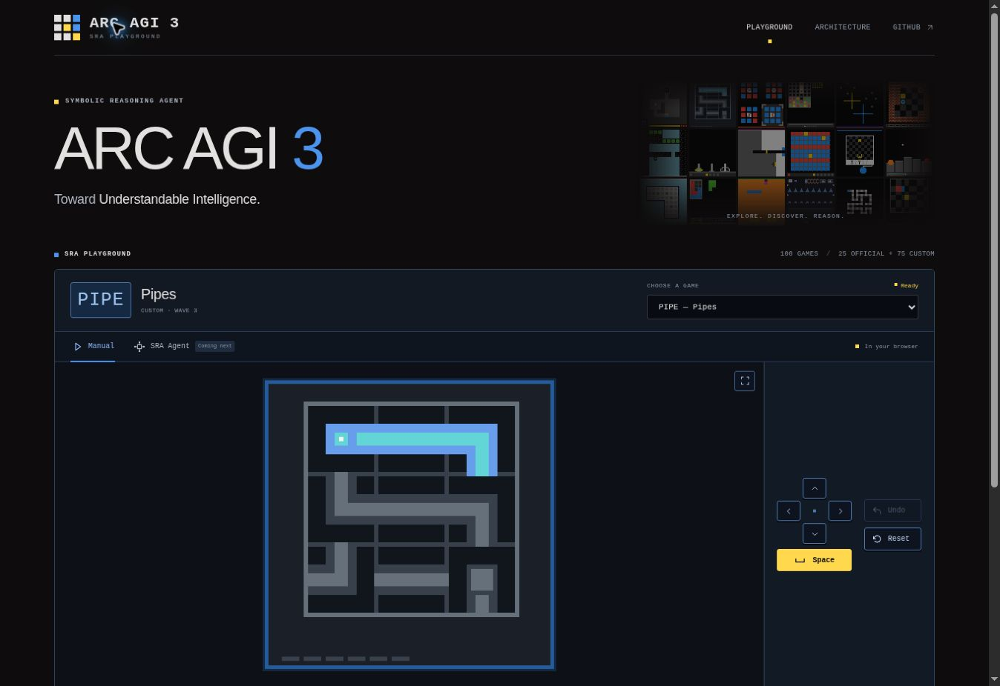

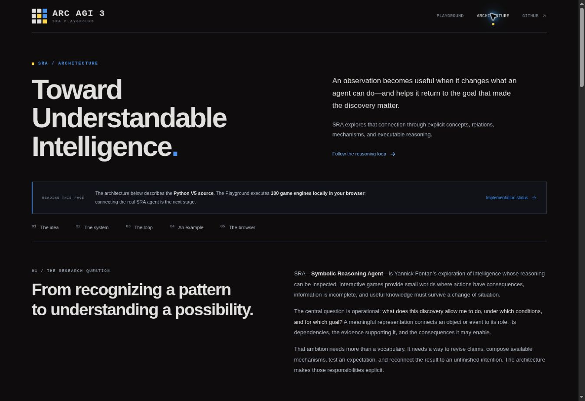

## SRA identity and architecture narrative update

SRA Playground is now the primary shared identity and homepage heading.
Symbolic Reasoning Agent is a large blue subtitle on the homepage and the
Architecture page's main heading. ARC AGI 3 remains a smaller research-context
label. The original game mosaic, blue interface accents, compact controls,
and four sorted groups are retained.

The Architecture page now develops a case for symbolic reasoning, the
artificial cortex ambition, an explicitly qualified binary/assembly analogy,
relational meaning, a behavior-tree-loop, current implementation mechanisms,
and behavioral evidence to seek. Current upstream main was verified as
`212d8d426f07eea2b6797c2bb647545767488a96`, matching the pinned code links.
An independent content review checked the claims against that source. The
copy distinguishes informative progress from physical completion, authored
structures from acquired knowledge, and architectural mechanisms from
demonstrated transfer.

The two Google Docs supplied with the request were inaccessible in this
session (HTTP 401 / Google sign-in). No text or ideas are attributed to their
unread contents. The narrative uses the inspected repository, the explicit
project brief, and the cited primary research context.

The new interactive example is an authored presentation of three mechanisms,
separate from the game runtime. It does not execute SRA or report a game run.
Fresh Chrome checks confirmed:

- The homepage's primary heading is 72 px at the checked desktop width;
  Symbolic Reasoning Agent is 34 px and the ARC AGI 3 context label is 9 px.
- PIPE reaches Ready. Space changes its board; Undo reports restoration;
  Reset restores the level and leaves Undo disabled.
- The selector still has 100 options in four groups of 25, all alphabetically
  sorted by code within their original groups.
- All three illustration buttons change the relation, prerequisite, plan,
  and progress criterion; exactly one button has `aria-pressed="true"`.
- All local Architecture fragment links resolve. The hero, research sections,
  mechanism illustration, behavior-tree-loop, and evidence table fit the
  checked 1348 px document width without horizontal overflow.
- No application failure surfaced; unrelated extension metadata entries were
  excluded from the app-error assessment.

Strict TypeScript checking, production build, and `git diff --check` pass.
The engine sources and worker protocol were not changed, so the earlier
engine parity suites were not rerun for this presentation update. Responsive
CSS was reviewed, but a mobile-sized browser or touch-device session was not
available through the exposed browser API.

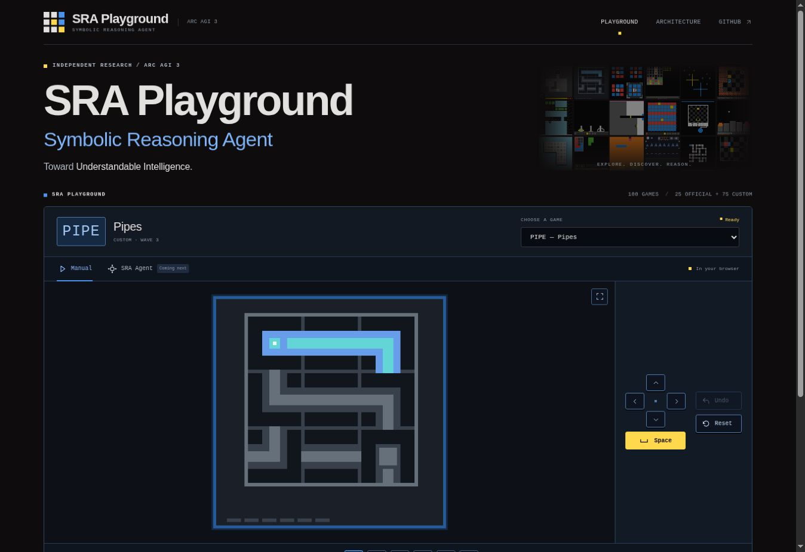

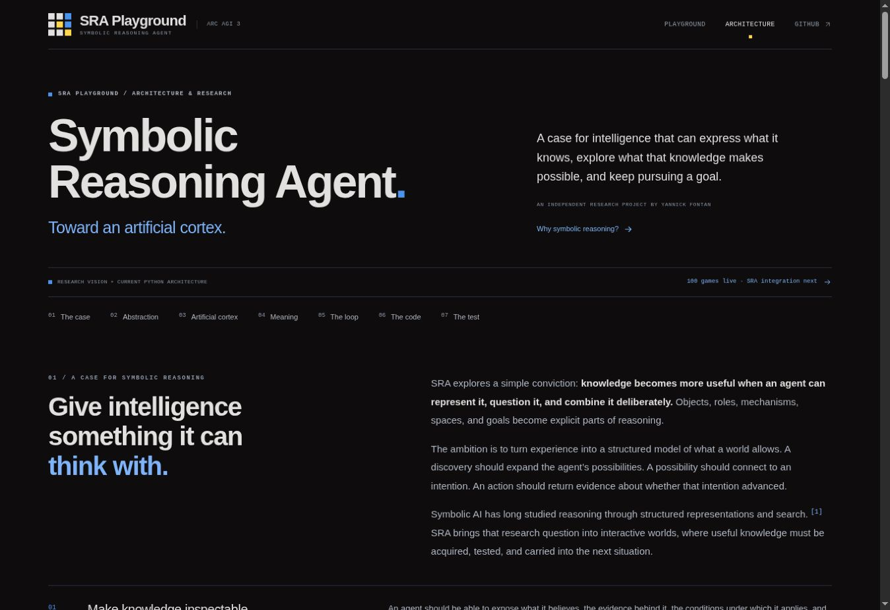

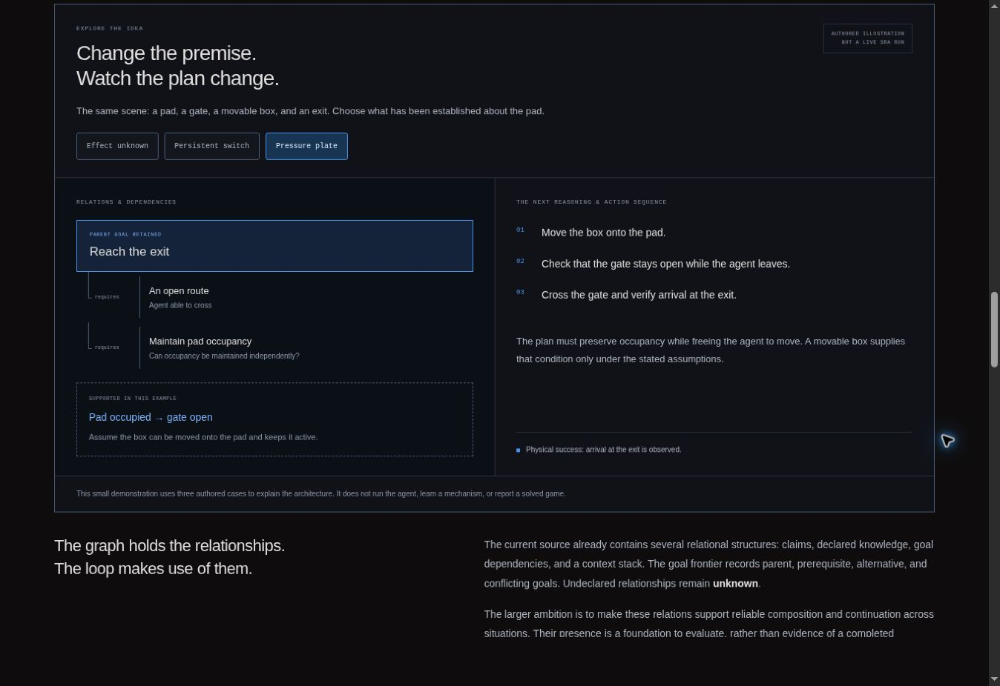

## CASC default, architecture chapters, and video series

The Playground now starts with CASC when no game is specified. Explicit game
links remain supported. ARC AGI 3 is larger in the shared header and above the
player, followed by the visible credit “75 new custom games created or compiled
by Yannick Fontan.” The 100-game catalogue and native engine behaviour remain
unchanged.

The earlier long architecture page has been replaced by a short introduction
and four separate chapters: representations, reasoning and the behavior-tree-loop,
memory and reuse, and implementation. The text is stored in
`content/architecture.json`; source claims remain pinned to the inspected
Python commit `212d8d426f07eea2b6797c2bb647545767488a96`.

The public Yanik_AI channel was inspected on 24 October 2026. Its displayed
count and complete video list both contained six uploads; every watch page's
metadata and full description were read. Each video now has its own page with
an original thumbnail, a click-to-load player, concise notes based on the
author's description, and relevant chapter/game links. Episode 4 is FT09 and
Episode 6 is AR25. The Legacy LS20 recording is distinguished from the current
official game linked in the Playground. Full source descriptions were not
copied into the site.

`scripts/generate-content-pages.mjs` produces five architecture documents,
six episode documents, and the video index. Including the Playground, Vite
builds 13 HTML pages. A built-output check resolved all 211 local links and
their relevant fragment targets, checked image/script assets, and found no
missing routes or duplicate article headings. An independent content review
found no material mismatch with the inspected Python sources or the video
descriptions. TypeScript, production build, and `git diff --check` pass.

Fresh browser verification at 1348 px confirmed:

- CASC loads the actual board and reaches Ready. Space acts, Undo restores,
  and Reset restores the level.
- There are still 100 selector options in four alphabetically sorted groups
  of 25. The custom-game credit is visible above the player at 15 px.
- The introduction, chapter navigation, representations table/code, and
  six-step behavior-tree-loop render as separate pages without horizontal
  document overflow.
- The six original video thumbnails load at 1280 × 720.
- Episode 06's Play button inserts the correct `youtube-nocookie.com` iframe,
  which shows the correct title, controls, and 6:40 duration. The persistent
  Watch on YouTube link points to the same verified episode.

The embedded player stayed at 0:00 after a normal Play click, without an explicit
error or sign-in wall. Loading the embed and its controls is verified; continuous
playback is not confirmed in the preview environment. Mobile viewport resizing
was unavailable, so responsive CSS was reviewed without a mobile browser session.
No broad engine parity suite was repeated for this presentation/default-selection
update; the original engines and worker protocol were untouched.

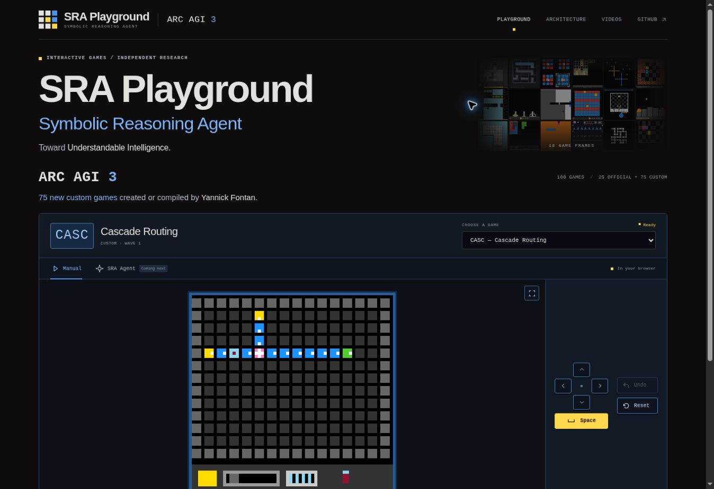

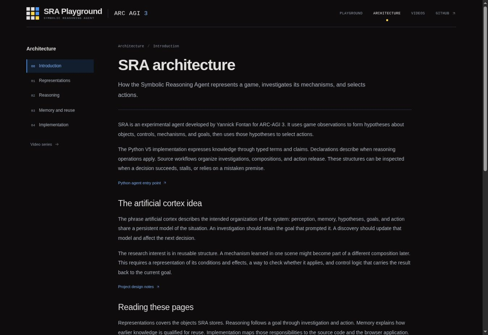

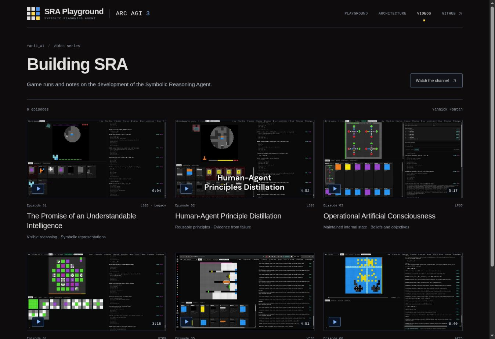

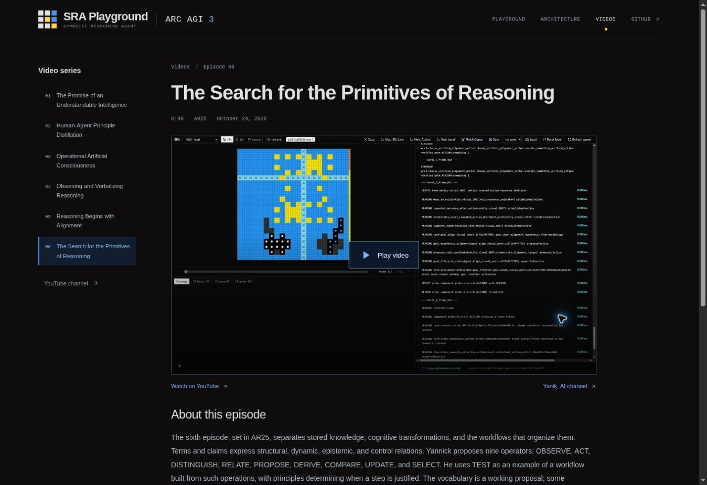

## Complete original episode texts

At the author's request, all six video pages now show the complete original
English texts published in their YouTube descriptions, replacing the short
episode summaries. The expanded descriptions were rechecked on 24 October
2026 and matched the captured originals character for character: 3,015 words
and 20,663 characters across the six episodes.

The exact source strings and attribution are stored in each `fullText` in
`content/videos.json`. All paragraphs and line breaks are rendered in the
static HTML beneath the player, with no collapsed section. A “Read full text”
link in the episode header jumps to the text. The short summaries remain only
in page metadata. The visible byline identifies the author and links to the
original YouTube description; these texts are not labelled as audio transcripts.

Source-to-output checks confirmed that all six built pages contain the complete
original wording and punctuation, allowing only HTML whitespace normalization.
They also verified source links, the full-text anchors, local navigation, and
one article H1 per episode. TypeScript, the production build, and
`git diff --check` pass. No game runtime, agent, or video-player code changed.

Browser QA followed the video index into Episodes 1 and 6, checked the
full-text anchor and first/last original passages, and used the episode pager.
Both texts remain fully expanded, with no horizontal document overflow at
1348 px. The body text renders at 16 px with 30.4 px line spacing. The Episode 6
source link points to its verified YouTube watch URL. Mobile CSS was reviewed;
no separate mobile browser session was available.

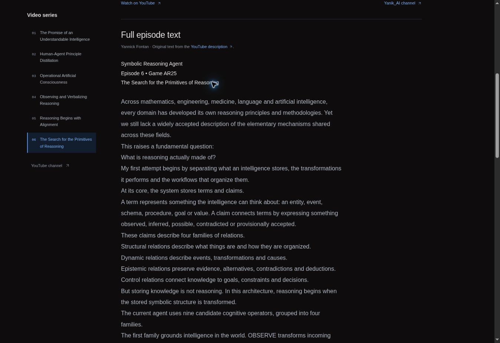

## Visual hierarchy, controls, and latest custom-level patchwork

The homepage gives the Symbolic Reasoning Agent name more prominence: its
desktop maximum size increases from 34 to 42 px, with brighter blue and a
stronger weight. The SRA Playground title decreases from 72 to 60 px. The
shared header makes the same adjustment in proportion. Above the player,
“75 new custom games” increases from 15 to 24 px, with the attribution retained.

Enabled directions and utility controls have a filled blue surface, a brighter
border, and white icons/text; disabled actions have a muted neutral treatment.
Space retains its yellow active appearance. Current-level selection remains
distinct. Enabled-control text contrast is 6.24:1, and reading-page buttons
and the current-level text also exceed 4.5:1.

The replacement `public/game-mosaic.png` contains 18 genuine initial-level
frames selected exclusively from Custom Wave 3. The 405 × 204 image preserves
the native 64 × 64 frames and palettes. Its six-column layout contains:
GRIL, CATL, PIPE, KLOT, SPOR, RSWP; DICO, EVAS, GIGO, TRCP, ONDE, CATR;
CAVA, AMZE, MOTO, DAME, CWSE, RECR. Two independent renders gave the same
SHA-256, `4d7ffcee792622cb066f5e1f9f713010487614a84ead6f82d91907e4c7be86c4`.
The image now renders at full opacity without the earlier gradient mask or
shadow overlay. A versioned image URL refreshes previously cached artwork.

All six episode pages omit the visible “Full episode text” heading while
retaining the complete original text, attribution, and direct text anchor.
Built-output checks confirm complete wording, no stale heading/ARIA target,
and valid accessible labels. TypeScript and the production build pass.
Game engines, worker code, and agent availability are unchanged.

Browser QA at 1348 px confirmed the requested type sizes, brighter patchwork,
and no horizontal document overflow. CASC starts at Ready. Its four available
directions render blue with white icons, Undo starts muted, and Space enables
Undo. Undo restores the state and becomes muted again; a directional action
followed by Reset returns to the initial level and clears Undo. Episode 6
retains all 673 original words and its working text anchor without the removed
heading. Mobile breakpoint styles were reviewed, but the available browser API
did not expose viewport resizing for a separate mobile session.

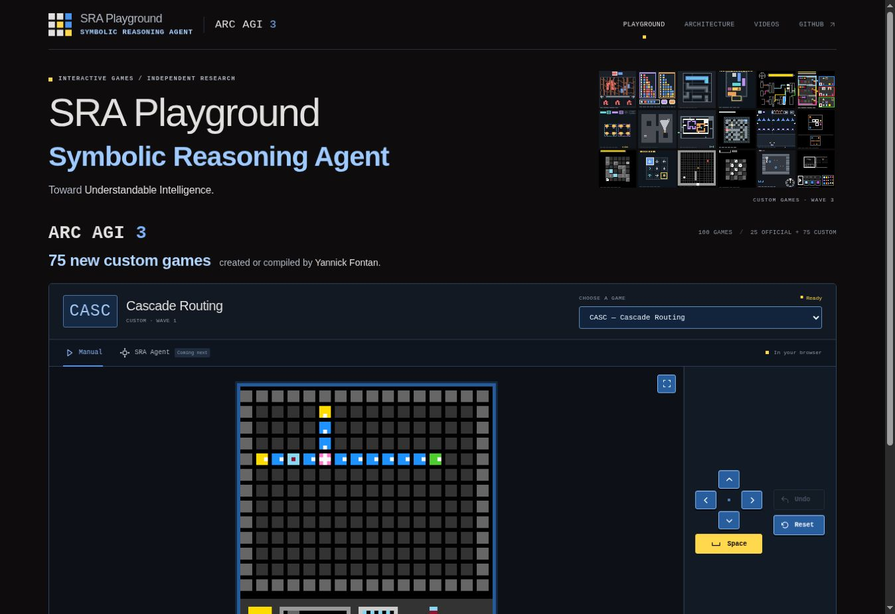

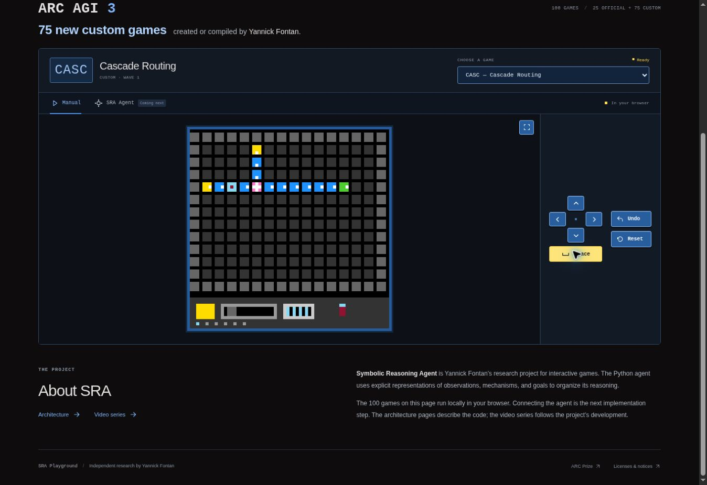

## Annotated title, navigation, and mode icons

The four browser annotations are addressed in the shared styling and the
Playground's mode tabs. The SRA Playground hero title is capped at 40 px on
desktop and is approximately 30 px at the annotated 619 px width, while the
Symbolic Reasoning Agent heading keeps its stronger emphasis.

Main navigation uses brighter text at 13 px on desktop and 12 px at the
annotated width, with 38 px minimum link heights and a filled blue current-page
state. At narrow widths the menu spans a separate header row; a compact 11 px
variant keeps all four links visible at 400 px and below. Existing focus
outlines and `aria-current` remain in place.

Manual now uses an outlined hand icon, and SRA Agent uses an outlined robot
head. Both are 18 px inline SVGs with decorative `aria-hidden` treatment;
the visible tab names, tab semantics, and existing selection handlers remain.
TypeScript, the production build, and `git diff --check` pass.

Browser QA verified the desktop page and actual 619 px and 390 px same-origin
iframe viewports, which apply the site's responsive CSS. At 619 px the title
measures 29.712 px and navigation text 12 px; at 390 px the values are 28 px and
11 px. Navigation links remain at least 38 px tall. All four links are visible
and neither narrow document has horizontal overflow. Both icons are visibly
recognizable. Manual/Agent tab switching and the Architecture navigation link
work, and the active-page highlight updates correctly. The temporary viewport
fixture was removed before source synchronization and publication.

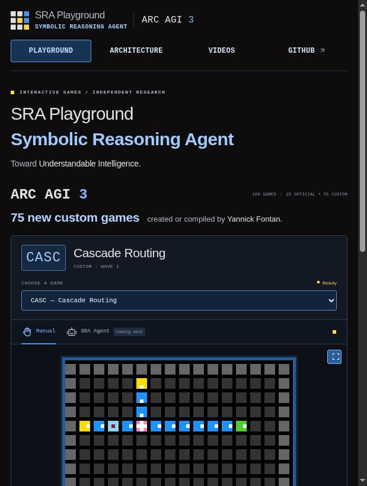

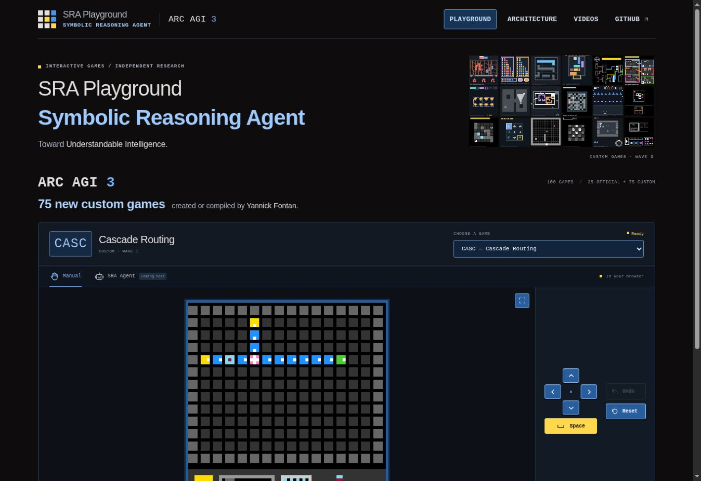

## Design rooted in human intelligence

The Playground now displays a compact Design Premise between its hero and the
games. Ethical principles are presented as a foundation for the design of
intelligence. Symbolic reasoning enables explicit concepts, relations, and
reasoning structures whose meaning and purpose are grounded in human
intelligence. This explicit design is presented as enabling human responsibility,
thereby fulfilling the ethical principle on which it is founded.

The Architecture introduction develops this premise under Design rooted in
human intelligence. It connects symbols, relations, and reasoning operations
to meanings that people can explain and to purposes for which they take
responsibility. Discovery and composition remain possible within that designed
framework. This is identified as the project's design direction, with its
implementation and readability to be evaluated in practice. The earlier
behavioral-correction wording is removed. External explainability references
are no longer attached to this statement of the author's design philosophy.

TypeScript, the production build, and `git diff --check` pass. All 13 HTML pages
build, and the homepage anchor matches the generated Architecture section.
The previous Architecture anchor redirects to the updated section.
Prior browser QA confirmed readable 14 px text in a 390 px same-origin iframe
viewport, with no horizontal overflow and a working link to the correct
section. The temporary viewport fixture was removed before packaging. The
latest wording refinement leaves the styling and navigation unchanged.
The game engines, agent integration status, and game controls are unchanged.

## Reproduce

With Node 22.18+ and Python 3.12+ with NumPy, Pydantic, and typing_extensions:

```sh
node scripts/prepare-python.mjs
python scripts/test-python-games.py --output /tmp/sra-native.json
node scripts/test-python-games.mjs --native-report /tmp/sra-native.json
python scripts/test-official-runtime.py --output /tmp/sra-official-native.json
node scripts/test-official-runtime.mjs --native-report /tmp/sra-official-native.json
npm test
npm run build
```

## Limits

These results validate engine transport and the tested deterministic behavior.
They do not establish every possible play sequence, solve every puzzle, test a
complete TypeScript rewrite, or validate SRA reasoning. The real SRA agent is
not connected to the browser interface yet. Cold loading without network access,
persistent progress across reloads, and game submissions are outside this
release's scope.
