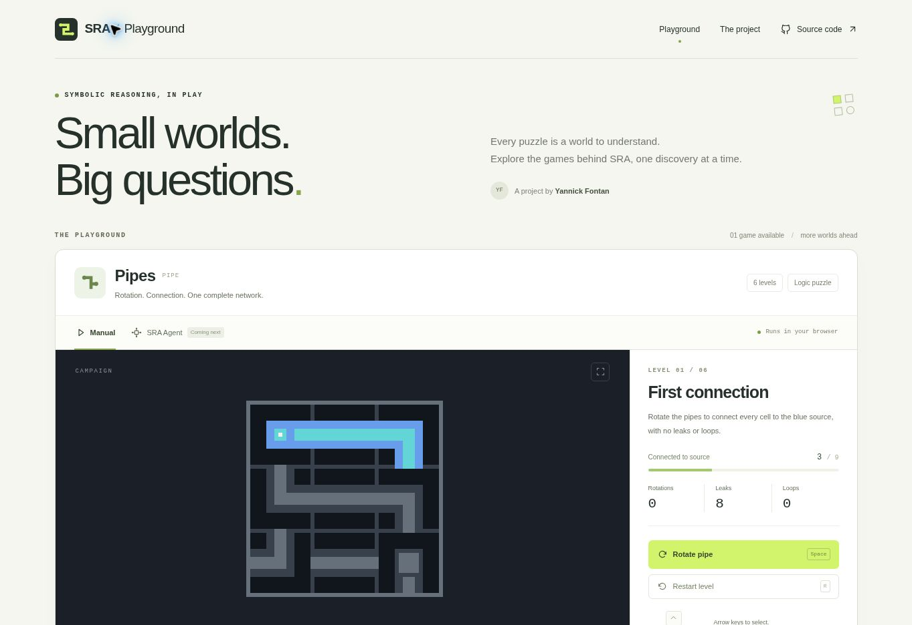
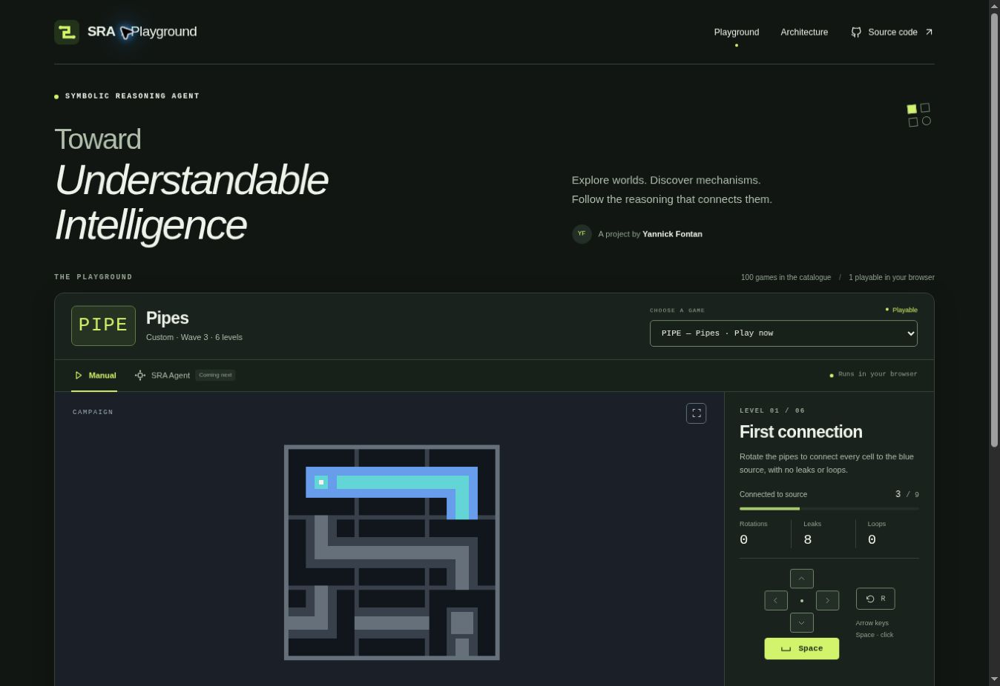
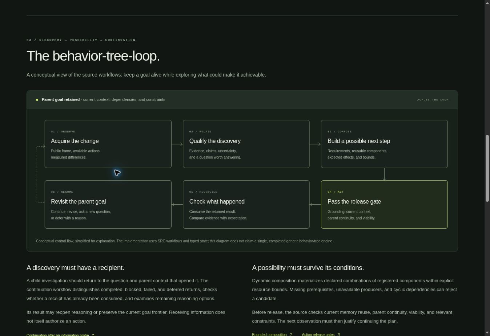

# Release 0.1 validation

Validated on 23 October 2026 with Node 24.19.0, TypeScript 5.9.3 and Vite 8.0.13.

## Automated checks

- Strict TypeScript type checking passes.
- The production build passes and emits static assets only.
- All 22 parity and invariant tests pass: 11 scenarios, 618 commands, 610
  observations and 644 full-frame hashes checked against the pinned Python
  reference, plus six network-analysis cases.
- Both six isolated level wins and an entire six-level campaign are exercised.
- Python references, test witnesses and test fixtures are absent from the
  production asset directory.

## Browser checks

The managed preview was opened in Chrome. The rendered page, keyboard rotation,
arrow-key selection, explicit SRA-pending panel, return to manual mode, practice
level 6, new-campaign reset and R restart were checked through the visible UI.
The SRA panel disables game controls and says that the agent is not connected.

The layout contains responsive rules and touch controls. A separate mobile-device
session and touch hardware were not tested. The canvas is keyboard-operable but
does not provide a complete nonvisual puzzle representation.

## Scope

This validates the PIPE port and the first website interface. It does not
validate SRA behavior, Python-to-TypeScript reasoning parity, any solve-rate
claim for SRA, persistent progress, submissions, or offline cold loading.

## Catalogue and architecture update

The subsequent dark-theme update adds a verified catalogue of 100 unique
four-character codes (25 official games and three collections of 25 custom
games), compact generic controls, and a separate `/architecture.html` page.
Only PIPE is marked playable; all other selections show their own metadata and
browser-port status. The catalogue and Python architecture references are pinned
to upstream commit `212d8d426f07eea2b6797c2bb647545767488a96`.

Validation for this update:

- Catalogue integrity: 100 unique codes and IDs, four groups of 25, valid
  four-character codes, correct pinned links, and PIPE as the sole playable entry.
- TypeScript and the multi-page production build pass.
- Chrome UI checks confirm all 100 select options, the new heading, generic
  Space action, and keyboard interaction with the real PIPE engine.
- Selecting LS20 hides PIPE and displays the matching pending-port entry.
  Returning with Play PIPE preserves the current move count. Browser back and
  forward restore the correct selection.
- The Architecture link loads its own page. Its six-stage behavior-tree-loop
  diagram, implementation status, and source links render as intended.
- Responsive rules were reviewed; no separate mobile-device or touch-hardware
  session was run for this update. The game engine was not changed.

