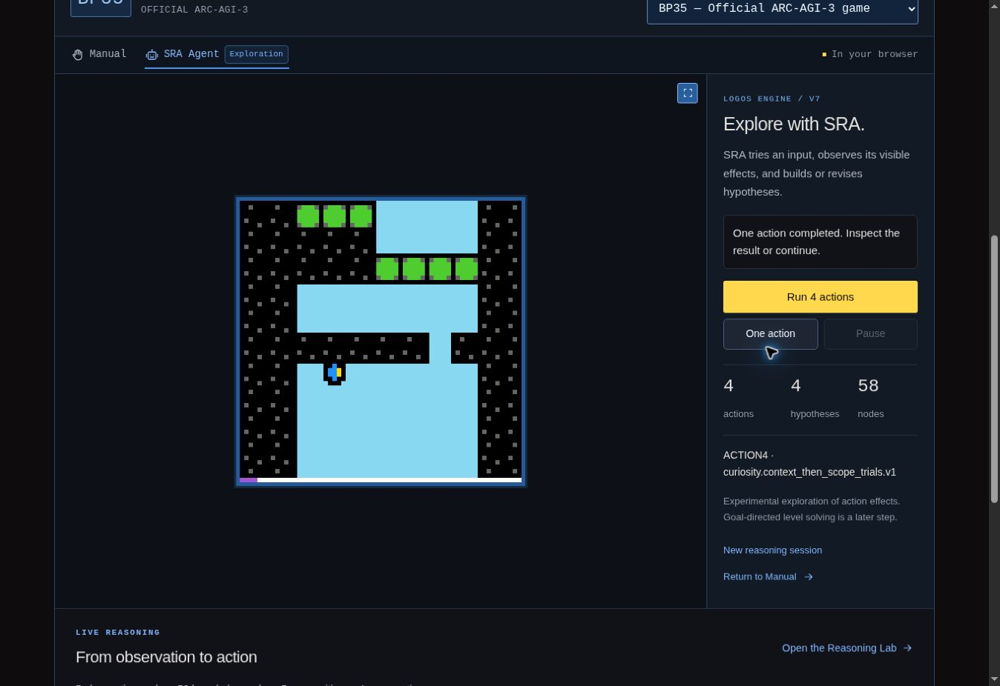

# SRA Agent in the browser: bounded V7 exploration

## User flow

The **SRA Agent** tab on the Playground now opens a working exploration panel.
Entering the tab preserves the current game position and does not send an
action. **One action** runs one reasoning/interaction cycle; **Run 4 actions**
runs a bounded series. **Pause** stops before another game action is dispatched.
An action already sent to the Python game runtime finishes normally.

The panel shows the current activity, completed action count, hypothesis and
knowledge counts, latest decision, and an expandable actual SRC execution trace.
The Reasoning Lab remains available for the controlled V7 experiments.

This is the original V7 experiment policy connected to real observations. It
investigates action effects. It is not yet the full goal/planning agent and does
not establish a new ARC score or a solved-level claim.

## Reasoning path

1. Copy the public final frame and declared input availability of the current
   game. Intermediate animation frames are presentation, not separate trials.
2. Project the frame using the V7 public observer: frame SHA-256, dimensions,
   monochrome component count, palette count, rectangular component count,
   public state and completed-level count.
3. Commit the observation with the existing `generators.src` workflow.
4. Execute the real compiled `experiment.src` with policy
   `native_context_curiosity`: prefer an input less observed in the exact
   current context, then in the current scope, then order ties by identifier.
5. Validate the retained proposal, its source and graph revision, observation,
   dependencies and one-time consumption. The host checks its current game
   session again immediately before dispatch.
6. Send the grounded command to the game and wait for its final public result.
   Feed that result back as a witnessed transition before considering another
   action.

All pixels and measurements come from the public game observation. The agent
cannot read hidden engine state, level solutions or the Undo history. Its
policy does not contain a route written for an individual game.

## Scope of actions

The original V7 empty-argument grounding contract supports `ACTION1` through
`ACTION5` when the game advertises them. `ACTION6` requires coordinates which
this first policy does not supply. `ACTION7` requires a recovery authority
which this mode does not grant. Both remain deferred, without an arbitrary
fallback input.

Games offering only coordinate inputs explain this limitation in the panel and
offer **Try BP35**, a game with grounded directional commands. That button loads
the game; it does not claim a solution or start movements automatically.

## Session and interruption rules

- Switching games, selecting a level, Undo, Reset, Restart, or returning to
  Manual invalidates pending proposals. A new reasoning session starts from
  the currently visible position the next time the user runs SRA.
- A proposal is bound to a session and observation sequence. The host also
  compares the current public frame, available inputs and progression before
  dispatching it. An old response cannot operate the newly selected game.
- Native actions are serialized. Pause can cancel thinking, but does not
  pretend to retract an action already dispatched to the game worker.
- A terminal state or a natural change of level/progression stops the run.
- Even an action with unchanged pixels consumes an action and advances the
  witnessed sequence. The run is bounded by both user action count and the
  declared V7 memory/execution limits.
- **New reasoning session** explicitly clears the reasoning session while
  preserving the game position. A budget limit never silently discards memory
  or restarts the game.

## Implementation boundaries

`src/logos-engine/public-observer.ts` contains the public measurement projection.
`V7Runtime.choose` executes the original SRC experiment program and issues a
proposal; it never dispatches a game action itself.
`src/runtime/sra-agent.ts` coordinates the separate reasoning worker and the
host game runtime. `src/main.ts` retains control of presentation, game selection
and the final action boundary.

The source reference remains the Python V7 at
`786dcf51ca57773d8e3a8948ce9ea3655e7baf8e`. The experiment IR is produced by the
original Python compiler. Targeted reference tests compare perception and
experiment decisions with the original Python implementations. Lifecycle tests
exercise stale responses, interruption, serialization and level boundaries.

## Verification on 7 November 2026

- `npm test`: 93 tests passed, none failed. This includes the original runtime
  comparisons, public perception, the experiment policy and 14 lifecycle tests.
- `npm run typecheck`: passed.
- Browser, CASC: entering the tab sent no action; one action followed by a batch
  of four produced five completed actions, six observation cycles and 86 nodes.
  Returning to Manual and resetting the level cleared the reasoning session.
- Browser, BP35: one action completed; Pause interrupted the next batch with
  three total actions and retained the acquired memory. One further action
  resumed from that memory, reaching four actions, five observation cycles,
  58 nodes and five compositions.
- Browser, CASC: exhausting the declared node budget stopped the agent with an
  explicit message and left the game and existing memory available to inspect.

These checks verify the interaction loop, not a solved game or benchmark score.

## Next capability

Use the observed traces to add a first explicit goal and a bounded composition
that produces useful progress on a selected game. Coordinate grounding and
editable reasoning nodes can then extend the same execution contract.
